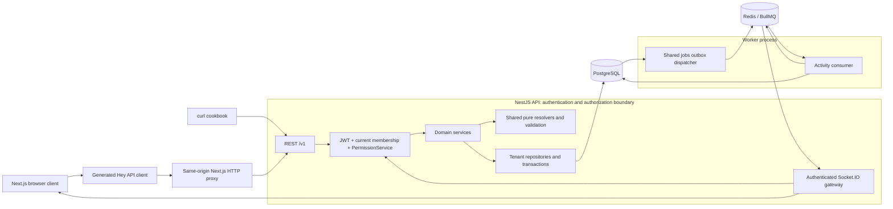
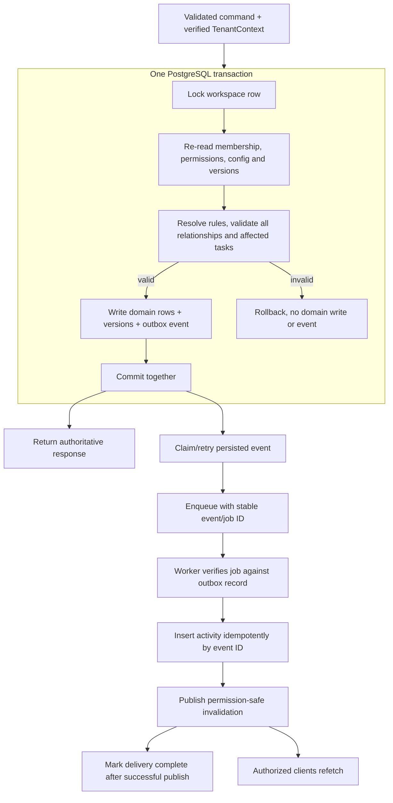
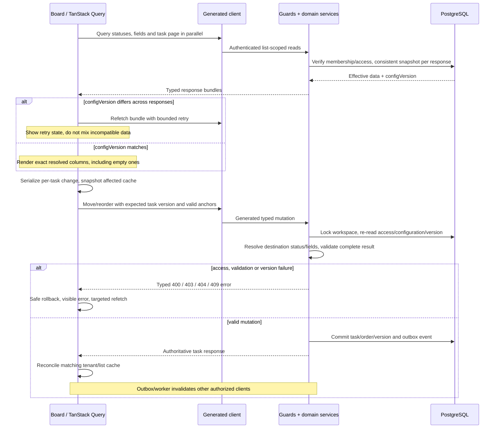

# Flowboard architecture reference

**Status: local MVP and P12 operational acceptance are verified; later UI refinements retain their own evidence. P38 verifies the temporary Vercel/Neon/Upstash demo. Main-branch CD activation, first release publication and future ECR/promotion retain separate gates.** Deployment review: 26 October 2026, source `507a0a8`.
This is a navigation and change-impact reference for the agreed design, not evidence that its controls run today.
The complete behavior lives in [PLAN.md](docs/PLAN.md), the original brief in [REQUIREMENTS.md](docs/REQUIREMENTS.md), and chosen defaults in [DECISIONS.md](docs/DECISIONS.md).
Use the [agent guide map](docs/agents/README.md) and [naming conventions](docs/NAMING_CONVENTIONS.md). Follow [AGENTS.md](AGENTS.md) and the ordered [task backlog](docs/TASKS.md) when implementing. Task evidence records distinguish observed behavior from remaining release/deployment work.

For a reader-oriented overview, use [HLD](docs/HLD.md), [LLD](docs/LLD.md), the [application guide](docs/APPLICATION_GUIDE.md) and [delivery summary](docs/DELIVERY_SUMMARY.md). This file remains the concise ownership/change-impact reference. The [30-diagram atlas](docs/DIAGRAMS.md) adds focused visual explanations with editable sources and explicit implementation/planning labels.

For the dated ClickUp/Asana/Linear research, see [product architecture references](docs/REFERENCE_ARCHITECTURES.md). For the concrete UI composition, tenant-aware ERD, query/index mapping, auth boundary and request/event sequences, see [system design](docs/SYSTEM_DESIGN.md). Use these design references with the requirement matrix and task evidence; research alone does not mark a requirement complete.

The implementation-ready [database and ER specification](docs/DATABASE_DESIGN.md) defines all records, tenant keys, migrations and transaction invariants.

The [REST API catalog](docs/API_CATALOG.md) lists operation IDs, schemas, permissions, errors and pagination for API usage and future changes.

The [shared form system](docs/FORM_SYSTEM.md) defines the RHF/Zod bindings and safe JSON presentation boundary.

The [component system](docs/UI_COMPONENT_SYSTEM.md#action-and-live-notifications) also defines the React Toastify host, modal placement and session-scoped action/remote notification boundary.

The [color and size conventions](docs/STYLE_TOKENS.md) define HSL tokens, rem dimensions and the shared MUI spacing scale.

The [composable UI system](docs/UI_COMPONENT_SYSTEM.md) defines the P13 styled-component and package-ownership refinement. The [Linear-inspired MUI guide](docs/UI_DESIGN.md) maps public UI patterns to our components, screens, state and accessibility tests.

[Workspace RBAC and DTO/entity design](docs/BACKEND_CONTRACTS.md) specifies workspace field inheritance, audit timestamps and decorator-driven Swagger → generated Next.js contracts.

[Backend structure and coding rules](docs/BACKEND_GUIDELINES.md) define feature-owned Nest modules, DTO placement, provider exports, test layout and the Swagger workflow. The [API-scoped instructions](apps/api/AGENTS.md) apply these rules to future changes; P02-06 covers auth/platform/common ownership; P02-10 colocates auth/platform tests while retaining shared helpers and process tests; P02-13 moves features under modules and separates config/utils/shared.

[Field validation reference](docs/FIELD_REFERENCE.md) defines every stored/embedded field and its enforcement layer; paginated APIs use cursor/limit only.

## System shape and authority

Flowboard is a modular NestJS API, a Next.js client and one BullMQ worker. PostgreSQL owns tasks, configuration, access, sessions, activity and delivery intent. Redis transports queued work and socket invalidations; it does not determine authorization or authoritative task state.

Five normal Compose services run: `web`, `api`, `worker`, `postgres`, `redis`. Web/API publish localhost ports 3000/3001; database and Redis ports remain internal unless a development override exposes them. Deployment, readiness, seed and scaling details are in [PLAN sections 8–9](docs/PLAN.md#8-realtime-and-asynchronous-activity).

For hosted browsers, the web-origin `/api/v1` proxy preserves first-party refresh cookies while forwarding to API `/v1` at a fixed server-only runtime origin (D57/D119). It validates Origin, bounds bodies, filters headers/cookies and disables caching without domain logic. Browser clients default to this route; independent SSR instances require explicit origins. Socket.IO is a direct JWT-authenticated connection to the API with a separate runtime public origin. The session provider disposes sockets and query state on identity/workspace changes.

## Package boundary matrix

These are intended workspace dependencies; external runtime libraries and shared compiler/lint/test configuration are additional dependencies appropriate to each package. Imports use public package exports and `workspace:*`, never another package's source path.

| Workspace                    | Responsibility                                                            | Allowed workspace dependencies / boundary                                           |
| ---------------------------- | ------------------------------------------------------------------------- | ----------------------------------------------------------------------------------- |
| `apps/api`                   | HTTP controllers, auth, authorization, orchestration and sockets          | `contracts`, `database`, `logger`, `jobs`; no other app or generated client         |
| `apps/worker`                | Dispatch committed events, persist activity and publish invalidations     | `contracts`, `database`, `logger`, `jobs`; no app imports                           |
| `apps/web`                   | Routes, session state, generated queries, feature composition             | `contracts`, `api-client`, `ui`, `forms`; no backend internals                      |
| `packages/contracts`         | Zod schemas, inferred types, enums, event contracts, pure resolvers       | Own files and Zod only; no other workspace, framework, environment or I/O           |
| `packages/database`          | Prisma schema/client, migrations, seed, scoped repositories, transactions | `contracts`, `logger`; sole owner of raw Prisma construction and SQL                |
| `packages/jobs`              | Shared durable outbox dispatch, queue publication and lifecycle           | `contracts`, `database`, `logger`; no framework or app imports                      |
| `packages/logger`            | Pino-backed JSON logs, async request context, safe metadata projection    | Pino and Node built-ins; no framework, database or other workspace imports          |
| `packages/openapi`           | Spec export, normalization, lint and drift checks                         | API's explicit spec-bootstrap export, **build tooling only**                        |
| `packages/api-client`        | Generated SDK, types and TanStack options; handwritten transport setup    | `contracts` for session validation; OpenAPI generation input; no API runtime import |
| `packages/forms`             | RHF control bindings, Zod resolver, strict JSON presentation fields       | `ui`, `contracts`; no data clients, router or business logic                        |
| `packages/ui`                | MUI theme/provider, controlled presentational components                  | `contracts` and UI libraries; no fetching, session or database code                 |
| `packages/config-typescript` | Base, Node/Nest, Next and library compiler settings                       | Configuration subpath exports                                                       |
| `packages/config-eslint`     | Shared lint rules, import ordering and boundaries                         | Configuration subpath exports                                                       |
| `packages/config-prettier`   | Shared formatting object and root/workspace format checks                 | Build tooling only                                                                  |
| `packages/release-tools`     | Independent app release planning and GitHub/GHCR publication              | CI tooling only; reads committed Git snapshots, no runtime app imports              |
| `packages/config-jest`       | Shared test presets and environment conventions                           | Configuration subpath exports                                                       |

Applications cannot import one another. The OpenAPI tooling exception (D19) is narrow: it loads real controllers/DTOs with inert providers, no listening socket and no database/Redis connection. It is not a production API dependency or a fake runtime service.

Authored workspaces and root tooling use native ESM (D95). Module manifests and verbatim TypeScript syntax prevent implicit CommonJS rewriting; NodeNext resolves Node output while ESNext/Bundler serves Next.js. CLI resolution uses import.meta.resolve. Generated Next.js and third-party internals retain their framework-supported module format.

The build graph is `contracts/logger → database → api → openapi → api-client → web`; UI branches from contracts, forms from UI/contracts, and worker from jobs/contracts/database. Root scripts delegate to Turbo; packages own tasks, inputs and outputs. Normal builds write ignored output. Explicit `pnpm gen:api` synchronizes committed spec/generated sources; temporary regeneration powers drift checks. See D17–D21 and [PLAN section 6](docs/PLAN.md#6-api-conventions-and-contract-pipeline).

Features live under `apps/api/src/modules/` (D93). Auth and platform remain flat (D89): grouped DTOs and auth configuration sit beside controllers/services/modules, with colocated unit/integration tests (D90/D92). D96 groups foundations in `src/core/`: `config` holds reusable settings, `utils` pure helpers, and `common` HTTP helpers and injection tokens. `src/shared/` owns SharedModule and logging; it registers core HTTP filters/validation/serialization once. Core cannot import shared/features, and shared cannot import features; shared ESLint checks these directions. The common runtime/spec factory explicitly uses Express. Prisma stays in `packages/database`. Shared test helpers and process tests keep their existing grouping. See the [adapted feature-first guide](docs/BACKEND_GUIDELINES.md).

## Module responsibility and data ownership

| Owner                                       | What belongs here                                                                             |
| ------------------------------------------- | --------------------------------------------------------------------------------------------- |
| API `core/config` / `core/utils`            | Reusable application/Redis settings / pure helpers                                            |
| API `shared`                                | SharedModule validation/serialization/filter wiring and shared logging providers              |
| API `core/common`                           | HTTP decorators, tokens, DTO helpers, sanitized errors/filters and Swagger support            |
| API `modules/platform`                      | Liveness/readiness and dependency probes                                                      |
| API `modules/auth`                          | Credentials, session rotation, JWT verification; narrow global identity repository            |
| API `modules/workspaces`                    | Membership, invitations, verified workspace switching, last-admin protection                  |
| API `modules/permissions`                   | One PermissionGuard/PermissionService for HTTP, locked mutations and subscriptions            |
| API `modules/hierarchy`                     | Typed parent relationships, container ordering/reparenting and subtree archive                |
| API `modules/statuses` / `modules/fields`   | Scoped configuration changes and validation of affected descendants                           |
| API `modules/tasks`                         | Task CRUD/moves/reorders, composing shared validation inside a transaction                    |
| API `modules/activity` / `modules/realtime` | Authorized feed reads, safe subscriptions and fanout                                          |
| API `modules/outbox`                        | Compatibility exports and optional test injection; no normal API polling                      |
| Worker and jobs package                     | Dispatch committed events, verify persisted identity, insert activity and retry publication   |
| Database package                            | Tenant filters, relation checks, storage operations, locks and transaction-bound repositories |
| Contracts / UI / web                        | Deterministic domain rules / plain presentation / data and interaction coordination           |

Controllers translate transport and call services. Services orchestrate policy and transactions; repositories own persistence. Pure contracts functions accept plain data, so both backend validation and UI previews use the same rules.

`User` and credential/session identity are global. Other domain rows and joins carry `workspaceId`, including memberships, nodes/grants, status identities/overrides, field definitions, tasks/assignees, activity and outbox events. Composite tenant foreign keys and repository checks protect relationships. `Workspace.configVersion` identifies the current inherited configuration; task/node versions detect stale edits. All 15 persisted models have createdAt/updatedAt; workspace field defaults inherit through space/folder/list. Detailed fields/indexes remain in [PLAN section 3](docs/PLAN.md#3-data-model).

## Trust boundaries and access

- An access JWT identifies a user, session and selected workspace; current database membership supplies the acting role. Request bodies cannot establish acting identity, tenant or authority. Typed membership-role changes and workspace-switch destinations are validated targets.
- `createDatabase(...).read(context, ...)` / `.write(context, ...)` fails without verified context, scopes reads/writes and validates relations. Auth's global identity access is deliberately narrow; workers derive tenant context from a verified persisted outbox event.
- Admin bypass applies only inside the active workspace. For members, any ancestor deny blocks its subtree; every private ancestor needs its own allow. A child grant cannot override an ancestor restriction. Visible containers permit task edits; configuration/container/access management is admin-only (D07–D08).
- Check source, destination, ordering anchors and assignees, including same-tenant relationships. Repeat access checks after taking the write lock. Filter tree, counts, feed and realtime content through the same policy.
- Use `401` for absent/expired authentication, `403` for forbidden resources in the active tenant, and `404` for missing or foreign-tenant resources. Other tenant identifiers must not disclose existence.
- Access tokens stay in browser memory. Digest-stored refresh tokens rotate atomically; reuse revokes the family. Cookie mutations check Origin. Logout/workspace switch clears query data and socket subscriptions. See [PLAN section 4](docs/PLAN.md#4-tenancy-identity-and-permissions).

## Transaction and event lifecycle

The workspace row serializes domain/configuration/access writes at hobby scale (D15). A fixed lock order and transaction-bound repositories prevent validation against stale permissions or configuration.

Task writes succeed independently of Redis availability because delivery intent commits in PostgreSQL. A worker crash after activity insertion must still retry publication; an existing activity row cannot imply completed delivery. Duplicate events are possible, so consumers deduplicate by event ID/version. Redis accepting publication does not mean every browser received it; reconnect triggers a refetch (D25–D26).

## Load a board, then drag a card

Every response's data and `configVersion` come from the same snapshot; matching versions make parallel bundles compatible (D31). A mutation revalidates current configuration under the lock rather than trusting the client's loaded bundle. Optimistic rollback must not overwrite a newer result or another list's cache. Keyboard drag and explicit move/status buttons use the same mutation path.

## Domain invariants that changes must preserve

- Hierarchy is strictly workspace → space → folder → list → tasks. A task has one primary list. Reparenting validates the resulting subtree; archiving removes descendants/tasks from ordinary reads without destroying history.
- Status identity/key/category are stable; override row IDs are never task status IDs. Resolve root-to-leaf by key; display overrides patch supplied attributes, hiding is reversible by nearer explicit visibility, and order is position/key/ID.
- Every affected effective status set retains `not_started`, `active`, `done`; `closed` is optional. A cross-list move keeps a visible status or selects the first destination status in the same category. No match rejects the entire move.
- Status changes cannot remove a status used by live tasks; physical identity deletion also respects archived references. No fallback orphan column disguises invalid data.
- Fields resolve workspace → space → folder → list; the nearest key replaces the whole definition. Enforce all six types, valid option IDs, unique multi-select IDs and real calendar dates. `0` and `false` satisfy required values; required text/multi-select must be nonempty.
- Validate the complete task after every write. Unknown keys fail; PATCH omission preserves a value, explicit optional `null` clears it. Cross-list moves explicitly clear source-only keys and supply required destination values.
- Configuration edits/removals and reparenting validate affected live tasks before commit. Do not silently drop values, invent defaults or remap a whole subtree. Details are canonical in [PLAN section 5](docs/PLAN.md#5-domain-algorithms-and-atomicity).

## Operational failure behavior

| Failure                                                 | Planned behavior                                                                                                                                        |
| ------------------------------------------------------- | ------------------------------------------------------------------------------------------------------------------------------------------------------- |
| Migration, seed or required dependency fails at startup | Readiness stays false; dependent services wait; seed retries preserve existing user edits                                                               |
| Redis enqueue/publish outage                            | Persisted outbox remains retryable; task writes remain durable; monitor backlog/failures/worker heartbeat                                               |
| Stale edit or concurrent configuration change           | Re-read under lock; reject stale versions with 409 or invalid data with typed errors; no partial write                                                  |
| Refresh fails/replays, or access is revoked             | A 401 may refresh and retry once; a 403 never refreshes. Failed refresh clears session data; access changes revoke rooms and sockets expire with tokens |
| Socket disconnect or duplicate delivery                 | Deduplicate event/version; refetch on reconnect; never claim Pub/Sub replay or browser delivery acknowledgment                                          |
| Invalid generated contract or service exception         | Reject/sanitize output with request ID; generation checks detect drift; never expose secrets or task content in default logs                            |

Task title/description search uses a PostgreSQL GIN expression index inside the existing tenant-scoped list query; see [search design](docs/SEARCH.md). OIDC, teams, email/webhook delivery, general container/task restoration and other listed future features remain outside MVP scope.

## Change-impact guide

Use this table to identify the smallest complete slice, then follow the corresponding task's acceptance criteria and [PLAN test strategy](docs/PLAN.md#10-test-strategy-and-execution-gates). These checks are executable through the owning packages; task evidence records the runs and remaining release gates.

| Change                                  | Layers and required evidence                                                                                                                                                                     |
| --------------------------------------- | ------------------------------------------------------------------------------------------------------------------------------------------------------------------------------------------------ |
| New/changed REST endpoint               | Contracts → Zod DTO/controller metadata → service/repository → spec → generated client; real-Postgres behavior, auth/tenant negatives, contract/drift checks (P01-02, P07-01–02 plus owner task) |
| Status/field rule or configuration edit | Pure contracts resolver tests; API descendant/in-use and concurrency tests; UI preview/form regressions; generated artifacts for transport changes (P04/P05, P10)                                |
| Task edit, move or reorder              | Shared validation, task transaction, outbox, generated mutation and affected UI; relation/anchor/tenant denials, stale versions, rollback and browser flow (P06, P09)                            |
| Membership, grant or auth change        | Auth/workspaces/permissions, tenant repository, cache/session and socket lifecycle; ancestor denials, cross-tenant isolation, last-admin/refresh races, revocation (P02/P03, P07-03, P11-03)     |
| Persistence model, seed or migration    | Database package plus all affected repositories/contracts; real migration/constraint tests, repeatable seed and startup/restart checks (P01-03–05)                                               |
| Queue, activity or realtime change      | Event contracts, shared jobs/worker runtime, gateway and web subscriptions; Redis/Postgres crash/retry/dedup and two-client authorization tests (P11/P38)                                        |
| Shared component or view                | Presentational UI and web coordination; accessible component tests, 320/768/1024/1440px, long content/reduced motion and relevant browser path (P08–P10, P12-01)                                 |
| Build, dependency or Docker change      | Package manifests/exports, Turbo graph, generation and image inputs; boundary fixtures, clean frozen build, drift checks and five-service health/restart (P00, P07, P12-03)                      |

After each implementation task, required build/lint/test and applicable contract/Docker gates must run with recorded results. Boundary lint, drift checks, integration tests and CI are implemented. Report actual results and unavailable infrastructure; a configured check is not evidence that a particular revision passed.

## Independent delivery

API, web and worker each have a pruned Dockerfile and independent semantic tags/images. A main workflow validates the repository and Compose stack, then publishes only affected app artifacts from a clean source SHA. The release graph follows runtime dependencies, so the build-only API-to-OpenAPI edge does not release an unchanged UI. GitHub Releases and their source/digest manifests are the publication record. Current image publication uses GHCR. The long-term target is Docker images in Amazon ECR; ECR publishing and the AWS container runtime remain future work.

D173 requires the future ECR deployer to consume the per-app affected set: shared jobs → API/worker, UI/forms/client → web, and contracts → all current consumers. Preserve unselected services in each environment; pin selected digests through dev/qa/stage/prod and inject runtime settings. Configuration-only changes reuse existing images. Current Vercel deployment is a full-project demo and does not implement this selective ECR contract. See [selection and promotion](docs/PROMOTION.md#which-services-deploy).

The verified Vercel Services/worker deployment is a temporary demo with Neon PostgreSQL and Upstash Redis. Its technical production target supports the daemon; it is not the long-term production platform. Automated demo CD remains behind `CD_ENABLED` and protected credentials. Provider secrets remain outside the repository. See [CI/CD](docs/CI_CD.md) and [Vercel demo](docs/VERCEL.md).

The [run modes](docs/RUN_AND_DEPLOY.md) keep native app development separate from the full Compose preview. The future [immutable promotion contract](docs/PROMOTION.md) deploys the same ECR image digest through environment targets with runtime configuration. Existing source-based Vercel deployment is not evidence of build-once promotion.

For contributor-facing explanations of trunk-based development, same-image environment injection and actual CI checks, read [delivery operations](docs/DELIVERY_OPERATIONS.md). [Redis and jobs](docs/REDIS_AND_JOBS.md) traces the current outbox → BullMQ → activity/invalidation flow and environment-isolation requirements.
