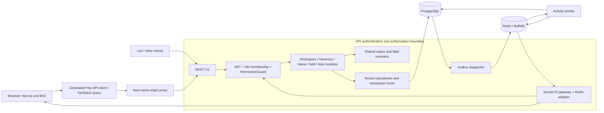

# Flowboard

A self-hosted project management app for learning sound architecture at hobby scale.

**Current state:** The modular API, tenant permissions, inherited statuses/custom fields, task board/table/drawer, configuration editors, activity worker and authenticated realtime collaboration are implemented. Shared contracts generate the OpenAPI client. Local Docker and host-development workflows are available; hosted preview activation remains a separate external setup. See task evidence for tested behavior and outstanding release gates.

**Try it locally:** [Run the complete preview with Docker](#preview-with-one-command); no `.env` setup is required.

Start with the [application guide](docs/APPLICATION_GUIDE.md) for features, packages and libraries; [HLD](docs/HLD.md) for system boundaries; [LLD](docs/LLD.md) for implementation flows; and the [delivery summary](docs/DELIVERY_SUMMARY.md) for prompt-to-task coverage and open gates. The [documentation index](docs/README.md) links the detailed references. See the [AI usage log](docs/AI_USAGE.md) for verified corrections and the [roadmap](docs/ROADMAP.md) for delivery priorities. The [diagram atlas](docs/DIAGRAMS.md) provides 30 rendered views of the system, domain rules, frontend, delivery and hosting plans.

Boards display only a consistent set of status, field and task revisions. A concurrent configuration or task change restarts loading, with a visible retry after repeated changes. Refreshing the board, returning to the tab or reconnecting starts again at the first page of every column. Use each column's **Load more** button to load additional cards; column counts describe loaded cards. Wider boards scroll inside their own region on small screens.

Use a card's **Drag** handle to change status or order. Keyboard users can pick up with Space, move with arrow keys, drop with Space, and cancel with Escape. Dropping outside the columns cancels. The **Move** button provides the same operations plus another visible destination list, placement controls and required custom-field corrections. Fields unavailable in the destination are explicitly listed before clearing. Saving disables repeat actions for that task; rejected moves roll back their own preview and show the error without discarding the form. Every completed save refreshes affected open boards. Moving to the end of a partially loaded column may put the card on a later page.

Choose **List** to see built-in fields and the list's actual resolved custom fields, labeled **Inherited** or **Local**, in MUI Data Grid. Sort by due date, priority or board order; empty due dates stay last. Apply one typed custom-field filter, or clear it to see all tasks. Multi-select filters match one selected option. View, sort and filter stay in the URL for sharing and browser history; cursors remain internal. **Load more tasks** adds the next server page; the grid's visible paginator selects among already-loaded rows. Changing lists or filters, refreshing, returning to the tab and completed moves start a new consistent page chain. Use grid keyboard navigation and horizontal scrolling to reach columns on narrow screens.

Task due times are edited and displayed in UTC, with milliseconds preserved. Clear the input for no due date. Date custom fields remain calendar days.

Open a card's task title, a table title or non-interactive table row content to edit its built-in fields and resolved custom fields; choose **New task** to create one. Optional fields can be cleared explicitly, including unchecked versus unset checkboxes. **Preview description** safely renders Markdown with raw HTML disabled. Failed saves keep your edits and show field errors; a concurrent change requires an explicit reload of the latest saved task. Close/Escape confirms before discarding unsaved edits, and **Archive task** asks before removing the task. Saving refreshes the visible board/table. A draft stays open through same-workspace list navigation, while signing out or switching workspaces clears the editor.

Administrators can open **Status settings** in the sidebar and select a workspace, space, folder or list. The effective preview uses the same resolver as the API. Add a status or edit one at a time; blank display fields inherit an ancestor's value, and visibility can inherit, show or hide. **Remove local override** restores ancestor configuration. The API rejects changes that invalidate descendant tasks or remove in-use statuses. Dirty drafts survive navigation inside the current workspace and require explicit reload after a conflict; leaving that workspace ends the retained editor. Members continue to see effective statuses on lists without configuration controls.

Visibility grants let members work on visible tasks; they do not grant configuration administration. Status/field changes remain admin-only because a single ancestor edit can affect many descendant lists and tasks. This keeps the hobby permission model explicit until separate edit/configuration capabilities are designed.

**Field settings** supports all six field types at the same scopes. An inherited field can be copied into a complete local definition; removing the local override restores the ancestor when existing task values allow it. Option identities survive renames and reordering. Type changes, option removal and required-field promotion are rejected if they invalidate live tasks, with the draft retained. The effective preview accepts sample values without saving them to tasks.

The [shared UI component guide](docs/UI_COMPONENT_SYSTEM.md) covers MUI styled controls, compound components and controlled views. Reusable presentation lives in `packages/ui`; web supplies data and actions. Activity timestamps display in UTC.

The [system design](docs/SYSTEM_DESIGN.md) covers the UI, backend, database ERD and request/event flows. [ClickUp/Asana/Linear research](docs/REFERENCE_ARCHITECTURES.md) explains the public patterns behind it, with sources and explicit limits on what is known.

The implementation-ready [database and ER specification](docs/DATABASE_DESIGN.md) defines all records, tenant keys, migrations and transaction invariants.

The [REST API catalog](docs/API_CATALOG.md) lists operation IDs, schemas, permissions, errors and pagination for API usage and future changes.

The [Linear-inspired MUI guide](docs/UI_DESIGN.md) maps public UI patterns to our components, screens, state and accessibility tests.

[Workspace RBAC and DTO/entity design](docs/BACKEND_CONTRACTS.md) specifies workspace field inheritance, audit timestamps and decorator-driven Swagger → generated Next.js contracts.

[Backend coding guide](docs/BACKEND_GUIDELINES.md) defines the feature-based NestJS layout, module boundaries, DTO/entity rules and Swagger workflow used for backend changes.

[Field validation reference](docs/FIELD_REFERENCE.md) defines every stored/embedded field and its enforcement layer; paginated APIs use cursor/limit only.

## Architecture and request flow

`apps/web` owns routes, session state and generated queries. `packages/ui` contains presentational MUI components. Nest feature modules own policy/orchestration; `packages/database` owns Prisma, tenant-scoped repositories and transactions. Shared Zod contracts supply DTOs, validation, OpenAPI and pure resolution algorithms.



```mermaid
sequenceDiagram
  participant UI as Board / generated client
  participant API as API guards and services
  participant DB as Tenant repositories / PostgreSQL
  participant Worker as Redis / worker / gateway
  UI->>API: GET resolved statuses, fields and task pages
  API->>DB: Verify membership and ancestor permissions; consistent reads
  DB-->>API: Data and configuration revisions
  API-->>UI: Typed responses
  Note over UI: Render only matching revisions, including empty columns
  UI->>UI: Optimistic move with rollback snapshot
  UI->>API: POST task move with expected versions and placement
  API->>DB: Lock workspace, recheck access, resolve destination and validate
  alt Invalid, forbidden or stale
    API-->>UI: Typed 400 / 403 / 404 / 409
    UI->>UI: Roll back and refetch current state
  else Valid
    API->>DB: Commit task + versions + outbox atomically
    API-->>UI: Authoritative task response
    DB->>Worker: Durable outbox dispatch
    Worker->>DB: Idempotent activity for status changes
    Worker-->>UI: Minimal authorized socket invalidation
    UI->>API: Refetch through generated operations
  end
```

See [ARCHITECTURE.md](ARCHITECTURE.md) for module boundaries and [the ER model](docs/DATABASE_DESIGN.md) for every field, type and relationship. All tenant-owned records carry `workspaceId`; all 15 persisted models carry `createdAt` and `updatedAt`. Composite tenant foreign keys and a fail-closed repository boundary prevent cross-tenant links. Tasks have one primary list, stable status identities, explicit revisions and JSONB custom values. Containers/tasks archive through `archivedAt`; ordinary reads hide them, while historical records remain.

## Preview with one command

With Docker Desktop or Docker Engine plus Compose v2 running, use this from the repository root:

```sh
docker compose up --build
```

Open [Flowboard](http://localhost:3000) or [Swagger](http://localhost:3001/docs). Sign in as `alice@example.com` with `FlowboardDemo123!`. Docker builds all three apps, starts PostgreSQL/Redis, and automatically runs migrations and the demo seed. You do not need a `.env` file, Node.js/pnpm on your computer, or manual database commands. The first build needs internet access to download dependencies; ports 3000 and 3001 must be available.

This is a local demo with public example credentials. Web/API ports bind to loopback; database, Redis and worker stay inside Docker. Ctrl+C stops the foreground services and retains their named-volume data. Run the same command again to resume without resetting edits. See [Docker operation](#run-with-docker) for background mode, optional configuration, logs and troubleshooting. [Host development](#run-locally) is a separate workflow for editing source outside containers.

## Local tooling

Use Node 22.23.2 (`nvm use`) and the pinned pnpm version from `package.json`. If pnpm is not already managed by Corepack, enable its shim with `corepack enable pnpm`, then run:

```sh
pnpm install --frozen-lockfile
pnpm build
pnpm lint
pnpm typecheck
pnpm --filter @flowboard/web exec playwright install --with-deps chromium
pnpm test
pnpm format:check
```

`pnpm format` applies the shared Prettier rules to every workspace plus root configuration and documentation. The original requirements are preserved verbatim. Tests cover package boundaries, application start/stop, shared domain rules, and real PostgreSQL/Redis integration for the implemented backend. Browser user-flow suites cover authentication, workspace/list navigation, session expiry, task editing and responsive keyboard controls. The root test command discovers every `apps/web/e2e/*.spec.ts` journey and gives each fresh API/web/worker processes and PostgreSQL/Redis containers. These cover login, exact sibling columns, field save/reload, same-browser role changes, socket updates, stale-write rollback and axe/keyboard/responsive checks. It requires Docker and installed Chromium; no external hosted services are contacted. Runtime libraries expose compiled outputs; tool configurations are directly consumable so first-time builds need no generated files.

On resource-constrained laptops, `pnpm test --concurrency=2` runs the same complete suite with fewer simultaneous Turbo tasks. Run Docker checks afterward. CI keeps its parallel build, lint, type and test jobs.

### Tests using Docker

Start Docker Engine/Desktop, install the pinned Node/pnpm toolchain and Chromium as above, then run `pnpm test`. Tests automatically create uniquely named PostgreSQL/Redis containers; Node, the API, worker and Chromium run on the host. No manually created test database or running development stack is required. Fixtures clean up only their own containers and use separate data, never the development database. Docker unavailability fails the suites rather than silently skipping them.

`pnpm docker:check` separately builds and boots all five application services using Compose defaults without env files, checks readiness and verifies restart persistence. It clears inherited application settings and changes only host ports and log verbosity for test isolation. It uses an isolated Compose project; it does not replace the behavioral suite. Production app images intentionally omit test files and dev dependencies, so `docker compose exec api pnpm test` is not a supported test command. CI runs the same workspace and Compose checks in parallel jobs on public-repository runners.

Run `pnpm hooks:install` once to enable the repository-local commit-message check. [Code-quality conventions](docs/CODE_QUALITY.md) explain the commit policy, manual checks and CI validation.

## Run locally

For host development with `pnpm dev`, create private configuration files from the examples. The Docker-only preview above does not need these files. `cp -n` preserves any files you already have:

```sh
cp -n .env.example .env
cp -n apps/api/.env.example apps/api/.env
cp -n apps/worker/.env.example apps/worker/.env
cp -n apps/web/.env.example apps/web/.env.local
docker compose -f compose.yaml -f compose.local.yaml up -d postgres redis
pnpm dev
```

The root `.env` configures Compose. The API and worker load their own `.env` when launched with their `dev` or `start` scripts; Next.js loads `.env.local`. Existing process environment variables override file values. The Node services also work without a file when their environment is supplied externally. Restart Node development processes after editing their env files. These private files are ignored by Git and excluded from Docker images. Keep database credentials/ports consistent between root and app files if you customize them, and never put server secrets in the web file. The local API example enables migrations, demo seeding and Swagger; hosted deployments use injected secrets and disable local-only settings.

Open [Flowboard](http://localhost:3000). Next.js reloads page edits; the API and worker compile with TypeScript and restart after successful changes. Stop all three with Ctrl+C. To run one app, use `pnpm dev --filter=@flowboard/web`, `pnpm dev --filter=@flowboard/api` or `pnpm dev --filter=@flowboard/worker`.

The development-only [component playground](http://localhost:3000/playground) demonstrates shared statuses, priorities, assignees, dates, custom fields and empty/error states in light and dark themes. It uses local sample props and makes no API requests. Production returns 404 for this route.

For the standalone component library, run `pnpm storybook` and open [localhost:6006](http://localhost:6006). It includes light/dark themes, editable props, viewport presets, accessibility inspection and interactive examples without app services. `pnpm storybook:build` creates the static site; `pnpm storybook:test` runs browser checks. See the [Storybook guide](docs/STORYBOOK.md) for setup and story conventions.

| Process | Default address         | Current behavior                                                             |
| ------- | ----------------------- | ---------------------------------------------------------------------------- |
| Web     | `http://localhost:3000` | Login/signup, workspace picker, visible tree, board/table and task drawer.   |
| API     | `http://localhost:3001` | Auth, workspaces, hierarchy, statuses, fields, tasks and Swagger at `/docs`. |
| Worker  | HTTP `localhost:3002`   | `/health/live` and dependency-aware `/health/ready`.                         |

The API and worker accept `HOST` and `PORT`; each app accepts its own `PORT`. Use a filtered command when overriding a port, so the three processes do not contend for it. For a production-mode shell, run `pnpm build`, then `pnpm --filter @flowboard/web start` (or `api`/`worker`). The Next production server binds all interfaces by default; set `HOSTNAME=localhost` to restrict it locally. The API requires `DATABASE_URL` and `REDIS_URL`, migrates before listening and serves `/health/live` and dependency-aware `/health/ready`. `API_DOCS=true` enables `/docs`; it defaults on in development and off in hosted production. Local Compose explicitly enables it.

The shared ESLint presets are exported as `@flowboard/config-eslint/node` and `/next`; compiler presets as `@flowboard/config-typescript/{node,nest,next,library}.json`. Workspace boundary violations fail lint. App manifests export their metadata only; apps are not reusable libraries.

## Debugging backend requests

API, database and worker events use Pino-backed structured JSON on stdout. `LOG_LEVEL=info` is the default; `LOG_LEVEL=debug` includes operation start/completion/failure and health requests. For local Compose, run `LOG_LEVEL=debug docker compose up --build`, then `docker compose logs -f api worker`. With local Node processes, use `LOG_LEVEL=debug pnpm dev --filter=@flowboard/api`.

Each HTTP response contains a server-generated `X-Request-Id`. Search that ID in logs to follow HTTP → auth → Redis/database work. Records include safe error codes, status, duration, operation, and DB-verified user/workspace IDs when available. Request bodies, tokens, cookies, SQL, query strings and raw exceptions are excluded. [Logging reference](docs/LOGGING.md) explains levels and failure diagnosis.

## Run with Docker

Start Docker Desktop (or Docker Engine with the Compose v2 plugin). Run the commands below from the repository root. Docker installs dependencies and builds the apps, so this workflow does not require Node.js or pnpm on your host. Stop any running `pnpm dev` processes first to free ports 3000 and 3001.

Build and start all five services with the built-in local defaults:

```sh
docker compose up --build
```

No environment file is required. If you want to customize ports or local settings, optionally copy `.env.example` to `.env` with `cp -n .env.example .env`, then edit it before starting. Existing root `.env` values and exported shell variables override the defaults; review those if a customized checkout behaves differently.

This runs in the foreground and shows the logs; Ctrl+C stops the services. To run in the background and wait for health checks instead:

```sh
docker compose up --build -d --wait
```

Compose builds separate web, API and worker images and starts PostgreSQL and Redis. The first build can take a few minutes. Once the services are healthy, open:

| Service         | Local URL                                                                |
| --------------- | ------------------------------------------------------------------------ |
| Web application | [http://localhost:3000](http://localhost:3000)                           |
| API Swagger UI  | [http://localhost:3001/docs](http://localhost:3001/docs)                 |
| API readiness   | [http://localhost:3001/health/ready](http://localhost:3001/health/ready) |

Sign in to the web with a demo account, choose a workspace, then select a list. The sidebar includes only containers visible to that account. Use **Board** for status columns or **List** for the task table; open a task title to edit it. Administrators can open **Status settings** and **Field settings**. Swagger exposes all implemented backend endpoints. Application containers run as non-root. Without the development override, PostgreSQL, Redis and the worker are private to the Compose network.

Docker Compose reads the root `.env`; the per-app `.env` and `.env.local` files are only needed for host development and are excluded from images. Without a root `.env`, Compose uses the development defaults in `compose.yaml`. To use different published ports, set `WEB_PORT` and `API_PORT` in the root file. An explicit `AUTH_ALLOWED_ORIGINS` must list both full browser origins, such as `http://localhost:3100,http://localhost:3101`. Without an explicit allowlist, Compose derives both localhost origins from the published ports. Keep these development credentials local.

For Swagger, open **Try it out**, replace illustrative credentials with a real account (for example the seeded Alice account below), and select **Execute**. The local allowlist includes `http://localhost:3001` because browsers send the Swagger page's own origin; changing the displayed Origin input cannot override that browser header. A `403 ORIGIN_REJECTED` means the page's exact origin is missing from the API's `AUTH_ALLOWED_ORIGINS`. Update the root `.env` for Docker or `apps/api/.env` for host development, then recreate/restart the API. Refresh and logout use the httpOnly cookie set by a successful login in the same browser. Keep hosted allowlists explicit and restricted to your intended HTTPS origins.

### Live code updates while developing

Use the development override when you want saved local source edits to appear automatically:

```sh
mkdir -p packages/database/src/generated
docker compose -f compose.yaml -f compose.dev.yaml up --build
```

Open the same [web URL](http://localhost:3000) or [Swagger UI](http://localhost:3001/docs). Next.js updates the page as you save; the API and worker recompile and restart. Shared source changes rebuild the affected packages and update their consumers. Compilation errors appear in the logs; correct the source to resume. Database contents survive these reloads.

Development also exposes the datastores to tools on your computer:

| Service    | Host address     | Port override in root `.env` |
| ---------- | ---------------- | ---------------------------- |
| PostgreSQL | `localhost:5432` | `POSTGRES_PORT`              |
| Redis      | `localhost:6379` | `REDIS_PORT`                 |

Use the database name, user and password configured in the root `.env`. The ports bind only to this computer's loopback interface. If a port is already occupied, choose another value in the root `.env`, then reapply `docker compose -f compose.yaml -f compose.dev.yaml up -d --wait`. Container-to-container connections continue using `postgres:5432` and `redis:6379`.

Development containers restart after watcher failures, including filesystem-watch errors while generated files are replaced. A restart can briefly interrupt the page or API; logs show the failure and recovery.

This mode mounts the web's `app/` and `src/`, the API/worker `src/` and their shared source directories read-only. The one-time `mkdir` creates an ignored mount point; generated Prisma files stay in container memory, with Linux dependencies and compiled output also kept inside containers. Private app env files are not mounted. Production-style startup without this override continues to use built images. The override works with Compose 2.20; it does not require Compose Watch.

After changing dependencies, the lockfile, Dockerfiles, TypeScript/Next configuration or generated OpenAPI artifacts, rebuild explicitly:

```sh
docker compose -f compose.yaml -f compose.dev.yaml up --build -d --wait
```

Root `.env` changes require the same command to recreate affected services. Use the same two `-f` options with `logs`, `ps` and `down`; for example, `docker compose -f compose.yaml -f compose.dev.yaml logs -f api worker`. Stop host `pnpm dev` before switching to Docker development, since both use the same ports.

### Logs, restart and shutdown

| Action                                        | Command                                 |
| --------------------------------------------- | --------------------------------------- |
| Show services and health                      | `docker compose ps`                     |
| Follow app logs (Ctrl+C exits the log viewer) | `docker compose logs -f web api worker` |
| Stop services, keeping containers and data    | `docker compose stop`                   |
| Start again or apply root `.env` changes      | `docker compose up -d --wait`           |
| Rebuild after source or dependency changes    | `docker compose up --build -d --wait`   |
| Stop and remove containers, keeping data      | `docker compose down`                   |

PostgreSQL and Redis use named volumes, so your data survives normal stop, rebuild and shutdown commands. Avoid `docker compose down -v` unless you intend to erase the local data. Production-style containers need a rebuild for source edits; use the development override above for automatic source updates.

Use `localhost` in local browser URLs and host-side connection settings. Compose keeps numeric loopback addresses for host port publishing, and container health probes use IPv4 to match their listeners. These settings keep services local while avoiding differences in IPv4/IPv6 hostname resolution. Container listeners retain `0.0.0.0` so the Compose network can reach them.

### Initialization and demo accounts

The API applies checked-in Prisma migrations, then seeds the local demo once before listening. The worker waits for API health. API and worker readiness check PostgreSQL and Redis with bounded timeouts. Task boards, editing, configuration and the activity feed are available; authenticated socket collaboration updates other authorized clients.

Local demo accounts are `alice@example.com` (admin), `bob@example.com` and `carol@example.com` (members), plus `dan@example.com` in a second tenant. Their development-only password is `FlowboardDemo123!`, stored as individually salted Argon2id hashes. Alice is also a member of the second tenant. Fresh main demo workspaces contain 48 tasks across six lists in three spaces and four folders, nine field definitions covering all six types across all four scopes, and inherited/overridden statuses. Alice, Bob, Carol, Eve and Frank demonstrate different access rules; Dan remains in the second tenant. The original private launch list and Bob's Discovery deny remain, and the private Operations space adds support-folder denial and private-list access. The second tenant has three tasks. Use `POST /v1/auth/login` with `{ "email": "alice@example.com", "password": "FlowboardDemo123!" }` and an allowed `Origin` header (for example `http://localhost:3000`). `POST /v1/auth/signup` also accepts `name` and `workspaceName`; it creates a separate workspace/admin/default statuses. Both return a 15-minute access token and set an httpOnly refresh cookie. Use `POST /v1/auth/refresh` with the refresh cookie and allowed Origin to rotate it; use `POST /v1/auth/logout` to revoke the family and expire the cookie. Both accept an empty body. A reused refresh cookie revokes the whole family, so the client session transport coordinates concurrent refresh requests.

`DEMO_SEED` defaults to `true` only in local Compose. Leave it `false` on hosted environments. A completed seed marker is committed atomically with the data; later or concurrent boots preserve your edits. Migrations use `DATABASE_URL_UNPOOLED` when supplied (Neon's direct connection), while runtime queries use `DATABASE_URL` (which may be pooled). For explicit local maintenance, export those URLs and run `pnpm db:migrate`, or `DEMO_SEED=true pnpm db:seed` after migration. Neither command resets data.

To run the apps with `pnpm dev` while keeping only PostgreSQL and Redis in Docker, follow [Run locally](#run-locally). That workflow uses `compose.local.yaml` to expose datastore ports to host tools. Full Docker startup uses `compose.yaml` alone. Do not run container apps and host development apps on the same ports.

Run `pnpm docker:check` for an isolated image/build/browser/restart/recovery check. It reserves ports, derives matching browser origins, ignores the root `.env`, and uses unique image tags. A real browser edits a task; REST edits survive restart; readiness reflects a Redis outage and queued activity appears after recovery. It removes its own containers and image tags, leaving its uniquely named data volumes intact. It never targets development volumes.

Run `pnpm docker:dev:check` to verify live app/shared-package edits and compile-error recovery against a temporary source copy. It uses separate images and random ports, preserves your source and running stack, and retains only its isolated data volumes after cleanup.

### Expanded demo personas and safe fresh previews

| Account | Main-workspace access                                                                                |
| ------- | ---------------------------------------------------------------------------------------------------- |
| Alice   | Administrator: all six lists, including private containers and configuration.                        |
| Bob     | Product backlog; no Private launch, Discovery or Operations.                                         |
| Carol   | All three original lists; no Operations.                                                             |
| Eve     | Product backlog, Discovery and all three Operations lists, including private Support triage.         |
| Frank   | Product backlog, Discovery and Routine operations; the Customer support folder is explicitly denied. |

Use `eve@example.com` and `frank@example.com` with the same local demo password shown above. Operations contains Support triage, Incident follow-up and Routine operations. Its lists show inherited/local status differences, text, multi-select, required severity and checkbox fields, with unassigned/multi-assigned tasks and zero/false values. Boards are alternate views of these lists; there is no separate board record. See [demo data](docs/DEMO_DATA.md).

Seeding runs once. An existing initialized database keeps its current dataset and edits after updating the code. To try the richer fixtures without touching it, use a new Compose project with unused local ports:

```sh
WEB_PORT=3020 API_PORT=3021 DEMO_SEED=true \
AUTH_ALLOWED_ORIGINS=http://localhost:3020,http://localhost:3021 \
WEB_ALLOWED_ORIGINS=http://localhost:3020 REALTIME_PUBLIC_URL=http://localhost:3021 \
docker compose -p flowboard-expanded-preview up --build
```

Open `http://localhost:3020` and `http://localhost:3021/docs`. The new project uses separate named volumes; choose another project name if this one already has initialized data. This does not reset, upgrade or merge the old database. Stop it with Ctrl+C; retain its volumes to preserve edits.

## Releases and hosted environments

[The delivery plan](docs/DELIVERY.md) defines independent API, web and worker releases and container tags. It also covers local PostgreSQL, Neon connection strings for hosted environments, and the proposed free-tier hosting layout. Current rollout status is tracked in P00-04 through P00-06; a local Docker build does not create a hosted deployment.

## Project guide

| Document                                                | Use it for                                                                |
| ------------------------------------------------------- | ------------------------------------------------------------------------- |
| [Architecture](ARCHITECTURE.md)                         | Understand components, boundaries, request/event flows and change impact. |
| [Implementation plan](docs/PLAN.md)                     | Read the full planned design and phased delivery.                         |
| [Task backlog](docs/TASKS.md)                           | Work through small, ordered tasks with acceptance and dependencies.       |
| [Original requirements](docs/REQUIREMENTS.md)           | Consult the preserved user brief.                                         |
| [Requirement traceability](docs/REQUIREMENTS_MATRIX.md) | Connect each requirement to its tasks and verification.                   |
| [Decisions](docs/DECISIONS.md)                          | Understand explicit choices and tradeoffs.                                |
| [Agent instructions](AGENTS.md)                         | Apply repository-specific AI guardrails.                                  |
| [Development workflow](docs/DEVELOPMENT_WORKFLOW.md)    | Follow the task, test, review, evidence and commit process.               |
| [Quality gates](docs/QUALITY_GATES.md)                  | Know which checks must pass and when they become executable.              |
| [Task and evidence templates](docs/TASK_TEMPLATE.md)    | Add consistent, reviewable work records.                                  |
| [Evidence directory](docs/evidence/README.md)           | Inspect what has actually been checked.                                   |
| [System Design companion](docs/system-design.docx)      | Read the template-based Word overview; Markdown remains canonical.        |

The [curl walkthrough](scripts/curl-cookbook.md) exercises the same API without the UI. [Event contracts](docs/api-events.md) explain internal events, public socket signals and future webhook boundaries.

## Local code navigation

Optional [Graphify navigation](docs/GRAPHIFY.md) builds a local code graph with `graphify update .`. Graphs, reports and caches stay Git-ignored; Codex uses focused queries to find relevant source.

The [AI coding tool guide](docs/AI_TOOLS.md) adds Serena symbol navigation, pinned ast-grep searches and local Gitleaks checks. Optional [Reverse Engineer Anything](docs/REA.md) inspects built JavaScript artifacts through an isolated local CLI. Tool installations, reports and local agent state stay out of Git.

## Realtime runtime configuration

Set `REALTIME_PUBLIC_URL` on the web server to the browser-reachable API origin, for example `http://localhost:3001`. It is read at request time, separately from server-only `API_INTERNAL_URL`. Compose supplies the local default; hosted preview uses its public HTTPS API URL. Add the exact web origin to the API's `AUTH_ALLOWED_ORIGINS` and the web's `WEB_ALLOWED_ORIGINS`. An empty realtime URL deliberately disables sockets.

Sockets use WebSocket transport with an in-memory JWT in the handshake, never the URL. The API checks current session/membership and list permissions, expires connections with the JWT, and rechecks access before delivery. Signals contain no task content or hidden destination. The browser refetches authorized state, deduplicates repeated events and catches up after reconnect; dirty editors preserve input and require explicit conflict resolution. Redis loss affects readiness and sockets, while committed task changes remain in PostgreSQL's retryable outbox.

## Verify a committed checkout

With Node 22.23.2, pnpm 12.15.0, Docker and Chromium installed as above, commit changes and run `pnpm release:check`. The gate refuses uncommitted files, clones the exact commit without ignored files, performs a frozen install, then runs build/lint/types/format, OpenAPI/client checks, all tests and both production/development Docker checks. It rejects tracked-file changes during verification, removes its temporary checkout and retains logs under `.ai-local/release/`. It does not merge, publish or deploy.

Behavioral suites run Node/Chromium on the host with isolated Docker datastores; image checks additionally run all five services in Docker. Docker must be running with space for production and development builds. Existing development containers, source files and volumes remain separate.

## Independent releases and hosting

Merges to `main` publish only affected applications: `api/vX.Y.Z`, `web/vX.Y.Z`, and `worker/vX.Y.Z`, with separate GHCR images and source/digest manifests. Shared runtime package changes release their consumers; documentation/test-only changes do not. Pull requests run read-only verification first.

Local development uses Docker PostgreSQL. The planned hosted target is now **Render** for web/API/worker and Redis-compatible Key Value, with **Neon** retained for PostgreSQL. Start with one shared preview; the Render adapter, resource/capacity decision and live verification are still open. See the [Render plan](docs/RENDER.md) and [delivery operations](docs/DELIVERY_OPERATIONS.md).

The existing CD adapter still targets Vercel/Northflank; `CD_ENABLED` does not switch it to Render. The [CI/CD guide](docs/CI_CD.md) lists the seven actual parallel check lanes and current publication/deployment gates. [Independent delivery](docs/DELIVERY.md) explains versions and release recovery; [Redis and BullMQ](docs/REDIS_AND_JOBS.md) explains background activity, realtime and failures.

Future `dev → qa → stage → prod` promotion will reuse one build and inject configuration at runtime. Docker remains the local development/test setup. See the [build-once contract and current limitations](docs/PROMOTION.md).

Generate contracts with `pnpm gen:api`. The isolated Nest bootstrap exports real DTO/controller metadata without database, Redis or secrets. `pnpm openapi:check` regenerates into a temporary directory, validates that fresh document with Spectral, compares it byte-for-byte with the committed spec, and always removes temporary files. Normal builds run the same check and also reject stale generated client output. The rules require unique operation IDs, versioned domain paths, typed errors, and cursor/limit plus an items/pageInfo envelope for paginated collections. Bounded status/field configuration collections are the documented pagination exceptions. The generated Hey API SDK and TanStack Query options are committed and never hand-edited. `pnpm client:check` compares a temporary regeneration, including missing or extra files. Public imports are `@flowboard/api-client/sdk`, `/types`, and `/tanstack-query`; the root export remains available. The pinned generator exposes `listTasksQueryKey`, `listTasksOptions`, `listTasksInfiniteOptions` and `createTaskMutation`, which are consumed by TanStack hooks. It does not generate React hooks directly. Response serialization rejects invalid server output with a sanitized 500. Public errors use the shared envelope, including malformed/oversized requests.

The public `@flowboard/api-client/session` export provides `setupClient({ onSessionChange })` in browsers, defaulting to the current web origin plus `/api`. Server callers supply explicit `baseUrl` and `origin`. Pass its `client` to generated SDK functions or TanStack options; use its `login`, `signup`, `refresh`, `switchWorkspace` and `logout` helpers for coordinated cookie operations. Sessions stay in memory. Concurrent401s share one refresh and replay once;403s and network errors do not refresh. Cancelled requests and responses belonging to an old login/workspace are discarded. `getSession` returns a copy; `dispose` closes an instance permanently.

In browsers, Web Locks serialize cookie changes and localStorage stores only an opaque revision to invalidate other tabs. Login/logout/workspace changes require other tabs to reauthenticate; tokens are never shared. Missing or failing browser coordination fails closed. The app provider connects `onSessionChange` to query-cache/socket cleanup. For SSR, create one client per incoming request; a custom request-scoped cookie adapter is required for refresh because Node fetch has no browser cookie jar. Browser REST requests use the same-origin proxy described below.

Browser requests to `/api/v1/*` pass through a server-only Next route to API `/v1/*`. Set `API_INTERNAL_URL` to the API HTTP(S) origin and `WEB_ALLOWED_ORIGINS` to exact, comma-separated web origins in the **web server runtime**. For local host development use `http://localhost:3001` and `http://localhost:3000`; Compose sets the internal API origin to `http://api:3001`. For a hosted preview, configure its exact HTTPS URL here and in the API's `AUTH_ALLOWED_ORIGINS`, and use the hosted API HTTPS origin. These settings are read per request, so a built image can be promoted without baking environment URLs into browser assets.

The proxy forwards only approved headers and the host-only `flowboard_refresh` cookie, preserves separate Set-Cookie values, validates mutation Origins, caps bodies at 256 KiB, disables caching and rejects redirects/ambiguous paths. Swagger and CLI clients keep calling the API directly. Forwarded client-IP headers are discarded: hobby previews conservatively share the proxy's socket-IP rate-limit bucket until a provider-authenticated IP policy is added. The browser transport tests use a controlled upstream to verify cookie ownership/rotation; the real-service product journeys also verify saved fields, permissions, live updates and stale-write rollback.

Auth runtime requires `AUTH_SECRET` (32+ bytes) and comma-separated `AUTH_ALLOWED_ORIGINS`. Hosted environments use a newly generated secret, exact HTTPS UI origins, `AUTH_ALLOW_INSECURE_HTTP=false`, and `DEMO_SEED=false`. The local Compose credentials and secret are deliberately public development defaults. The API refuses the known local secret when secure mode is selected. Browser access tokens belong in memory; refresh credentials never appear in JSON and only SHA-256 digests are stored. Signup/login enforce Origin and return `Cache-Control: no-store`; credential failures are generic401. Login limits are 100 per socket IP and 10 per IP/email per 15 minutes; signup is 10 per IP/hour. Refresh and logout each allow 120 per IP/minute. 429 includes `Retry-After`. Forwarded IP headers are untrusted; a future provider-specific client-IP policy must authenticate those headers before trusting them.

Workspace administration is available through Swagger and the generated client: `GET /v1/me`, cursor-paginated `GET /v1/workspaces`, and `GET/POST/PATCH/DELETE /v1/workspaces/{workspaceId}/members` (PATCH/DELETE include `{userId}`). Administrators manage memberships; ordinary members can list names and roles but see only their own email. Mutations require the `expectedConfigVersion` returned by the member page. The last administrator cannot be removed or demoted. Removing a member clears their grants/assignments and records task changes atomically while retaining historical activity.

Create a 48-hour invitation with `POST /v1/workspaces/{workspaceId}/invitations` using `{email,role,expectedConfigVersion}`. Privately share the returned token; it is shown once and only its digest is stored. The recipient signs in, then sends `{token}` to `POST /v1/invitations/accept`. Acceptance requires the same email, rejects expired/reused tokens and never upgrades an existing member. It does not select the new workspace or send email; invitation management is currently an API operation.

Select a joined workspace with `POST /v1/auth/switch-workspace` and `{workspaceId}`, sending both the current bearer token and refresh cookie with an allowed Origin. Switching rotates that cookie within the same login family and preserves its expiry; tokens for the previous selected workspace stop working. Other browser/login families are unchanged. If the selected membership is removed, a still-valid token can use `/v1/me`, list workspaces, accept an invite and switch to another membership. Normal workspace access and refresh remain forbidden until recovery or a fresh login. Member-page cursors bind the current configuration revision; discard and restart after `CURSOR_STALE`. Cursors expire after 15 minutes and cannot be reused with another caller, resource or page limit.

OIDC can replace password verification and map the provider's stable subject to User while retaining workspace membership, the permission layer and local session boundary. Provider tokens must be verified server-side; a claimed external role never replaces the DB role. Team-based grants can later add team memberships to PermissionService without duplicating authorization in controllers.

Hierarchy containers now support `POST /v1/nodes`, `GET/PATCH/DELETE /v1/nodes/{nodeId}` through Swagger and the generated client. Container creation, editing and archival require a workspace administrator. Members can read containers they can see through the full ancestor chain. Create uses `{name,type,parentId,visibility?,expectedConfigVersion}`: spaces have a null parent, folders require a space, and lists require a folder. Responses include the node plus `configVersion` and `dataVersion`. PATCH accepts name/visibility with both `expectedVersion` and `expectedConfigVersion`; unchanged values preserve revisions. Sibling positions are assigned by the server.

DELETE requires both expected versions and soft-deletes the entire live subtree and its tasks using `archivedAt`. History, field/status configuration, grants and assignments remain stored. Normal reads hide archived nodes and nodes beneath archived ancestors; repeated deletion returns404. Stale versions return409 with no partial change. Reparenting is described below; restore remains outside the MVP.

The visible sidebar API is `GET /v1/tree?limit=50`. It returns a flat page of live authorized containers plus the virtual workspace root, configuration revision and data revision. Parents precede children: order is depth, then the full ancestor path using numeric sibling positions and UUID ties. Follow `pageInfo.nextCursor` with the same limit; a changed revision returns `409 CURSOR_STALE` and requires restarting. There are no total counts or hidden-node placeholders. Each page uses one repeatable-read snapshot; the hobby-sized implementation reads the live workspace graph before filtering and paging, so its cost grows with workspace size.

Visibility is inherited along the entire ancestor chain. A deny on any ancestor hides that whole subtree. Every private container on the path requires its own explicit allow; allowing a child does not bypass a private or denied parent. Administrators bypass grants within their active workspace. Same-tenant denied direct reads return403; missing, archived and foreign targets return404.

Administrators manage explicit grants using `GET/PUT /v1/nodes/{nodeId}/grants` and `DELETE /v1/nodes/{nodeId}/grants/{userId}`. PUT accepts `{userId, mode: "allow" | "deny", expectedConfigVersion}`; DELETE accepts `{expectedConfigVersion}`. GET uses cursor-only pagination. Grant changes recheck current membership and role after taking the workspace lock, bump configuration once and record an outbox invalidation in the same transaction. Same-value PUT and absent-grant DELETE preserve revisions after validation. Grants control visibility; they do not grant administrative or configuration editing rights.

`POST /v1/nodes/{nodeId}/reorder` accepts `{placement, expectedVersion, expectedConfigVersion}` for administrators. Placement is exactly `{edge:"start"}`, `{edge:"end"}`, `{beforeId:"sibling-uuid"}` or `{afterId:"sibling-uuid"}`. Anchors must be distinct live siblings under the same parent. The server assigns integer positions, increments every changed sibling once and updates workspace revisions atomically. Canonical no-ops preserve timestamps and revisions; legacy ties/gaps normalize to dense positions. Reparenting uses the separate move endpoint below.

`POST /v1/nodes/{nodeId}/move` lets administrators reparent a folder to a space or a list to a folder. It requires `{parentId,placement,expectedVersion,expectedConfigVersion}` and uses the same strict sibling placement forms. Spaces retain the workspace root. Missing/foreign/archived parents or anchors return404; wrong types/self anchors return400; stale or incompatible inherited configuration returns409.

The API tentatively applies the new parent inside its transaction, validates every resulting live scope and descendant task, and rolls everything back if any status, field value or retained assignee becomes invalid. It validates empty scopes too. Grants and task data stay attached to their existing resources; visibility follows the new ancestor chain. A successful move updates changed sibling/node versions once and advances both workspace revisions once. Descendant task versions and archived history remain unchanged.

The shared `resolveStatuses` function walks an explicit workspace → space → folder → list path. It merges by immutable key while retaining the canonical status ID/category. A first definition supplies name, color and position; later nonnull values override individual attributes. Null inherits. A hidden status remains in the internal map so a deeper `hidden:false` can restore it; a display-only edit leaves it hidden. Visible results sort by position, key and ID and must include not_started, active and done (closed is optional). The function returns either valid items or typed validation issues. Each item includes the introducing owner and per-attribute override provenance used by configuration previews. The status endpoints validate affected descendant lists and in-use task references under the workspace configuration lock; the administrator settings page previews the same resolution rules.

### Custom-field configuration

Administrators manage complete local field definitions at `/v1/scopes/{ownerType}/{ownerId}/fields` (GET/POST) and `.../{fieldId}` (PATCH/DELETE). Owners are workspace, space, folder or list. Visible members read `/v1/lists/{listId}/resolved-fields`. These bounded collections are complete and reject pagination parameters; each returns the same-snapshot `configVersion`. Writes require `expectedConfigVersion`.

Resolution walks workspace → space → folder → list. The nearest matching key replaces the **whole definition**, including type, required flag and options; options are never merged. Select-option colors are optional: leave the color input blank to use a neutral badge. A supplied color must be six-digit hexadecimal; clearing it preserves the option ID and label. Results sort by position, key, then ID and include source/audit metadata plus `isInherited`. Empty schemas are valid. IDs, keys and owners are immutable; PATCH preserves omitted attributes and rejects nulls. A type change may require replacing options in the same request.

Before committing configuration, the API validates all affected live schemas and task values. In-use removal or incompatible fallback/type/option/required changes return409 with field paths and leave data unchanged. Compatible inherited fallback may succeed. To make a field required, first add it as optional, populate valid values, then enable required. Use the task PATCH endpoint to populate values before enabling the required flag.

### Task writes

Visible workspace members can create tasks with `POST /v1/lists/{listId}/tasks`, edit with `PATCH /v1/tasks/{taskId}`, and archive with `DELETE /v1/tasks/{taskId}`. Create requires title, resolved statusId and expectedConfigVersion; description defaults to empty, priority to none, dueDate to null, and assignees/customFields to empty. Required fields still need valid values. PATCH/DELETE also require expectedVersion. The server owns tenant, identity, position, versions and audit timestamps.

PATCH preserves omitted fields, replaces the complete assignee array, clears dueDate with null, and patches customFields with null to remove an optional value. It validates the complete result, including retained assignees. Status changes append to the destination column; ordinary edits retain position. Unchanged edits preserve all versions and timestamps. Archive keeps history and assignments but hides the task from normal reads. Use the placement endpoints below for cross-list moves and explicit ordering.

Use `GET /v1/workspaces/{workspaceId}/members?assignableToListId={listId}` for eligible assignees. The caller must see the list; candidates must see every ancestor. Filtering happens before pagination, and cursors bind the list. Foreign members return404; same-workspace members without list access return403 with the original input index.

Writes recheck access and configuration under the workspace lock. Each real mutation advances dataVersion once, leaves configVersion unchanged, and commits its outbox event atomically. Creation emits `task.created`; edits/archives emit `task.updated` with sanitized changes and no raw title, description or field values.

The API dispatches committed task, hierarchy and configuration events to BullMQ. PostgreSQL retains delivery intent: concurrent dispatchers claim bounded batches with expiring database-clock leases and fresh fencing tokens. Jobs carry only `{schemaVersion, eventId, workspaceId}` and use the event UUID as their stable ID. Redis acceptance marks an event `queued`, never `delivered`. Queued events are rechecked every 30 seconds, expired claims recover, and transient failures retry with capped exponential delay. Invalid persisted envelopes are quarantined with a sanitized error code. The dispatcher starts only in the running API, not during OpenAPI export, and stops with the application. The worker validates each job against its persisted event, takes a separate processing lease, and inserts one activity per status-change event. Publication is retried after an interrupted insert/publish handoff; delivery completes only after Redis accepts the invalidation. Other supported events publish invalidations without creating status activity. Socket delivery invalidates authorized clients, which refetch current state.

`GET /v1/tasks/{taskId}/activity` rechecks the current task and ancestor permissions for each cursor-only page. Its descending creation-time/ID order retains the first page’s upper watermark and a fixed 15-minute cursor expiry. The drawer shows the original actor, action time and status IDs with current labels when available; labels are not a historical snapshot. It refreshes in the foreground and provides controls for older entries and retry. Activity refresh does not replace task-form drafts.

### Task placement

`POST /v1/tasks/{taskId}/move` accepts `{destinationListId,statusId?,customFields?,placement,expectedVersion,expectedConfigVersion}`. `POST /v1/tasks/{taskId}/reorder` accepts placement and both expected versions within the current list/status. Placement is exactly `{edge:"start"}`, `{edge:"end"}`, `{beforeId:"task-uuid"}` or `{afterId:"task-uuid"}`. Source, destination, anchor and retained assignees must satisfy current access rules.

A move retains a destination-visible status, otherwise uses the first destination status in the same category (position/key/ID order). With no match it returns400; an explicit valid status may be supplied. Missing destination-required values and source-only values reject until supplied or explicitly cleared in customFields. An anchor must belong to the destination status column; hidden/foreign/archived anchors fail without a partial move.

Both affected columns are renumbered densely using all live tasks. Every changed task advances its version once; changedTaskIds includes shifted siblings. The command advances dataVersion once, preserves configVersion and commits all events atomically. Canonical no-ops preserve audits/revisions. Existing task-page cursors must restart after a successful mutation. A stale task/configuration version returns409; refetch before retrying.

### Task reads

`GET /v1/lists/{listId}/tasks` returns a cursor page; `GET /v1/tasks/{taskId}` returns task details. Both check the task's live list and ancestors and include `configVersion` and `dataVersion` from the same database snapshot. Assignees contain only ID/name. Task writes use the same scoped repository and access policy.

Task pages accept `limit` (1–100), `cursor`, `sort=manual|dueDate|priority`, and `direction=asc|desc` (manual supports asc). Manual order follows resolved statuses, then card position/ID. Due dates place nulls last in either direction; ties use ascending IDs. Filters are `statusId`, `assigneeId`, `priority`, or one complete `fieldKey`/`fieldOperator`/`fieldValue` triplet. Field values are JSON-encoded scalars: `3`, `false` or `"Platform"`; `eq` matches a typed scalar, and `contains` matches one multi-select option ID. Invalid field types/options return400 with paths.

Continue with the returned cursor and identical query. Cursors expire after fifteen minutes and are bound to the caller, workspace, list and query. A changed configuration or task-data revision returns409 CURSOR_STALE; restart from the first page. No page numbers, offsets or hidden totals are exposed.

## Scaling, trade-offs and next steps

The API keeps authoritative state in PostgreSQL and shared authentication/rate-limit/queue data in Redis. Additional API instances can serve the same tenant; the Socket.IO Redis adapter connects their local clients. WebSocket-only transport avoids polling affinity; enabling long-polling later requires sticky sessions. Redis Pub/Sub is a notification channel, not a replay log. Reconnect refetch and durable outbox retries cover those distinct failure modes.

Current indexes lead with tenant/resource context: nodes use workspace/parent/archive/position, grants workspace/user/resource, board tasks workspace/list/archive/status/position, table tasks due date or priority, and activity workspace/task/time/ID. Owner/key uniqueness supports status and field resolution. Custom-field JSONB predicates are parameterized but do not have a universal GIN index; profile actual fields and add targeted expression/GIN indexes or a typed value table when volume warrants it. Numeric sibling positions require rewriting affected siblings, and the workspace write lock serializes mutations. These choices simplify invariants at hobby scale. Large trees currently read the workspace graph before permission filtering/pagination.

Keep this modular monolith until workload or ownership justifies a split. The existing worker is the first independent process. Search indexing, notifications/webhook delivery, or realtime fanout could later become separate services using versioned events and idempotent consumers. The current search stub is explicitly tracked by NEXT-01. Do not split transactional task/configuration policy from its database boundary without redesigning consistency. Task datetime support is verified in [P28-06](docs/evidence/P28-06.md). Workspace rename/archive/recovery is verified in [P29-02](docs/evidence/P29-02.md). Subtasks, search, bulk updates and container/grant screens are selected local follow-ups. The [roadmap](docs/ROADMAP.md) separates day-5/week-2 priorities from later ideas and explains why already-delivered extensions exceed the retrospective two-stretch suggestion. OIDC, team grants, general resource restoration and attachments remain future choices. Hosted preview activation and build-once environment promotion retain the external gates described in [CI/CD](docs/CI_CD.md).
