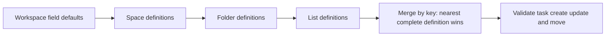
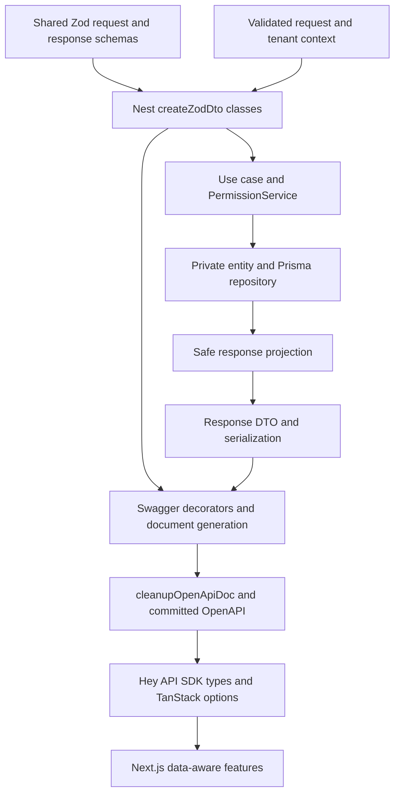

# Workspace authorization and backend contract design

Status: planned implementation, reviewed 23 October 2026. This refinement follows the user's request for explicit workspace RBAC, workspace-defined custom fields, complete ER attributes, audit timestamps and decorator-driven DTO/Swagger generation. It updates [database design](DATABASE_DESIGN.md), [API catalog](API_CATALOG.md) and [implementation tasks](TASKS.md); it does not claim running endpoints or migrations.

## 1. Workspace RBAC and container access

Membership is the role assignment: `(workspaceId,userId,role)`. There is no global User.role. Alice can be admin in workspace A and member in workspace B; changing workspace requires verified target membership and does not carry A's privileges into B. The built-in roles remain admin/member from the product brief; custom role authoring is a future feature, not an extra table needed now.

Permission names are shared, typed action constants interpreted by one PermissionService and one PermissionGuard. Controllers declare required actions; they do not implement role comparisons themselves.

| Action                               | Workspace admin                       | Workspace member                                                         |
| ------------------------------------ | ------------------------------------- | ------------------------------------------------------------------------ |
| workspace.read, member.list          | Allowed in active workspace           | Allowed in active workspace; restricted member projection                |
| member.manage, grant.manage          | Allowed                               | Denied                                                                   |
| container.create/update/archive/move | Allowed                               | Denied                                                                   |
| container.read, task.read            | Allowed inside tenant                 | Only through visible ancestor chain                                      |
| task.create/update/archive/move      | Allowed inside tenant                 | Only on visible source/destination; check anchors and assignees too      |
| configuration.read/write             | Allowed, including workspace defaults | Raw configuration denied; resolved schema available for accessible lists |
| activity.read, list.subscribe        | Allowed inside tenant                 | Only for authorized task/list                                            |

Resource grants add allow/deny visibility rules to workspace RBAC. A member's explicit allow does not grant configuration management. Any ancestor deny blocks a subtree; each private ancestor needs an allow. Admin bypass never crosses tenants. Denied same-tenant access is403; missing/foreign resource IDs are404. Role/grant changes bump configVersion, recheck in-flight mutations and revoke subscriptions. Current DB membership wins over any stale role claim.

An authorization regression must use the **same user in both workspaces**, prove admin actions succeed in A and fail in B, then change B's role and verify the next request sees the new authority. Separate users alone do not prove workspace-scoped roles.

## 2. Workspace custom fields inherited by lists

Both status and field scope enums now accept `workspace | space | folder | list`. For ownerType=workspace, ownerId must equal the active workspaceId. The existing generic field endpoints cover workspace defaults; no new endpoint is required.



For example: workspace defines effort as required number; a space inherits it; a list may replace effort with its own complete compatible definition. A replacement is intentional and includes type, required, options and display values. Editing the workspace definition affects only lists where that definition remains effective; still evaluate every affected list's final schema, rather than assuming all descendants use the same fields.

A workspace admin can also replace a required ancestor definition with a local optional one: required belongs to the winning complete definition. If a future product needs non-overridable organization requirements, that is a separate policy, not an implicit exception in this resolver.

Workspace mutations lock the workspace and validate affected live tasks atomically. A new required field cannot invalidate existing tasks; use optional definition → populate task values → promote to required. Schema deletion cannot silently discard values. A list move revalidates against the full destination chain. Keep the existing cap of 100 effective fields per list even though four scopes can each contain 100 local definitions; check the cap after resolution and before every mutation/reparent commit.

Seed coverage includes a workspace default, a space/folder definition and a list override; at least three distinct effective fields remain across at least two levels. Preserve the required single-select, required value, 24 varied tasks, second tenant and permission fixtures.

## 3. Entities, DTOs and client types

Use five explicit representations, with one source of truth for public shapes:

| Representation                 | Location and purpose                                                    | May contain                                                                        |
| ------------------------------ | ----------------------------------------------------------------------- | ---------------------------------------------------------------------------------- |
| Prisma model/generated record  | packages/database; schema, migrations and repository implementation     | Native Dates, raw joins, password hashes, refresh digests, operational fields      |
| Entity/read model              | Private repository/domain boundary; plain TypeScript such as TaskEntity | Typed domain data needed by a use case; no Nest decorators or HTTP behavior        |
| Request DTO                    | apps/api/.../dto; class derived from shared request schema              | Only accepted command fields, including typed target role/owner and version guards |
| Response DTO                   | apps/api/.../dto; class derived from shared response schema             | Explicit safe projection, response envelope, serialized dates and audit fields     |
| Next.js generated type/options | packages/api-client/src/generated from OpenAPI                          | Public wire contract only; SDK functions and TanStack options                      |

Keep Prisma as the ORM. The Prisma schema defines persistence entities; plain entity types may describe repository results where useful. Do not add TypeORM @Entity classes, decorate a Prisma model as an HTTP response or make Next.js import a backend class. Do not add a second class for every table solely for symmetry; internal entity aliases/read models can derive from repository selections. This preserves the user's DTO/entity distinction without duplicating every domain shape.

The [field reference](FIELD_REFERENCE.md) fixes field-by-field validation and enforcement ownership; API pagination uses only cursor/limit with strict query schemas.

Public contracts stay in framework-free Zod schemas in packages/contracts. Request and response schemas are separate: CreateTaskSchema cannot accept id, acting tenant, timestamps or raw position, while TaskSchema includes server-generated values. Shared fields compose schemas, but a mutation schema must explicitly pick allowed fields rather than omit a few secrets from a full DB shape.

Response projection is an explicit mapper/use-case result followed by Zod serialization. Never return or spread a Prisma record and depend on undocumented serializer stripping to remove secrets. Contract schemas use serializable ISO timestamps and date-only strings. Invalid server output becomes sanitized 500, not a success response or a400 blaming the caller.

## 4. Decorators and Swagger generation

Feature ownership, DTO placement and the implementation checklist follow [the backend coding guide](BACKEND_GUIDELINES.md). Shared schemas remain in contracts, feature DTO adapters remain in the API, and Prisma persistence remains in database.



Use `createZodDto` for named classes such as CreateTaskDto, UpdateTaskDto, TaskParamsDto, TaskResponseDto and TaskPageResponseDto. The global ZodValidationPipe validates body/query/path inputs. ZodSerializerInterceptor validates/serializes responses. Prefer `@ZodResponse({status,type})` to connect the response DTO, status, compile-time return checking and Swagger output. The integration also requires `cleanupOpenApiDoc` when exporting/serving the document. [nestjs-zod documentation](https://github.com/BenLorantfy/nestjs-zod)

Controller metadata includes `@ApiTags`, stable `@ApiOperation({operationId})`, bearer/cookie security, typed errors and path/query descriptions where needed. Use explicit 204 status with `@ApiNoContentResponse` for no-body operations. Concrete page/envelope DTOs prevent generic type erasure in OpenAPI. [NestJS operation decorators](https://docs.nestjs.com/openapi/operations)

The following shows planned DTO/decorator composition, not existing source. Schemas, services and the project's guard metadata are implemented in their owning tasks; DTO classes do not repeat field declarations:

```typescript
export class CreateTaskDto extends createZodDto(CreateTaskSchema) {}
export class UpdateTaskDto extends createZodDto(UpdateTaskSchema) {}
export class TaskResponseDto extends createZodDto(TaskEnvelopeSchema) {}
export class TaskPageResponseDto extends createZodDto(TaskPageSchema) {}

// Controller method metadata for the existing getTask operation:
// @Get(':taskId')
// @ApiOperation({ operationId: 'getTask' })
// @ApiBearerAuth('access-token')
// @ZodResponse({ status: 200, type: TaskResponseDto })
// @ApiNotFoundResponse({ type: ErrorResponseDto.Output })
// Plus the single PermissionGuard's task.read requirement.
```

Swagger decorators do not enforce authorization. Auth/permission guards still run on every request, including configuration and list queries. For a route requiring bearer **and** refresh cookie, represent both in one OpenAPI security requirement object; separate alternatives would describe OR. Document cookie-only refresh and public authentication separately.

Shared Zod schemas already supply property types/requiredness/enums/examples. Do not hand-maintain equivalent @ApiProperty and class-validator schemas. If special Swagger metadata is needed, extend documentation without changing the shared validation source. Lock compatible dependency versions when implementing, and verify generated output against the installed versions rather than assuming latest decorator APIs.

P02-04 documents the current auth and health endpoints with operation summaries/descriptions, schema/model titles and descriptions, schema-valid examples, and response/header examples. Put field metadata in Zod `.meta({ title, description, example })`; keep operation and transport details in Nest decorators. Use synthetic credentials only. A supplemental `@ApiResponse` must preserve the concrete `type: ResponseDto.Output` alongside `@ZodResponse`; otherwise the installed decorator merge can erase the generated response schema. Tests assert those references and their components. No-body 204 responses remain without content or a fabricated example.

The spec-only bootstrap loads real DTOs/controller metadata without DB/Redis connections. Export/normalize OpenAPI → run Spectral conventions/drift check → generate Hey API → compile client/web. A schema, response or decorator change must regenerate both committed artifacts. Hey API provides typed SDK, query/infinite-query options and mutation options; Next.js calls TanStack hooks with those generated options. [Hey API TanStack plugin](https://heyapi.dev/docs/openapi/typescript/plugins/tanstack-query)

## 5. Response projections and audit fields

Every stored record has createdAt and updatedAt. Public **full-resource** DTOs expose both, as server-owned ISO timestamps; lightweight embedded summaries intentionally pick fewer fields. Never add invented audit values to a computed result.

| Response                                       | Safe projection                                                                                                                          |
| ---------------------------------------------- | ---------------------------------------------------------------------------------------------------------------------------------------- |
| UserSelf                                       | id/name/email/createdAt/updatedAt; no passwordHash                                                                                       |
| WorkspaceSummary                               | id/name/createdAt/updatedAt; optional caller role belongs to Membership, not global Workspace                                            |
| MemberResponse / GrantResponse                 | Target IDs, authorized name/role or mode, createdAt/updatedAt; restrict email to authorized views                                        |
| NodeResponse / TaskResponse                    | Catalog resource fields, version, createdAt/updatedAt; Task uses title/description and safe assignee summaries                           |
| StatusIdentityResponse / ScopeStatusResponse   | Stable id/key/category and local display fields; identity and local override timestamps are labeled separately                           |
| FieldDefinitionResponse                        | id/key/name/type/required/options/owner/position/createdAt/updatedAt                                                                     |
| ResolvedStatusResponse / ResolvedFieldResponse | Effective values plus provenance containing source record IDs and source createdAt/updatedAt; no fictional standalone creation timestamp |
| ActivityResponse                               | Authorized actor/change summary and activity createdAt/updatedAt; the append-only values normally match                                  |

RefreshSession, raw OutboxEvent and SeedState have audit fields in storage but no public CRUD response. A public session response exposes accessToken/expiry/safe user/workspace data, never refresh credentials in JSON. Activity payloads are versioned projections, not raw event/database JSON.

## 6. Implementation order and evidence

1. P01-01: define audit timestamp schema, workspace-role/action constants, field scope enum and strict transport primitives.
2. P01-02: add DTO/decorator/serializer/spec baseline and a generated consumer compile test using real health responses. Assert sanitized 500 for invalid server output and correct auth/security metadata.
3. P01-03/P01-04: create all 15 complete models, audit triggers, tenant FKs and repository entity/projection boundaries. Test inserts and Prisma/raw-SQL/worker updates, immutable createdAt and unchanged read timestamps.
4. P02-03/P03-02: prove the same user's differing workspace roles, centralized action decisions, grants and revocation.
5. P05-01 through P05-03: implement four-level field resolution and workspace mutation safety, including shadowing and effective-count bounds. P01-05 seed uses valid workspace defaults.
6. Each endpoint: request/response schemas → DTOs/decorators/guards → entity/use-case/mapper → REST negative tests → regenerated OpenAPI/client → consumer compile checks. P07 strengthens drift automation.
7. P10-02: expose workspace field settings and inherited indicators using the same generated API and resolver. P09 forms receive these fields automatically through list resolution.

Acceptance must prove that passwordHash/tokenDigest/lease/error internals appear in neither public responses nor OpenAPI/generated types. Test another tenant's ownerId, same-user role changes, inherited workspace-required fields, nearer replacements, updates that would invalidate tasks, all audit columns and nullable serialized dates. Documents only specify these tests; runtime verification remains future work.
