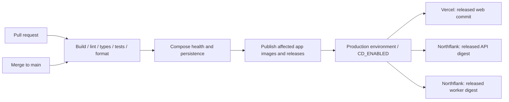

# Continuous integration and deployment

**Later clarification:** This page describes the existing production-only implementation. It does not yet provide strict build-once promotion through four environments: the Vercel Git path rebuilds source. [PROMOTION.md](PROMOTION.md) defines the new future contract; keep provider CD disabled until the chosen path satisfies it.

Implementation for P00-08, 23 October 2026. This extends the existing release workflow; it does not create provider accounts or database resources.

## Deployment contract

- CI runs on pull requests and main; pull requests cannot publish or deploy.
- The existing serialized publisher stays authoritative for versions and immutable images.
- A separate production deployment job runs only after successful release publication on main, and only when repository variable `CD_ENABLED=true`. Until credentials and target IDs are connected, it remains visibly skipped.
- Reconcile the latest published release of each application whose source is verified as an ancestor of current main. Already-deployed versions are read-only skips. This recovers missed/failed deployments even when a later merge changes a different app; it never republishes an image.
- Northflank receives the exact API/worker image digest. Vercel receives the exact released Git commit. No deployment uses the newest branch head or a mutable image tag.
- Validate all needed settings before the first provider write. Missing credentials, API errors, failed rollouts and timeouts fail the job. No simulated deployment success.
- Serialize production deployments. Refuse a stale workflow before provider writes so an older run cannot roll production back accidentally. Rollback remains an explicit provider operation to a known release.
- Poll provider state until ready, with a bounded timeout. Reuse a matching ready/in-progress deployment on retry where the provider exposes its identity. Provider calls and clocks are tested at controlled boundaries.
- PostgreSQL/Redis secrets stay on the hosts. CD requires deployment permissions, not database credentials. Automatic migrations remain P01-05 and are not faked here.

## Connection boundary

The repository has no Vercel or Northflank deployment credentials configured as of this task's start. Code, tests and workflow wiring can be completed now; a live rollout requires the user to connect provider IDs/tokens and enable CD. P00-09 records that live acceptance separately. P00-07 remains the first main-release verification and does not block writing the CD integration on the open PR.

## Enable production CD

1. Create the existing Vercel project and Northflank API/worker services as described in [DELIVERY.md](DELIVERY.md). Keep the Vercel project linked to this GitHub repository and its root at `apps/web`; this lets the REST API build an exact commit. `apps/web/vercel.json` disables competing automatic Git deployments. Disable Vercel rolling releases and Northflank automatic image/tag updates for these services.
2. Create a GitHub environment named `production`, restricted to `main`. Add the two tokens as environment secrets. Add the target IDs as repository variables (the optional Vercel team ID is omitted for personal resources).
3. Set repository variable `CD_ENABLED` to `true` only after all three targets and their runtime secrets are ready. It is disabled when the variable is absent. The next successful main run reconciles the latest published releases. You can also run the existing workflow manually on current main; reruns never allocate a new app version just for deployment.

| Name                           | Kind                          | Purpose                                                                     |
| ------------------------------ | ----------------------------- | --------------------------------------------------------------------------- |
| `VERCEL_TOKEN`                 | Production environment secret | Read/create deployments and promote the selected project                    |
| `NORTHFLANK_API_TOKEN`         | Production environment secret | Read/update the selected services; Services General Read/Update permissions |
| `VERCEL_PROJECT_ID`            | Repository variable           | Existing web project ID                                                     |
| `VERCEL_TEAM_ID`               | Optional repository variable  | Team owning the Vercel project; omit for personal account                   |
| `NORTHFLANK_PROJECT_ID`        | Repository variable           | Existing Northflank project                                                 |
| `NORTHFLANK_API_SERVICE_ID`    | Repository variable           | Existing external-image API service                                         |
| `NORTHFLANK_WORKER_SERVICE_ID` | Repository variable           | Existing external-image worker service, different from API                  |
| `CD_ENABLED`                   | Repository variable           | Exactly `true` enables the production job                                   |

GitHub supplies the read-only GitHub token, repository ID and current workflow SHA automatically. Never paste provider tokens into an issue, PR, file or chat. Database URLs, Redis credentials and future auth secrets remain in the provider's runtime secret settings, not in this deployment job.

## Verification and recovery

Northflank updates only the external deployment image and preserves replica count and saved registry credentials. It does not overwrite runtime variables or ports. Readiness requires the requested image plus `COMPLETED` and a deployed `imageUrl` containing the expected digest. If that field is absent or cannot prove the digest, the job times out rather than claiming success.

Vercel creates a production build with per-deployment domain assignment disabled. After `READY`, it rechecks current main and promotes that exact deployment. The job requires matching production alias completion; it accepts a skipped repeat promotion only when the exact deployment is already current. Failed/blocked/cancelled builds, failed promotions and timeouts fail the job. Rolling releases are rejected because deferred promotion would weaken the stale-run check.

Each provider wait is bounded to 15 minutes. Existing matching releases/deployments are reused; a later current-main workflow also recovers pending versions from earlier commits. If a new main commit arrives mid-run, the old run stops before further mutations. A failed Northflank rollout may need a provider-side fix or restart; inspect and resolve its status, then rerun current main. An in-progress matching rollout is resumed by polling. Failed Vercel builds remain staged and receive no production traffic. There is no automatic database migration or destructive rollback.

## References checked 23 October 2026

- [Northflank update semantics](https://northflank.com/docs/v1/api/use-the-api#update-resources-safely), [service update](https://northflank.com/docs/v1/api/project/services/patch-deployment-service), [service status](https://northflank.com/docs/v1/api/project/services/get-service)
- [Vercel deployment creation](https://vercel.com/docs/rest-api/deployments/create-a-new-deployment), [deployment listing](https://vercel.com/docs/rest-api/deployments/list-deployments), [production promotion](https://vercel.com/docs/rest-api/projects/point-production-traffic-to-a-given-deployment)
- [Vercel staged deployment option](https://github.com/vercel/vercel/blob/main/packages/cli/src/commands/deploy/index.ts), [promotion status](https://github.com/vercel/vercel/blob/main/packages/cli/src/commands/promote/status.ts), [Git deployment configuration](https://vercel.com/docs/project-configuration/git-configuration)
