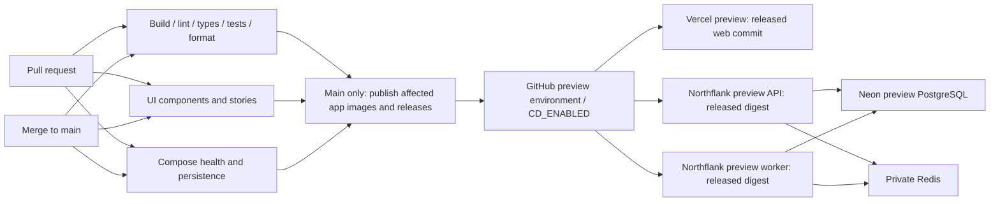

# Continuous integration and preview deployment

Updated 25 October 2026. **This page describes the currently implemented workflow**, including its legacy Vercel/Northflank provider adapter. The new selected target is [Render with Neon](RENDER.md), but that adapter and live rollout are still planned. Do not enable the legacy CD job expecting it to deploy Render. See [delivery operations](DELIVERY_OPERATIONS.md) for trunk-based development and runtime configuration, and [PROMOTION.md](PROMOTION.md) for the future build-once `dev → qa → stage → prod` contract.

Database and queue connections in this diagram are implemented and verified locally. Provider deployment and its live acceptance remain separate, unchecked work.

## Parallel checks and free runners

Five matrix jobs cover build, lint, tests, types and formatting. The test leg runs `pnpm test --filter='!@flowboard/ui'`; a sixth independent job runs `pnpm test --filter=@flowboard/ui` for components and Storybook. This preserves every package suite while isolating browser component tests from backend/browser integration load. The other matrix commands use Turbo across all applicable apps and packages. Turbo still builds required dependencies inside a job before a dependent check can use them; database type checking waits for its Prisma-generating build. No check waits for another check job. Fail-fast is disabled, so one failed lane does not cancel the remaining results. Workflow lint runs within the lint lane.

Production-image and development live-reload Compose checks start alongside these six lanes. Publication waits for the complete verification matrix, UI job and Compose checks to succeed; deployment waits for publication. Runner availability and the account's concurrency limits can still queue jobs.

Every job uses the standard `ubuntu-24.04` GitHub-hosted runner. [GitHub documents these runners as free and unlimited for public repositories](https://docs.github.com/en/actions/reference/runners/github-hosted-runners#standard-github-hosted-runners-for-public-repositories). This setup adds no larger runner, paid cache service, organization subscription or billing change. Entry jobs skip if the repository becomes private, preventing their dependent release/deployment jobs from running under potentially billable private-repository rules. This is a CI-runner guarantee, not a promise about unrelated hosting or storage products.

Branch protection should require `Workspace / build`, `Workspace / lint`, `Workspace / test`, `Workspace / typecheck`, `Workspace / format:check`, `UI / components and stories`, `Compose / docker:check` and `Compose / docker:dev:check`, replacing obsolete check names if configured. Repository settings are not changed by this workflow commit.

## Exact checks and dependency graph

Source: [`.github/workflows/delivery.yml`](../.github/workflows/delivery.yml). PR open/update/reopen/title edits, main pushes and manual dispatch trigger verification. All eight instances below start independently, subject to runner capacity; they do not run sequentially after each other. Each runner has its own checkout and frozen pnpm install. The earlier C24 diagram is a snapshot of the preceding seven-job workflow.

| Required check name           | What it verifies                                                                                                                                                    |
| ----------------------------- | ------------------------------------------------------------------------------------------------------------------------------------------------------------------- |
| `Workspace / build`           | Every applicable app/package build. Includes OpenAPI regeneration comparison, Spectral conventions and generated-client drift checks through package build scripts. |
| `Workspace / lint`            | Shared ESLint/boundaries/naming/version rules, Conventional Commit/PR title validation, checksum-verified Actionlint for workflows.                                 |
| `Workspace / test`            | Turbo suites excluding the UI package: contracts, real PostgreSQL API/database, worker/Redis and application browser journeys.                                      |
| `UI / components and stories` | UI component and Storybook browser suites, with story files run sequentially and failed browser request diagnostics enabled.                                        |
| `Workspace / typecheck`       | App/package TypeScript contracts, including separate story/form type checks.                                                                                        |
| `Workspace / format:check`    | Shared formatting; package manifest order remains deliberate.                                                                                                       |
| `Compose / docker:check`      | Production-image five-service health and application acceptance.                                                                                                    |
| `Compose / docker:dev:check`  | Development Compose startup/live-update verification.                                                                                                               |

Within a lane, Turbo still respects dependency builds. Both matrices set `fail-fast: false`; a failed lane does not cancel the other results. Standard `ubuntu-24.04` runners and public-repository guards retain the existing cost boundary. [GitHub's public-runner policy](https://docs.github.com/en/actions/reference/runners/github-hosted-runners#standard-github-hosted-runners-for-public-repositories).

Within the web suite, [the launcher](../apps/web/scripts/test.mjs) runs all discovered ordinary test files with the existing 60-second file limit, then runs the aggregate E2E wrapper with a budget derived from its discovered journeys. Per-journey timeouts remain in force. A failure in either group fails the suite without suppressing the other group. This prevents an aggregate file timeout from cancelling otherwise bounded journeys on slower runners; it does not retry tests or omit assertions.

`Publish affected apps` requires both complete matrices, the UI job and a non-PR main run. It alone receives GitHub contents/packages write permissions and serializes publication. `Deploy released applications to preview` depends on publication, main, and `CD_ENABLED=true`; it uses the protected GitHub `preview` environment and serializes deployments. A PR never publishes or deploys this shared target. Workflow job configuration does not prove branch protection or environment approval settings were enabled in GitHub.

The workflow does not currently add dependency-audit, CodeQL, image-vulnerability or external penetration-test jobs. OpenAPI/client checks are part of builds, not extra named GitHub check lanes. `pnpm release:check` is a separate clean-checkout acceptance command, not the workflow's entry command.

## Existing legacy deployment contract

- CI runs on pull requests and main; pull requests cannot publish or deploy this shared preview.
- The serialized publisher remains authoritative for independent versions and immutable images.
- A deployment job follows successful main publication only when repository variable `CD_ENABLED=true`. It uses the GitHub `preview` environment and `pnpm deploy:preview`. Absent configuration leaves it visibly skipped.
- Reconcile each app's latest published release whose source is a verified ancestor of current main. This recovers missed deployments after a later merge changes another app. Matching ready deployments are reused without a new rollout.
- Northflank receives the exact API/worker image digest. Vercel builds the exact released Git commit as a **preview**, without assigning production traffic. This is intentionally a source build, not four-environment artifact promotion.
- Validate all required settings before any provider writes. Missing credentials, invalid identities, provider errors, failed rollouts and timeouts fail the job.
- Serialize preview deployments and refuse stale main workflows before mutations and during readiness polling. A stale Vercel build can finish at its unique preview URL, but it cannot acquire a production alias through this workflow.
- PostgreSQL/Redis secrets stay on the hosts. CD needs deployment permissions, not database credentials. API startup applies checked-in migrations before readiness; hosted DEMO_SEED stays false.

## Legacy Vercel/Northflank setup (not the Render plan)

1. Create the Vercel project and **preview-only** Northflank services using [DELIVERY.md](DELIVERY.md). Use a dedicated `flowboard-preview` Vercel project, linked to this repository with root `apps/web`. Vercel forces the first deployment to production even for preview requests. CI checks unfiltered project history and refuses an empty project before writing; complete the explicitly reviewed bootstrap in the hosting guide first. The committed `vercel.json` disables automatic Git deployments, so CI controls which released SHA builds. Keep Northflank automatic image/tag updates disabled.
2. Create a GitHub environment named `preview`, restricted to `main`. Add the two tokens below as environment secrets. Add the resource IDs as repository variables. Use least-privilege tokens for the selected preview project/services.
3. Configure the preview services' runtime secrets, including the region-matched Neon database and private Redis. Do not reuse production data or credentials. Northflank currently requires a payment method even for Sandbox resources; complete that step in the provider UI, with the free allocation selected.
4. Merge the release workflow to main when ready. Set repository variable `CD_ENABLED=true` only after the targets and secrets exist. The next passing main run deploys the published releases; the workflow can also be dispatched manually on current main. Deployment retries do not mint new versions.

| Name                           | Kind                         | Purpose                                                   |
| ------------------------------ | ---------------------------- | --------------------------------------------------------- |
| `VERCEL_TOKEN`                 | Preview environment secret   | Read project/deployments and create previews              |
| `NORTHFLANK_API_TOKEN`         | Preview environment secret   | Read/update the selected preview services                 |
| `VERCEL_PROJECT_ID`            | Repository variable          | Preview web project ID                                    |
| `VERCEL_TEAM_ID`               | Optional repository variable | Owning team; omit for a personal account                  |
| `NORTHFLANK_PROJECT_ID`        | Repository variable          | Preview project ID                                        |
| `NORTHFLANK_API_SERVICE_ID`    | Repository variable          | Preview external-image API service                        |
| `NORTHFLANK_WORKER_SERVICE_ID` | Repository variable          | Preview external-image worker service, different from API |
| `CD_ENABLED`                   | Repository variable          | Exactly `true` enables the shared preview job             |

GitHub supplies its token, repository ID and workflow SHA. Never paste provider tokens into a PR, issue, file or chat. Database URLs, Redis credentials and auth keys belong in provider runtime secrets. Vercel receives only settings it needs; no database or Redis secret belongs in the browser.

API runtime settings now include `DATABASE_URL`, optional direct `DATABASE_URL_UNPOOLED`, `REDIS_URL`, a newly generated `AUTH_SECRET` of at least 32 bytes, `AUTH_ALLOWED_ORIGINS` listing exact HTTPS web origins, `AUTH_ALLOW_INSECURE_HTTP=false`, `DEMO_SEED=false`, and `API_DOCS=false` unless Swagger exposure is intentional. Store secrets on Northflank; they are never build inputs. Readiness is `/health/ready`. Configure web runtime `API_INTERNAL_URL` and `REALTIME_PUBLIC_URL` to the API HTTPS origin, with `WEB_ALLOWED_ORIGINS` listing exact web origins. Browser REST and refresh use the implemented same-origin Next proxy; realtime connects to the API. Forwarded client-IP headers remain untrusted.

## Readiness and recovery

Northflank updates only the external image, preserving replica count, registry credentials, ports and runtime variables. Readiness requires the requested digest, deployment state `COMPLETED` and a deployed image URL containing that digest. Missing digest evidence times out.

After the explicit initial project bootstrap, Vercel creates a preview by omitting `target` from the deployment request and disabling automatic custom-domain assignment. Retry lookup filters previews by released SHA and metadata, including providers that represent previews as a null target. Polling verifies preview identity, the release metadata, `READY` and a generated `*.vercel.app` URL before printing it. No production promotion endpoint is called. Failed, cancelled or blocked builds fail the job; an in-progress matching preview is polled on retry. Project protection may require Vercel sign-in to open the URL; readiness does not imply anonymous access.

Each provider wait is bounded to 15 minutes. If main changes mid-run, rerun on current main. A failed Northflank rollout may need a provider-side correction or restart. There is no automatic destructive rollback or production promotion. The API startup applies migrations before reporting ready.

## Current limits and live acceptance

The local MVP includes login/refresh/logout, a permission-filtered tree, board/list/task editing, scoped configuration, realtime updates and durable activity processing. Both API and worker expose HTTP liveness/readiness; API startup runs migrations with opt-in demo seeding. P12-03 verifies the full suite and both Docker modes. These local results do not establish a verified hosted deployment.

The original P00-14 target is superseded by P22-02/P22-03 for Render. Those tasks must record actual provider resources, the workflow run and external checks. Local HTTP fixtures prove integration behavior, not a live deployment. P00-07 separately records first real GitHub Releases/images after merge. Sign-in, resource setup and an authorized merge are needed before those tasks can pass.

## Legacy provider references checked 23 October 2026

- [Vercel first-deployment behavior](https://vercel.com/docs/deployments/environments#first-deployment), [Vercel preview creation](https://vercel.com/docs/rest-api/deployments/create-a-new-deployment), [deployment listing](https://vercel.com/docs/rest-api/deployments/list-deployments), [generated URLs](https://vercel.com/docs/deployments/generated-urls), [deployment protection](https://vercel.com/docs/deployment-protection)
- [Northflank update semantics](https://northflank.com/docs/v1/api/use-the-api#update-resources-safely), [service update](https://northflank.com/docs/v1/api/project/services/patch-deployment-service), [service status](https://northflank.com/docs/v1/api/project/services/get-service), [Sandbox limits and account requirements](https://northflank.com/docs/v1/application/billing/pricing-on-northflank)
- [Neon regions](https://neon.com/docs/introduction/regions)
