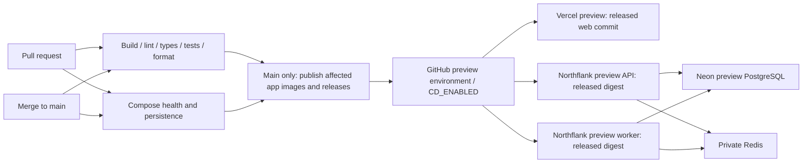

# Continuous integration and preview deployment

The initial hosted environment is a **shared preview** on Vercel (web), Northflank (API, worker and Redis) and Neon (PostgreSQL), as requested on 23 October 2026. P00-13 replaces the earlier production-only CD target. The future build-once `dev → qa → stage → prod` flow remains separate in [PROMOTION.md](PROMOTION.md); it does not block this preview.

Database/queue connections in this diagram describe the target topology. Current app shells do not yet use them; see the limits below.

## Parallel checks and free runners

Five independent GitHub jobs run `pnpm build`, `pnpm lint`, `pnpm test`, `pnpm typecheck` and `pnpm format:check`. Each root command uses Turbo across all applicable apps and packages; new workspaces join through the workspace graph. Turbo still builds required dependencies inside a job before a dependent check can use them. No check waits for another check job. Fail-fast is disabled, so one failed lane does not cancel the remaining results. Workflow lint runs within the lint lane.

Compose health/persistence checks start alongside the five lanes. Publication waits for the complete verification matrix and Compose checks to succeed; deployment waits for publication. Runner availability and the account's concurrency limits can still queue jobs.

Every job uses the standard `ubuntu-24.04` GitHub-hosted runner. [GitHub documents these runners as free and unlimited for public repositories](https://docs.github.com/en/actions/reference/runners/github-hosted-runners#standard-github-hosted-runners-for-public-repositories). This setup adds no larger runner, paid cache service, organization subscription or billing change. Entry jobs skip if the repository becomes private, preventing their dependent release/deployment jobs from running under potentially billable private-repository rules. This is a CI-runner guarantee, not a promise about unrelated hosting or storage products.

Branch protection should require the five `Workspace / ...` checks and `Compose health and persistence`, replacing the former `Build, lint and test` check if it was configured. Repository settings are not changed by this workflow commit.

## Deployment contract

- CI runs on pull requests and main; pull requests cannot publish or deploy this shared preview.
- The serialized publisher remains authoritative for independent versions and immutable images.
- A deployment job follows successful main publication only when repository variable `CD_ENABLED=true`. It uses the GitHub `preview` environment and `pnpm deploy:preview`. Absent configuration leaves it visibly skipped.
- Reconcile each app's latest published release whose source is a verified ancestor of current main. This recovers missed deployments after a later merge changes another app. Matching ready deployments are reused without a new rollout.
- Northflank receives the exact API/worker image digest. Vercel builds the exact released Git commit as a **preview**, without assigning production traffic. This is intentionally a source build, not four-environment artifact promotion.
- Validate all required settings before any provider writes. Missing credentials, invalid identities, provider errors, failed rollouts and timeouts fail the job.
- Serialize preview deployments and refuse stale main workflows before mutations and during readiness polling. A stale Vercel build can finish at its unique preview URL, but it cannot acquire a production alias through this workflow.
- PostgreSQL/Redis secrets stay on the hosts. CD needs deployment permissions, not database credentials. Automatic migrations remain P01-05.

## Connect the shared preview

1. Create the Vercel project and **preview-only** Northflank services using [DELIVERY.md](DELIVERY.md). Use a dedicated `flowboard-preview` Vercel project, linked to this repository with root `apps/web`. Vercel forces the first deployment to production even for preview requests. CI checks unfiltered project history and refuses an empty project before writing; complete the explicitly reviewed bootstrap in the hosting guide first. The committed `vercel.json` disables automatic Git deployments, so CI controls which released SHA builds. Keep Northflank automatic image/tag updates disabled.
2. Create a GitHub environment named `preview`, restricted to `main`. Add the two tokens below as environment secrets. Add the resource IDs as repository variables. Use least-privilege tokens for the selected preview project/services.
3. Configure the preview services' runtime secrets, including the region-matched Neon database and private Redis. Do not reuse production data or credentials. Northflank currently requires a payment method even for Sandbox resources; complete that step in the provider UI, with the free allocation selected.
4. Merge the release workflow to main when ready. Set repository variable `CD_ENABLED=true` only after the targets and secrets exist. The next passing main run deploys the published releases; the workflow can also be dispatched manually on current main. Deployment retries do not mint new versions.

| Name                           | Kind                         | Purpose                                                   |
| ------------------------------ | ---------------------------- | --------------------------------------------------------- |
| `VERCEL_TOKEN`                 | Preview environment secret   | Read project/deployments and create previews              |
| `NORTHFLANK_API_TOKEN`         | Preview environment secret   | Read/update the selected preview services                 |
| `VERCEL_PROJECT_ID`            | Repository variable          | Preview web project ID                                    |
| `VERCEL_TEAM_ID`               | Optional repository variable | Owning team; omit for a personal account                  |
| `NORTHFLANK_PROJECT_ID`        | Repository variable          | Preview project ID                                        |
| `NORTHFLANK_API_SERVICE_ID`    | Repository variable          | Preview external-image API service                        |
| `NORTHFLANK_WORKER_SERVICE_ID` | Repository variable          | Preview external-image worker service, different from API |
| `CD_ENABLED`                   | Repository variable          | Exactly `true` enables the shared preview job             |

GitHub supplies its token, repository ID and workflow SHA. Never paste provider tokens into a PR, issue, file or chat. Database URLs, Redis credentials and later auth keys belong in provider runtime secrets. Vercel receives only settings it needs; no database or Redis secret belongs in the browser.

## Readiness and recovery

Northflank updates only the external image, preserving replica count, registry credentials, ports and runtime variables. Readiness requires the requested digest, deployment state `COMPLETED` and a deployed image URL containing that digest. Missing digest evidence times out.

After the explicit initial project bootstrap, Vercel creates a preview by omitting `target` from the deployment request and disabling automatic custom-domain assignment. Retry lookup filters previews by released SHA and metadata, including providers that represent previews as a null target. Polling verifies preview identity, the release metadata, `READY` and a generated `*.vercel.app` URL before printing it. No production promotion endpoint is called. Failed, cancelled or blocked builds fail the job; an in-progress matching preview is polled on retry. Project protection may require Vercel sign-in to open the URL; readiness does not imply anonymous access.

Each provider wait is bounded to 15 minutes. If main changes mid-run, rerun on current main. A failed Northflank rollout may need a provider-side correction or restart. There is no automatic destructive rollback, database migration or production promotion.

## Current limits and live acceptance

The deployed web is a foundation page. The API has TCP liveness and returns 404 for HTTP routes; the worker exposes private TCP liveness and does not consume jobs. Auth, board, migrations, seed data and queue processing are still planned. A hosted shell is not a completed product preview.

P00-14 records actual provider resources, the workflow run and external checks. Local HTTP fixtures prove integration behavior, not a live deployment. P00-07 separately records first real GitHub Releases/images after merge. Sign-in, resource setup and an authorized merge are needed before those tasks can pass.

## References checked 23 October 2026

- [Vercel first-deployment behavior](https://vercel.com/docs/deployments/environments#first-deployment), [Vercel preview creation](https://vercel.com/docs/rest-api/deployments/create-a-new-deployment), [deployment listing](https://vercel.com/docs/rest-api/deployments/list-deployments), [generated URLs](https://vercel.com/docs/deployments/generated-urls), [deployment protection](https://vercel.com/docs/deployment-protection)
- [Northflank update semantics](https://northflank.com/docs/v1/api/use-the-api#update-resources-safely), [service update](https://northflank.com/docs/v1/api/project/services/patch-deployment-service), [service status](https://northflank.com/docs/v1/api/project/services/get-service), [Sandbox limits and account requirements](https://northflank.com/docs/v1/application/billing/pricing-on-northflank)
- [Neon regions](https://neon.com/docs/introduction/regions)
