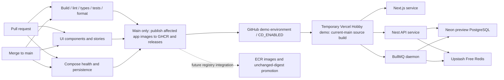

# Continuous integration and deployment

Updated 26 October 2026. Parallel verification and current GHCR publication feed the gated temporary Vercel demo. Future production uses Docker images in ECR and unchanged-digest promotion; that path is not implemented. Vercel's technical production target enables its daemon. See [run modes](RUN_AND_DEPLOY.md), [Vercel demo](VERCEL.md) and [promotion](PROMOTION.md).

The temporary Vercel/Neon/Upstash deployment was verified in P38-03. Protected CI activation remains separate. The dotted ECR path represents future work; current jobs still authenticate and publish to GHCR.

## Parallel checks and free runners

Five matrix jobs cover build, lint, tests, types and formatting. The test leg runs `pnpm test --filter='!@flowboard/ui'`; a sixth independent job runs `pnpm test --filter=@flowboard/ui` for components and Storybook. This preserves every package suite while isolating browser component tests from backend/browser integration load. The other matrix commands use Turbo across all applicable apps and packages. Turbo still builds required dependencies inside a job before a dependent check can use them; database type checking waits for its Prisma-generating build. No check waits for another check job. Fail-fast is disabled, so one failed lane does not cancel the remaining results. Workflow lint runs within the lint lane.

Production-image and development live-reload Compose checks start alongside these six lanes. Publication waits for the complete verification matrix, UI job and Compose checks to succeed; deployment waits for publication. Runner availability and the account's concurrency limits can still queue jobs.

Every job uses the standard `ubuntu-24.04` GitHub-hosted runner. [GitHub documents these runners as free and unlimited for public repositories](https://docs.github.com/en/actions/reference/runners/github-hosted-runners#standard-github-hosted-runners-for-public-repositories). This setup adds no larger runner, paid cache service, organization subscription or billing change. Entry jobs skip if the repository becomes private, preventing their dependent release/deployment jobs from running under potentially billable private-repository rules. This is a CI-runner guarantee, not a promise about unrelated hosting or storage products.

Branch protection should require `Workspace / build`, `Workspace / lint`, `Workspace / test`, `Workspace / typecheck`, `Workspace / format:check`, `UI / components and stories`, `Compose / docker:check` and `Compose / docker:dev:check`, replacing obsolete check names if configured. Repository settings are not changed by this workflow commit.

## Exact checks and dependency graph

Source: [`.github/workflows/delivery.yml`](../.github/workflows/delivery.yml). PR open/update/reopen/title edits, main pushes and manual dispatch trigger verification. All eight instances below start independently, subject to runner capacity; they do not run sequentially after each other. Each runner has its own checkout and frozen pnpm install. [Atlas C24](diagrams/06-delivery.md#c24--eight-ci-lanes-and-release-gates) shows these eight checks and the current deployment gate.

| Required check name           | What it verifies                                                                                                                                                    |
| ----------------------------- | ------------------------------------------------------------------------------------------------------------------------------------------------------------------- |
| `Workspace / build`           | Every applicable app/package build. Includes OpenAPI regeneration comparison, Spectral conventions and generated-client drift checks through package build scripts. |
| `Workspace / lint`            | Shared ESLint/boundaries/naming/version rules, Conventional Commit/PR title validation, checksum-verified Actionlint for workflows.                                 |
| `Workspace / test`            | Turbo suites excluding the UI package: contracts, real PostgreSQL API/database, worker/Redis and application browser journeys.                                      |
| `UI / components and stories` | UI component and Storybook browser suites, with story files run sequentially and failed browser request diagnostics enabled.                                        |
| `Workspace / typecheck`       | App/package TypeScript contracts, including separate story/form type checks.                                                                                        |
| `Workspace / format:check`    | Shared formatting; package manifest order remains deliberate.                                                                                                       |
| `Compose / docker:check`      | Production-image five-service health and application acceptance.                                                                                                    |
| `Compose / docker:dev:check`  | Development Compose startup/live-update verification.                                                                                                               |

Within a lane, Turbo still respects dependency builds. Both matrices set `fail-fast: false`; a failed lane does not cancel the other results. Standard `ubuntu-24.04` runners and public-repository guards retain the existing cost boundary. [GitHub's public-runner policy](https://docs.github.com/en/actions/reference/runners/github-hosted-runners#standard-github-hosted-runners-for-public-repositories).

Within the web suite, [the launcher](../apps/web/scripts/test.mjs) runs all discovered ordinary test files with the existing 60-second file limit, then runs the aggregate E2E wrapper with a budget derived from its discovered journeys. Per-journey timeouts remain in force. A failure in either group fails the suite without suppressing the other group. This prevents an aggregate file timeout from cancelling otherwise bounded journeys on slower runners; it does not retry tests or omit assertions.

`Publish affected apps` requires both complete matrices, the UI job and a non-PR main run. It alone receives GitHub contents/packages write permissions and serializes publication. `Deploy released services to Vercel Hobby` depends on publication, main, and `CD_ENABLED=true`; it uses the protected GitHub `demo` environment and serializes deployments. A PR never publishes or deploys this shared target. Workflow job configuration does not prove branch protection or environment approval settings were enabled in GitHub.

The workflow does not currently add dependency-audit, CodeQL, image-vulnerability or external penetration-test jobs. OpenAPI/client checks are part of builds, not extra named GitHub check lanes. `pnpm release:check` is a separate clean-checkout acceptance command, not the workflow's entry command.

## One Vercel Services deployment

The serialized publisher remains authoritative for independent app versions and immutable images. After successful publication, the deployment job runs pnpm deploy:vercel for the current main SHA only when CD_ENABLED=true. It uses the GitHub demo environment and the configured Vercel Hobby team/project.

All published app manifests are validated before a provider mutation, and their source commits must be reachable from current main. The adapter submits one production deployment for web, API and worker together. It verifies the linked repository, service-project configuration, required production environment-key names, source SHA, release metadata, ready state, expected service inventory and generated Vercel URL. It reads environment names without decrypting values.

The production target is deliberate: Vercel Daemons do not run in previews. This project is a dedicated hobby demo, not an authorization to reuse unrelated production data. The source build does not implement the future four-environment unchanged-artifact promoter.

## Credentials and activation

The demo GitHub environment needs the VERCEL_TOKEN secret plus VERCEL_PROJECT_ID and VERCEL_TEAM_ID variables. The token must belong to the selected account. No Northflank credentials are used. Database, Redis and auth secrets live in Vercel runtime settings; they are not needed by the deployment adapter and must not enter its logs.

The project must already exist, be linked to this GitHub repository and use the Services preset with repository root. P38-03 verifies the manual live demo; protected main-branch CD remains disabled until its credentials and activation are explicitly configured. Root vercel.json disables automatic Git deploys so the verified publication/deployment path remains the owner.

## Readiness and recovery

Retries look up the production deployment by current source SHA and validated release metadata, reusing ready or in-progress work instead of creating a new rollout. Missing, mismatched, failed, cancelled or malformed provider results fail closed. Polling is bounded. A main revision change stops the old workflow before further mutations.

No automatic destructive database rollback is attempted. API startup applies checked-in migrations before serving requests; deployment rollback still requires schema compatibility. Vercel READY is only provider readiness: P38-03 additionally checks real auth, task writes, worker activity and realtime behavior.

## Current limits and live acceptance

The local MVP and regression suites do not establish a hosted rollout. P38-03 owns the actual Vercel/Neon/Upstash records and live user journeys; P38-04 owns independent worker dispatch. Free quotas can interrupt a continuously running demo. See [Vercel setup and limits](VERCEL.md).

## Provider references

- [Services](https://vercel.com/docs/services), [Daemons and production-only support](https://vercel.com/docs/daemons)
- [Create deployment](https://vercel.com/docs/rest-api/deployments/create-a-new-deployment), [deployment listing](https://vercel.com/docs/rest-api/deployments/list-deployments), [deployment protection](https://vercel.com/docs/deployment-protection)
- [Neon Free](https://neon.com/blog/neon-free-plan-1-gb-per-project), [Upstash Free](https://upstash.com/pricing/redis)
