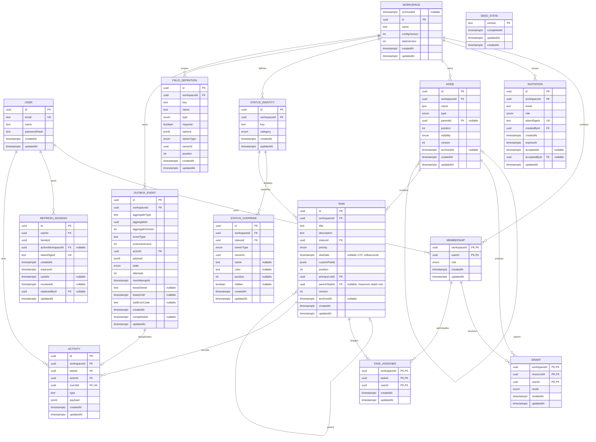

# Flowboard database and ER design

Status: schema, migrations, tenant repositories and the MVP service invariants are implemented. [P01-03](evidence/P01-03.md), [P01-04](evidence/P01-04.md) and the later domain task records contain their verification; the [LLD](LLD.md) summarizes current flows and the P38 deployment/runtime changes. This detailed design originated on 23 October 2026; resolve implementation details against the current schema and task evidence. [PLAN](PLAN.md), [DECISIONS](DECISIONS.md) and the original requirements remain the scope authority.

## Storage boundary

Use Prisma with PostgreSQL, locally in Docker and hosted on Neon. `packages/database` owns the Prisma client, schema, migrations, seed, SQL and scoped repositories. API/worker code receives repositories, not a raw client. Redis carries jobs and invalidations; it is not authoritative storage.

The Node runtime uses Prisma with `@prisma/adapter-pg` and `pg`, not a Neon HTTP driver. Runtime repositories use pooled `DATABASE_URL`; `DATABASE_URL_UNPOOLED` provides the direct migration/advisory-lock connection when present. API startup runs checked-in migrations under the initialization lock before serving; hosted demo seeding is disabled. The worker consumes already-initialized tables. See [database connection setup](../packages/database/README.md) and [LLD startup](LLD.md#runtime-startup-and-deployment-wiring).

There are 15 logical records. Workspace is the tenant root. User and RefreshSession are global identity records; SeedState is global operational metadata. Every other record carries `workspaceId`, even joins and events. Membership.role supplies built-in workspace RBAC: the same User may be admin in one Workspace and member in another. There is no separate Board table: Board and List are views of tasks in a List node.

Names below are logical Prisma/contract names; map physical tables/columns consistently to snake_case in the migration. UUIDs are opaque. `?` means nullable; unmarked fields are NOT NULL. Timestamps use `timestamptz(3)` and UTC; calendar dates use PostgreSQL `date`, exposed as `YYYY-MM-DD`. Every one of the 15 tables stores createdAt and updatedAt as NOT NULL timestamptz(3). They start equal at insertion. createdAt is immutable; a shared SQL BEFORE UPDATE trigger sets updatedAt to the actual write time for Prisma, raw SQL and worker paths. No-op commands avoid writes. Immutable records retain both original values; event timestamps such as occurredAt/completedAt remain separate. Versions, not clock timestamps, order concurrent changes. Counters/positions use nonnegative PostgreSQL integers, with versions starting at 1. Overflow must fail rather than wrap.

## Entity relationship model

Relationships are logical cardinalities; the following key table specifies actual composite FKs. Scope-owner and generic aggregate references are deliberately not drawn as ordinary Node FKs. Nullable fields are explicitly labeled in the ER diagram; the dictionary defines enum values/defaults. Names belong on User, Workspace, Node, FieldDefinition and StatusOverride; Task uses title. Membership/Grant/credentials have no artificial name. StatusIdentity deliberately has key/category while scoped display names live in StatusOverride.

## Data dictionary

| Record          | Complete stored fields                                                                                                                                                                                                                                                                                                                                                            | Defaults and identity rules                                                                                                                                                                                                                                                                              |
| --------------- | --------------------------------------------------------------------------------------------------------------------------------------------------------------------------------------------------------------------------------------------------------------------------------------------------------------------------------------------------------------------------------- | -------------------------------------------------------------------------------------------------------------------------------------------------------------------------------------------------------------------------------------------------------------------------------------------------------- |
| User            | `id uuid`, `email text`, `name text`, `passwordHash text`, `createdAt`, `updatedAt`                                                                                                                                                                                                                                                                                               | UUID PK; normalized email globally unique. Password is an Argon2id encoded hash, never a response field.                                                                                                                                                                                                 |
| Workspace       | `id uuid`, `name text`, `configVersion int`, `dataVersion int`, `createdAt`, `updatedAt`                                                                                                                                                                                                                                                                                          | UUID PK; both revisions start at 1. Row is the domain-write lock. Root tree node is virtual and uses this ID.                                                                                                                                                                                            |
| Membership      | `workspaceId uuid`, `userId uuid`, `role admin\|member`, `createdAt`, `updatedAt`                                                                                                                                                                                                                                                                                                 | Composite PK; role never inferred from a mutation body or stale JWT claim.                                                                                                                                                                                                                               |
| RefreshSession  | `id uuid`, `userId uuid`, `familyId uuid`, `activeWorkspaceId? uuid`, `tokenDigest text`, `createdAt`, `expiresAt`, `usedAt?`, `revokedAt?`, `replacedById? uuid` , `updatedAt`                                                                                                                                                                                                   | One row per random credential; digest unique; familyId stable across rotations. All family rows share its fixed expiry. replacedById references a replacement row. activeWorkspaceId is copied on refresh and changed only by the verified switch endpoint; null represents a login with no memberships. |
| Invitation      | `id uuid`, `workspaceId uuid`, `email text`, `role admin\|member`, `tokenDigest text`, `createdById uuid`, `createdAt`, `expiresAt`, `acceptedAt?`, `acceptedById? uuid` , `updatedAt`                                                                                                                                                                                            | Digest unique; normalized email; actor and accepted user are global User references. Accept once before expiry.                                                                                                                                                                                          |
| Node            | `id uuid`, `workspaceId uuid`, `name text`, `type space\|folder\|list`, `parentId? uuid`, `position int`, `visibility public\|private`, `version int`, `archivedAt?`, `createdAt`, `updatedAt`                                                                                                                                                                                    | UUID PK; position=0, visibility=public, version=1, archivedAt=null. Duplicate names are allowed; positions need not be unique.                                                                                                                                                                           |
| Grant           | `workspaceId uuid`, `resourceId uuid`, `userId uuid`, `mode allow\|deny`, `createdAt`, `updatedAt`                                                                                                                                                                                                                                                                                | Composite PK. No edit bit: members may edit tasks they can access; only admins manage configuration/containers/grants.                                                                                                                                                                                   |
| StatusIdentity  | `id uuid`, `workspaceId uuid`, `key text`, `category not_started\|active\|done\|closed`, `createdAt`, `updatedAt`                                                                                                                                                                                                                                                                 | UUID PK; workspace/key unique. Key/category immutable. This ID is task.statusId.                                                                                                                                                                                                                         |
| StatusOverride  | `id uuid`, `workspaceId uuid`, `statusId uuid`, `ownerType workspace\|space\|folder\|list`, `ownerId uuid`, `name? text`, `color? text`, `position? int`, `hidden? boolean`, `createdAt`, `updatedAt`                                                                                                                                                                             | UUID PK; owner/status unique. Null display attributes inherit. hidden=null inherits, true hides, false explicitly restores. Do not default hidden to false.                                                                                                                                              |
| FieldDefinition | `id uuid`, `workspaceId uuid`, `key text`, `name text`, `type text\|number\|single_select\|multi_select\|date\|checkbox`, `required boolean`, `options jsonb`, `ownerType workspace\|space\|folder\|list`, `ownerId uuid`, `position int`, `createdAt`, `updatedAt`                                                                                                               | UUID PK; owner/key unique; required=false, options=[], position=0. Each option has stable id, label and optional color. A nearer key replaces the entire definition.                                                                                                                                     |
| Task            | `id uuid`, `workspaceId uuid`, `title text`, `description text`, `statusId uuid`, `priority urgent\|high\|normal\|low\|none`, `dueDate? timestamptz(3)`, `customFields jsonb`, `position int`, `primaryListId uuid`, `parentTaskId? uuid`, `version int`, `archivedAt?`, `createdAt`, `updatedAt`                                                                                 | UUID PK; description='', priority=none, customFields={}, position=0, version=1. Title is nonempty and at most 500 characters. Assignees are separate rows.                                                                                                                                               |
| TaskAssignee    | `workspaceId uuid`, `taskId uuid`, `userId uuid`, `createdAt`, `updatedAt`                                                                                                                                                                                                                                                                                                        | Composite PK; API derives assigneeIds[]. No duplicate assignment.                                                                                                                                                                                                                                        |
| OutboxEvent     | `id uuid`, `workspaceId uuid`, `aggregateType text`, `aggregateId uuid`, `aggregateVersion int`, `eventType text`, `schemaVersion int`, `actorId uuid`, `payload jsonb`, `state pending\|dispatching\|queued\|processing\|delivered\|failed`, `attempts int`, `nextAttemptAt`, `leaseOwner? text`, `leaseUntil?`, `lastErrorCode? text`, `createdAt`, `completedAt?`, `updatedAt` | UUID PK; state=pending, attempts=0, schemaVersion=1. One event per aggregate version. Claims are bounded and leased; enqueued is not delivered. Store sanitized error codes, not secrets or raw exception bodies.                                                                                        |
| Activity        | `id uuid`, `workspaceId uuid`, `taskId uuid`, `actorId uuid`, `eventId uuid`, `type text`, `payload jsonb`, `createdAt`, `updatedAt`                                                                                                                                                                                                                                              | UUID PK; eventId unique. Payload is a versioned, validated change summary. Actor references User, not Membership, so departure preserves history.                                                                                                                                                        |
| SeedState       | `version text`, `completedAt`, `updatedAt`, `createdAt`                                                                                                                                                                                                                                                                                                                           | Version PK. Operational seed-completion marker, written with seed data under an initialization lock. No tenant data or credentials live here.                                                                                                                                                            |

The [field reference](FIELD_REFERENCE.md) gives all 137 stored fields their exact storage/wire types, defaults, relations and validation owners. Required names/keys reject empty or whitespace-only strings. String bounds count Unicode code points consistently across contracts/UI/PostgreSQL; JSON byte limits are separate. Do not add global uniqueness to workspace names, node names or field display labels.

## Physical tables and audit policy

| Model           | PostgreSQL table  |
| --------------- | ----------------- |
| User            | users             |
| Workspace       | workspaces        |
| Membership      | memberships       |
| RefreshSession  | refresh_sessions  |
| Invitation      | invitations       |
| Node            | nodes             |
| Grant           | grants            |
| StatusIdentity  | status_identities |
| StatusOverride  | status_overrides  |
| FieldDefinition | field_definitions |
| Task            | tasks             |
| TaskAssignee    | task_assignees    |
| OutboxEvent     | outbox_events     |
| Activity        | activities        |
| SeedState       | seed_states       |

Use Prisma @@map/@map for these names and snake_case columns. A common migration function/trigger enforces immutable created_at and write-time updated_at on every table; do not rely on Prisma @updatedAt alone because raw SQL and worker updates must obey the same rule. Both timestamps are server-owned. Insert-only StatusIdentity, Activity and SeedState are not edited merely to advance their clock. Refresh consumption, invitation acceptance and outbox delivery do advance their own updatedAt; reading a record does not.

Field options are embedded values, not additional tables: each has id/label and optional color, and its parent definition's updatedAt records a change. Resolved field/status views are computed rather than stored rows; they expose source/provenance timestamps, not invented creation times.

## Keys and database-enforced integrity

Every tenant table with a UUID id also has `UNIQUE(workspaceId,id)` and an FK from workspaceId to Workspace. Joins already identify their workspace in the composite PK. All FKs below use RESTRICT/NO ACTION for physical deletion; archive is the normal product operation.

| Child fields                                  | Referenced key                      | Purpose                                                                            |
| --------------------------------------------- | ----------------------------------- | ---------------------------------------------------------------------------------- |
| Membership.userId                             | User.id                             | Global account can join multiple workspaces.                                       |
| Node.(workspaceId,parentId)                   | Node.(workspaceId,id)               | A parent cannot belong to another tenant. Nullable only for a space.               |
| Grant.(workspaceId,resourceId)                | Node.(workspaceId,id)               | Grant belongs to that tenant's resource.                                           |
| Grant.(workspaceId,userId)                    | Membership.(workspaceId,userId)     | Grantee must be a current member.                                                  |
| StatusOverride.(workspaceId,statusId)         | StatusIdentity.(workspaceId,id)     | Override cannot reference a foreign status.                                        |
| Task.(workspaceId,primaryListId)              | Node.(workspaceId,id)               | List link cannot cross tenant.                                                     |
| Task.(workspaceId,primaryListId,parentTaskId) | Task.(workspaceId,primaryListId,id) | Nullable same-list parent. SQL rejects self; repository enforces depth/live rules. |
| Task.(workspaceId,statusId)                   | StatusIdentity.(workspaceId,id)     | Stable task classification cannot cross tenant.                                    |
| TaskAssignee.(workspaceId,taskId)             | Task.(workspaceId,id)               | Assignment belongs to that tenant's task.                                          |
| TaskAssignee.(workspaceId,userId)             | Membership.(workspaceId,userId)     | Assignee must be a member.                                                         |
| Activity.(workspaceId,taskId)                 | Task.(workspaceId,id)               | History belongs to the same task tenant.                                           |
| Activity.(workspaceId,eventId)                | OutboxEvent.(workspaceId,id)        | Idempotency cannot link another tenant's event.                                    |
| Activity.actorId, OutboxEvent.actorId         | User.id                             | Preserve historical actors after membership removal.                               |

Additional unique keys: `(workspaceId,key)` on StatusIdentity; `(workspaceId,ownerType,ownerId,statusId)` on StatusOverride; `(workspaceId,ownerType,ownerId,key)` on FieldDefinition; `(workspaceId,aggregateType,aggregateId,aggregateVersion)` on OutboxEvent. Invitation tokenDigest and RefreshSession tokenDigest are globally unique. RefreshSession userId/replacedById and invitation actor IDs have global identity FKs.

RefreshSession also has `UNIQUE(userId,familyId,id)` and a composite self-FK `(userId,familyId,replacedById)` to that key. A replacement cannot belong to a different user or family. Application checks enforce equal family expiry and prevent cycles under the User lock. activeWorkspaceId has a nullable FK to Workspace.id. A partial unique index on familyId WHERE usedAt IS NULL AND revokedAt IS NULL enforces one current credential; define it in SQL.

The field reference also specifies invitation acceptance-pair, refresh replacement, outbox lease/completion and digest-shape checks. Named CHECK constraints enforce enum values, positive versions, nonnegative positions, nonempty required strings, `char_length(title) <= 500`, `jsonb_typeof(customFields)='object'`, array-shaped options, object-shaped event/activity payloads, and expiry after creation. Node checks require `parentId IS NULL` for space and nonnull for folder/list, plus `parentId <> id`. Any workspace-owned status or field must have `ownerId=workspaceId`.

Prisma models express relations/unique keys; SQL migration fragments express checks and any later partial/expression indexes. Do not assume `prisma db push` reproduces checked-in SQL constraints. Verify with a fresh migration database.

## Integrity that needs the service transaction

SQL checks cannot validate arbitrary cross-row hierarchy or the resolved custom-field schema. Scope rows keep ownerType/ownerId to match contracts: for Node-owned scopes, validate that ownerId names a live node of the right type in the same tenant. There is no claimed polymorphic FK. Field definitions may be owned by Workspace; that ownerId must equal the active workspaceId, just as for workspace statuses. All four field scopes remain tenant-owned.

Under the workspace lock, validate all of the following before writing:

- A folder's parent is a space; a list's parent is a folder; tasks belong to lists. Ancestors are live and reparenting cannot form a cycle.
- Every referenced source, destination, anchor and assignee is visible/valid in the acting tenant. An admin bypass never crosses tenants.
- Resolved status sets retain not_started, active and done. A new local introduction supplies name/color/position; a partial override needs an inherited definition. Reusing a key in a sibling scope reuses the same identity/category or rejects a conflicting category.
- A configuration mutation does not invalidate affected live tasks. Removing an override may reveal inheritance; it is not a deletion of the shared identity. Any archived task reference also blocks physical identity deletion.
- Field keys and option IDs are stable. Types/options/required constraints are evaluated against the entire proposed task. Unknown keys reject; omitted PATCH values remain; explicit optional null clears. False/zero are valid required values.
- Membership removal explicitly deletes grants/assignments, versions affected tasks and writes events before deleting Membership. Last-admin protection runs under the same lock. History rows remain.

Application tenant scoping remains mandatory even with composite FKs: FKs protect relationships, not read authorization. RLS is a possible later defense, not an implemented guarantee.

## Concurrency, reads and event flow

```mermaid
flowchart LR
  Command[Validated command and TenantContext] --> Lock[Lock Workspace row]
  Lock --> Check[Re-read membership access config versions]
  Check --> Resolve[Resolve status and field rules]
  Resolve --> Write[Write rows and affected versions]
  Write --> Outbox[Insert outbox events]
  Outbox --> Commit[Commit transaction]
  Commit --> Claim[Lease committed events]
  Claim --> Queue[BullMQ]
  Queue --> Worker[Verify persisted event and insert activity]
  Worker --> Publish[Publish allowed invalidations]
  Publish --> Done[Mark delivered after publish succeeds]
```

Domain/config/access writes acquire the workspace row first; any row locks within it use a stable order. Authentication rotation first locks the global User row. Operations needing both use User before Workspace; no domain write may take those locks in reverse order. No external network operation is held inside a database transaction.

Task/node `expectedVersion` checks happen after locking and rereading. Increment the target once for one command; if integer renumbering changes siblings, increment each changed sibling once and emit task events for changed tasks. Unchanged rows keep their versions. Positions are not unique: sort by position then id and renumber the affected bounded sibling set. Later fractional indexing is a separately measured optimization.

Workspace.configVersion increments once per command changing inherited configuration, hierarchy, membership or access. Workspace.dataVersion increments once per command changing node/task collection data, including task assignments and sibling renumbering. A command may increment both. These coarse revisions favor correctness over concurrent pagination throughput at hobby scale. Workers appending activity do not increment them.

Multi-query read responses use one consistent snapshot so their data/revisions agree. Separate board responses must match configVersion before the client combines them. Mutable tree/task cursors bind both revisions, checked in the page's snapshot; if either changed, return 409 CURSOR_STALE and restart from the first page. This prevents skipped/duplicated rows during a reorder without retaining historical snapshots. Append-only activity uses live keyset pagination, bounded by its original newest event; new/late activity may require a refresh; transaction commit order means this is not a historical snapshot.

For a task move, source removal, destination placement, status selection, field validation, all affected positions/versions and events commit together. Keep an available status; otherwise use the destination's first same-category status ordered by position/key/id. Missing optional closed category rejects rather than inventing another category. A failed move changes nothing.

Refresh rotation locks User, rereads credential/family, marks the old row used and inserts the replacement in one transaction. The JWT session claim is familyId, not the consumed row ID. Check family expiry/revocation and its current activeWorkspaceId against the access JWT; a consumed refresh row alone does not revoke an already issued access JWT. Replay revokes all family rows. Switching rotates the credential and changes the selected workspace for this family only. A fixed seven-day family lifetime is not extended by rotation; retain used digests through that lifetime. Never log raw tokens or digests.

Outbox retries use stable event/job IDs and bounded lease claims. Workers verify queued identity against the persisted event and derive tenant/actor from it. Unique Activity.eventId makes inserts idempotent. An existing activity does not prove publication: retry the publish before setting delivered/completedAt. Duplicate invalidations are acceptable; exactly-once browser delivery is not promised. No purge job may remove events still referenced by Activity.

Use task/node.version for their aggregateVersion and configVersion for the distinct `workspace_config` aggregate type. Never interchange independent counters for the same aggregate identity. After the configured bounded retry limit, retain a failed event for inspection; an explicit operator retry resets its delivery state while preserving its event ID. No public retry endpoint or silent dropping is implied.

## Initial query/index plan

| Query                          | Initial B-tree index or access path                                                                           |
| ------------------------------ | ------------------------------------------------------------------------------------------------------------- |
| User login                     | Unique normalized User.email                                                                                  |
| Refresh lookup / family revoke | Unique tokenDigest; `(userId,familyId,revokedAt,expiresAt)`                                                   |
| My workspaces / members        | Membership `(userId,workspaceId)` and its composite PK                                                        |
| Invite acceptance              | Unique tokenDigest; `(workspaceId,email,acceptedAt,expiresAt)` for administration                             |
| Visible tree children          | Node `(workspaceId,parentId,archivedAt,position,id)`; Grant `(workspaceId,userId,resourceId)`                 |
| Board column                   | Task `(workspaceId,primaryListId,archivedAt,statusId,position,id)`                                            |
| Subtask lookup                 | Task `(workspaceId,parentTaskId,archivedAt)`; parent filtering shares normal task cursor ordering             |
| Due-date table                 | Task `(workspaceId,primaryListId,archivedAt,dueDate,id)` with explicit nulls-last comparison                  |
| Priority table                 | Task `(workspaceId,primaryListId,archivedAt,priority,id)`; priority enum order is urgent/high/normal/low/none |
| Configuration chain            | Unique owner/status and owner/key indexes; fetch known ancestor scopes in bounded queries                     |
| Task activity                  | Activity `(workspaceId,taskId,createdAt,id)`                                                                  |
| Pending delivery               | OutboxEvent `(state,nextAttemptAt,id)` plus lease-expiry access path; bounded batches                         |

Custom-field filters must be typed, parameterized and limited to supported keys/operators. Measure the actual expression before adding JSONB GIN or expression indexes. Do not claim a general GIN index accelerates arbitrary casts or sorting. B-tree composite order follows the equality prefixes and cursor order of the actual query.

## Migration and test handoff

1. P01-03 creates identities/tenants, nodes/configuration, tasks/joins, then events/activity/seed marker; add FKs only after referenced keys exist. Use checked-in migrations, not automatic schema synchronization.
2. P01-04 exposes fail-closed repositories and transaction helpers. Tests use an isolated real PostgreSQL container and the actual application DB role.
3. P01-05 migrates before seeding and holds an initialization lock. SeedState commits last with data; failed initialization remains retryable. Demo seed does not overwrite existing edits or run in hosted production mode.

Required audit evidence: every physical table has both NOT NULL timestamps; immutable createdAt rejects alteration; Prisma/raw SQL/worker updates advance updatedAt without changing event time; read-only operations do not change either field.

Required negative evidence: foreign-tenant parent/list/status/assignment/event links; duplicate membership/grant/field key; invalid node parent shape; JSON array supplied as customFields; missing/invalid options; unknown status; deleting referenced statuses; last-admin races; stale concurrent moves; duplicate worker delivery; used refresh-token replay. Verify migration reapplication and stored data after restart. These are planned acceptance tests, not current passes.

References: PostgreSQL [constraints](https://www.postgresql.org/docs/current/ddl-constraints.html) and [row locking](https://www.postgresql.org/docs/current/explicit-locking.html); Prisma [multi-field relations](https://www.prisma.io/docs/orm/prisma-schema/data-model/relations/one-to-many-relations). They explain mechanisms; Flowboard's domain rules above are our design decisions.

## Task due datetime migration

P28-06/D156 changes task dueDate from a calendar DATE to a PostgreSQL timestamptz(3). Requests require an ISO datetime with seconds and Z or an explicit offset, with no more than three fractional digits. Responses normalize to UTC milliseconds. UTC years are bounded to 0001–9999; unset remains null. Calendar custom-field values retain YYYY-MM-DD semantics.

Migration 202610250001 interprets old task dates as midnight UTC regardless of the database session timezone. It also normalizes only the historical task.updated dueDate before/after payload paths, preserving nulls and unrelated event content. Queued jobs reload those records by identity. Task versions and task audit times are preserved; updated outbox rows follow the existing database audit trigger. Restart API and worker consumers together for this contract change. Old date-only mutations and old date-shaped cursors are rejected rather than truncating times.

Workspace root lifecycle uses a nullable archive timestamp without modifying descendant rows. Ordinary identity and tenant transactions reject archived workspaces; the narrow administrator recovery capability rechecks session, membership and version under locks. See [workspace lifecycle](WORKSPACE_LIFECYCLE.md).

One-level task relations use [D158 and the subtask design](SUBTASKS.md). Task-only archive blocks live children; cross-list moves block every child reference, including archived ones. Container subtree archive remains atomic for all tasks. The nullable-column migration preserves existing rows and timestamps.
