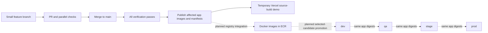

# From a change to a running environment

Updated 26 October 2026. This guide explains the current code and target operating model. [Run modes](RUN_AND_DEPLOY.md) defines native development, full Compose preview, the temporary [Vercel demo](VERCEL.md), and future Docker/ECR production. [CI/CD](CI_CD.md) lists executable checks; [independent delivery](DELIVERY.md) defines current GHCR publication. ECR and its AWS application runtime are not configured.

## What exists and what is next

| Concern                      | Current implementation                                                                                            | Remaining work                                                                                                   |
| ---------------------------- | ----------------------------------------------------------------------------------------------------------------- | ---------------------------------------------------------------------------------------------------------------- |
| Main and feature branches    | PR/main checks exist; work is committed in small feature branches.                                                | Enforce the desired branch protection in GitHub settings.                                                        |
| Independent release          | API, web and worker have separate versions, image digests and release manifests.                                  | First/live publication is evidenced separately, never inferred from local tests.                                 |
| Runtime environment settings | API/worker read startup settings; web reads origins at dynamic request boundaries.                                | Verify each chosen hosted environment with the same released image.                                              |
| Hosted CD                    | P38-03 verifies the temporary Vercel demo with web/API services and a worker daemon; CI deployment remains gated. | ECR integration and the production runtime remain planned; enable CI deployment only with its required settings. |
| Ordered promotion            | The contract is documented in [PROMOTION.md](PROMOTION.md).                                                       | P00-11/P00-12 implement and verify explicit candidate promotion through dev/qa/stage/prod.                       |

## Trunk-based development in Flowboard

**TBD means trunk-based development; TDD means test-driven development.** In the intended workflow, `main` is the integration trunk. Start a short-lived branch from current main, implement one coherent task, run its checks, open a PR and merge only when the required checks pass. Stacked PRs are a review technique: each child targets its unmerged parent, then is updated as that parent lands. Keep branches small and bring them back to main promptly.

Do not create permanent `dev`, `qa`, `stage` and `prod` source branches. They are deployment environments containing selected artifacts and environment-specific data/configuration. A hotfix follows the same PR path; it creates a new release candidate instead of editing a running container. Incomplete work must remain unreachable or explicitly gated; no generic feature-flag system is implemented today.



Both existing release/CD jobs serialize their own work. Publication verifies the committed source and release history; deployment additionally rejects a workflow whose SHA is no longer current main. They do not implement the dotted four-environment path. CI can validate many PRs in parallel; changing an environment should still have one serialized deployment owner.

## How independent releases work

The planner in [release-tools](../packages/release-tools/src/index.ts) compares each app with **its own latest published release**, using committed files and dependency fingerprints. It does not simply look at the last commit or the Conventional Commit scope. Runtime dependencies, relevant build inputs and locked transitive packages count; docs/tests/lint-only changes do not. The API-to-OpenAPI build edge does not by itself make the browser a runtime consumer of API internals.

| Example change                                                 | Expected release effect                                  |
| -------------------------------------------------------------- | -------------------------------------------------------- |
| API service logic; no generated-client/runtime contract change | API only.                                                |
| Web page or shared UI presentation used by web                 | Web only.                                                |
| Worker processing logic                                        | Worker only.                                             |
| Shared jobs, database or logger consumed by API and worker     | API and worker, if their production fingerprints change. |
| Shared contracts                                               | API, web and worker under the current runtime graph.     |
| Generated API client                                           | Web only.                                                |
| Documentation, test or ESLint-only change                      | No application release.                                  |
| Change completely reverted before release                      | No release when the final fingerprint matches.           |

Each app begins at `0.1.0`. Tags use `api/v…`, `web/v…` and `worker/v…`. Relevant shipped commits select the highest bump: breaking change → major, `feat` → minor, otherwise patch. A commit's scope is a label, not authority to ignore affected files. Public assets and actual source changes still count even when a commit is called `docs` or `style`.

The [publisher](../packages/release-tools/src/publisher.ts) publishes each affected app's `linux/amd64` image, creates the tag and draft release, uploads `release.json`, then publishes the release. The manifest records app, version, Git SHA, image and digest. Version and full-SHA image tags help navigation; the digest identifies the actual bytes. Conflicting tags fail rather than being overwritten. Retries finish the same pending identity; they do not mint a replacement version. See [release recovery](DELIVERY.md#github-release-setup-and-recovery).

## Future selective ECR deployment

Use the [runtime dependency mapping](PROMOTION.md#which-services-deploy) to select app releases, then compare the selected desired digests/configuration revisions with each target's deployed state. Shared jobs changes deploy API/worker; a UI change deploys web; contracts currently reach all three. Preserve unchanged services and never expand a selected release set just because another commit reached main. A configuration-only update redeploys the same image for its affected service.

Promote each pinned app digest through dev → qa → stage → prod with per-environment settings and isolated data. If a target already has the selected image/configuration, skip it; if compatibility fails, stop and resolve it explicitly. This future ECR deployer is distinct from the current full-project Vercel adapter. The existing planner/publication logic is reusable, but selective environment execution remains unimplemented.

## Build once means one image per app candidate

PR builds and image smoke checks are disposable verification builds. The publisher builds the changed app's release image once; that published digest is the promotion input. Reuse it when moving between environments. Do not rerun `next build`, install dependencies, edit bundles or rebuild an image for QA/stage/prod.

An application version, source commit and image digest answer different questions: what release is this, which source produced it, and which bytes are running? Environment configuration has a separate revision. An environment records a set of compatible app releases, for example web version A + API version B + worker version C; independent release does not mean incompatible contracts may be deployed together.

Illustration only: replace the symbolic registry owner/digest with a verified release manifest, and keep the environment file outside Git.

```sh
docker run --env-file /secure/dev/web.env \
  ghcr.io/OWNER/flowboard-web@sha256:DIGEST

docker run --env-file /secure/qa/web.env \
  ghcr.io/OWNER/flowboard-web@sha256:DIGEST
```

The image reference stays identical; values inside the two runtime environment files differ. These examples use the current GHCR format; the planned ECR publisher changes the registry reference without changing the digest-promotion rule. A managed host injects settings from service secrets. Config changes require a restart/redeploy to reach the new process environment, not a new app version. The current repo has portable images and runtime seams; it does **not** yet have an ECR publisher or executable four-environment promoter proving this entire sequence.

## Where environment settings enter

| Process | Injected at runtime                                                                                                                                                                    | Read boundary                                                                                                              |
| ------- | -------------------------------------------------------------------------------------------------------------------------------------------------------------------------------------- | -------------------------------------------------------------------------------------------------------------------------- |
| Web     | `HOSTNAME`, `PORT`, `API_INTERNAL_URL`, `WEB_ALLOWED_ORIGINS`, `REALTIME_PUBLIC_URL`                                                                                                   | Standalone server startup; REST proxy reads origins per request; authenticated layout dynamically reads the socket origin. |
| API     | `HOST`, `PORT`, `DATABASE_URL`, optional `DATABASE_URL_UNPOOLED`, `REDIS_URL`, `AUTH_SECRET`, `AUTH_ALLOWED_ORIGINS`, `AUTH_ALLOW_INSECURE_HTTP`, `DEMO_SEED`, `API_DOCS`, `LOG_LEVEL` | Startup validation and dependency construction.                                                                            |
| Worker  | `HOST`, `PORT`, `DATABASE_URL`, `REDIS_URL`, `LOG_LEVEL`                                                                                                                               | Startup validation and worker connections.                                                                                 |

Use `NODE_ENV=production` for every hosted target, including hosted dev/qa. `APP_ENV` is a possible future environment label, **not an implemented application selector**. Never set Node mode to `qa` or `stage` expecting configuration to load automatically.

[The REST proxy](../apps/web/src/server/apiProxy.ts) keeps requests under browser-origin `/api/v1`. [The authenticated layout](../apps/web/app/%28app%29/layout.tsx) calls `connection()` before reading `REALTIME_PUBLIC_URL`, so the origin is not frozen during static generation. Only a validated public WebSocket origin reaches browser props. Database, Redis, signing keys and deployment credentials remain server-side. Do not introduce environment-specific `NEXT_PUBLIC_*` or Next config `env` substitutions; those would bake values into the browser build.

For each environment, inject its own exact HTTPS origins, database credentials, Redis URL and auth secret. Keep `DEMO_SEED=false`, `AUTH_ALLOW_INSECURE_HTTP=false`, and normally `API_DOCS=false`. Auth origins permit browser cookie mutations; web origins protect the proxy. `API_INTERNAL_URL` is the API origin, without appending `/v1`; `REALTIME_PUBLIC_URL` must be reachable by the user's browser, not a private host name.

## Data, promotion and rollback

Use isolated PostgreSQL data and Redis instances per environment. Redis queue/channel names are currently fixed; changing only the database connection or a Redis logical database number is not an environment-isolation strategy. See [Redis and jobs](REDIS_AND_JOBS.md).

API startup applies the included migrations before listening, using the direct database URL when supplied; worker startup does not own migrations. Roll out schema changes that remain compatible with the running API/worker versions. Prefer additive changes first, deploy readers/writers, and remove old fields only after compatibility is verified. Reusing an old image does not reverse an already-applied migration.

A future promotion record must include environment, all selected app versions/digests, source identities, configuration revision, migration/compatibility assessment and acceptance results. QA failure stops that candidate; a later main commit creates another candidate rather than silently replacing it. Rollback selects a retained, compatible digest and known configuration. It must not delete data or assume an automatic schema rollback.

## Operational reading order

1. [CI/CD](CI_CD.md): what starts, which checks gate publication, and what the existing CD job actually does.
2. [Delivery](DELIVERY.md): fingerprints, tags, manifests and publication recovery.
3. [Vercel Services](VERCEL.md): configured services, routes, bindings, runtime settings and current gaps.
4. [Redis and jobs](REDIS_AND_JOBS.md): async activity, realtime transport and failure recovery.
5. [Promotion](PROMOTION.md): acceptance contract for the future four-environment workflow.
