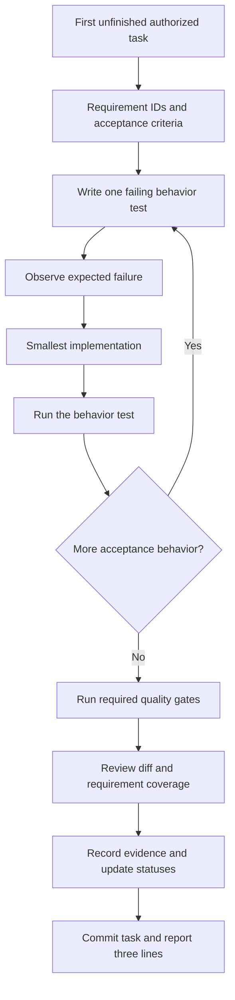

# Flowboard Development Workflow

This is the operating procedure for a human or AI implementing Flowboard. Its purpose is to carry one requirement from the brief to working behavior, verified evidence and a reviewable commit. It does not authorize starting implementation: the user has authorized the Phase 0 monorepo, shared configuration and application-shell setup.

## 1. Read the right source

| Question                           | Authoritative source                                                              |
| ---------------------------------- | --------------------------------------------------------------------------------- |
| What did the user request?         | Latest direct user instructions, then [REQUIREMENTS.md](REQUIREMENTS.md)          |
| What design will implement it?     | [PLAN.md](PLAN.md) and recorded choices in [DECISIONS.md](DECISIONS.md)           |
| Where does a change belong?        | [ARCHITECTURE.md](../ARCHITECTURE.md)                                             |
| Which requirement does it satisfy? | [REQUIREMENTS_MATRIX.md](REQUIREMENTS_MATRIX.md)                                  |
| What can I work on next?           | [TASKS.md](TASKS.md) in document order                                            |
| What rules apply to the work?      | [AGENTS.md](../AGENTS.md) and [QUALITY_GATES.md](QUALITY_GATES.md)                |
| What has actually been checked?    | Task evidence under [evidence/](evidence/README.md) and its associated Git commit |

These files have different jobs. Do not copy entire requirements into agent instructions or silently change a product rule in an evidence record. If sources conflict, resolve the conflict before dependent work: the latest user instruction wins; preserve a decision trail instead of quietly rewriting the original brief.

## 2. Preflight each task

1. Inspect the working tree, current branch and relevant existing code. Identify unrelated changes and leave them alone. Do not assume an empty repository, clean tree or the same tools as a previous session.
2. Read the first unfinished task and verify each dependency. A checkbox without adequate evidence does not satisfy a dependency.
3. Locate the matching requirement IDs and their verification criteria. Identify architecture rules affected by this change, especially tenant scope, permissions, generated contracts and package imports.
4. State a small work contract: task ID, intended observable behavior, files expected to change, negative cases and validation commands. [TASK_TEMPLATE.md](TASK_TEMPLATE.md) is the format.
5. Check the commands/tools actually exist. Read the relevant package scripts before running them. Never install a different stack, silently substitute a mock DB, or treat unavailable checks as passed.

Choose a sensible local implementation detail yourself and record consequential defaults. Ask the user only for a genuine product ambiguity or an action beyond current authorization. Reading these documents does not create a new approval requirement.

## 3. Execute one vertical slice

The public seams are already selected: pure contracts functions; REST through real PostgreSQL; browser user journeys; client refresh transport; worker event handling. A test should fail because the required behavior is absent, not merely because of a typo or broken test setup. Keep the relevant failure reason in the evidence record. Config/documentation changes use structural or rendering checks instead of artificial application tests.

For an endpoint, build the shared request/response schema, DTO, authorization metadata, service/repository behavior and test in the same task. Export the spec and regenerate the client before completion. Spec-only dependency providers remain isolated from normal runtime code. A fake successful response is never a substitute for an unfinished service.

A later hardening task does not justify a known unsafe first implementation. The first usable write endpoint must enforce permissions and invariants. Later tasks add broader coverage, race tests and recovery behavior.

## 4. Handle changes and failures

| Situation                                      | Required response                                                                                                                                                   |
| ---------------------------------------------- | ------------------------------------------------------------------------------------------------------------------------------------------------------------------- |
| New behavior changes the product               | Update the relevant decision, plan, requirement mapping and task acceptance before implementation. Record whether the source is the user or an engineering default. |
| A needed file was outside the expected list    | Explain why it belongs to this task; update its scope. Do not bundle unrelated cleanup.                                                                             |
| Existing implementation contradicts the design | Reproduce the behavior, inspect callers, then choose a compatible fix or record a deliberate design change.                                                         |
| Required test fails                            | Keep the task incomplete; fix the implementation/test setup, then rerun the failing gate. Never weaken a requirement to get green output.                           |
| Docker/tooling is unavailable                  | Record `not_run` with the reason. Continue independent work, but do not mark an implementation task complete if its mandatory evidence is missing.                  |
| Previously passing behavior regresses          | Reopen the affected task/requirement verification and repair it before proceeding to dependent work.                                                                |
| Requirement is too large for one task          | Split it into ordered sub-tasks with independently safe outcomes; preserve requirement IDs and dependency links.                                                    |
| Temporary incomplete behavior is unavoidable   | Add a concrete `TODO(task-id)` and an unchecked task; do not expose it as functioning product behavior.                                                             |

Do not quarantine/delete a failing test, disable a lint rule, add broad `any`/type suppression, or broaden permissions just to clear a gate. A justified exception must be narrow, documented and accompanied by a regression test; it must not contradict the user's requirements.

## 5. Review before completion

Review the actual diff against both the task and its requirement IDs. Ask:

- Can another tenant or an unauthorized user observe or mutate the new data path?
- Are malformed, empty, missing, stale and conflicting inputs handled at the right boundary?
- Does a config change still leave every affected task valid?
- Do source/destination/anchor/assignee checks run inside the mutation transaction?
- Are failed writes free of partial updates and premature events?
- Are generated files reproducible from the schema, and browser code isolated from backend internals?
- Does the interface show loading/failure/forbidden states and support keyboard use without discarding edits?
- Do evidence records show real commands and current output rather than an earlier run?

For sensitive changes—authentication, tenant filtering, permissions, transactional moves, event delivery—use an independent review when available. A reviewer examines the same task; they do not start the next task or silently expand scope. The implementer still verifies any reviewer suggestion.

## 6. Record, commit and report

Create or update `docs/evidence/<task-id>.md` using the [evidence rules](evidence/README.md). Include the requirement IDs, behavior checks, exact commands/outcomes, environment prerequisites, review result and limitations. Keep secrets and raw personal data out of evidence.

Update the relevant matrix status only as far as proven. A task may verify one part of a requirement spanning several tasks without making the whole requirement `verified`. Tick the task after its mandatory gates pass. Commit its code, generated artifacts, task update and evidence together with the conventional commit message. An evidence file inside that commit identifies it through Git history; avoid self-referential commit hashes.

End with the requested three-line report:

1. `Completed <task-id>: <observable result>.`
2. `Verified: <checks that passed>; <checks not run, if relevant>.`
3. `Next: <next task>, or <specific unresolved blocker>.`

Do not say the app or phase is complete because one test suite passed. Use the [phase and release gates](QUALITY_GATES.md) and the requirement matrix to establish the actual completion boundary.

## 7. Resume after an interruption

Read Git status, the current task, its latest evidence and relevant code; do not trust an old chat summary as the entire repository state. Distinguish committed work, partial edits and unrelated user edits. Re-run checks affected by changes since the recorded verification. Continue the same unfinished task before moving forward. Record any new failure or limitation instead of overwriting the history to imply uninterrupted success.

## 8. Scale the process to this project

Keep this workflow lightweight: one task, one short evidence record, one reviewable commit. No new workflow service, custom agent orchestrator, mandatory external tracker or approval bureaucracy is needed. The repository remains the source of truth; optional tools such as Postman can supplement it without replacing automated contract and behavior tests.
