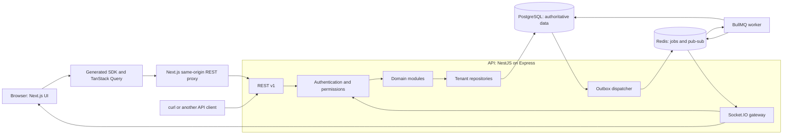
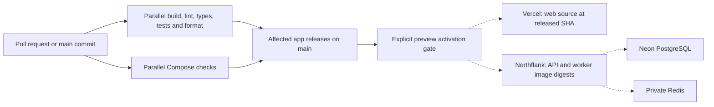

# Flowboard high-level design

As-built reference, 25 October 2026. Implementation baseline: `3cc62b0` (P19-01). This describes the local application, not a claim of live cloud deployment. Start with the [application guide](APPLICATION_GUIDE.md) for a product tour, or the [low-level design](LLD.md) for implementation details. The [delivery summary](DELIVERY_SUMMARY.md) distinguishes completed work from open gates.

Current source links follow the P21-01 UI module layout; the described public behavior is unchanged by that refactor.

The [diagram atlas](DIAGRAMS.md) provides focused rendered views and editable Mermaid sources, separating current implementation from hosting and promotion plans.

## Purpose and scope

Flowboard is a self-hosted project management application: workspaces contain spaces, folders, lists and tasks. Lists support a board and a table over the same records. Statuses and custom fields inherit through the hierarchy. Users collaborate within workspace and container permissions; edits update other authorized clients and status changes produce a durable activity feed.

The architecture favors a modular monolith with one database transaction boundary. Web, API and worker are separate processes and release units. Backend domain modules remain in one API so permission, configuration and task consistency can be enforced together. It does not reproduce the private architecture of ClickUp, Asana or Linear; [public research](REFERENCE_ARCHITECTURES.md) informed the interaction and domain choices.

## System context

REST is the shared contract for the web app and second-channel clients. The web proxy provides a fixed upstream and same-origin cookie boundary; it contains no task/domain implementation. WebSockets deliver invalidation signals rather than another editable copy of task state. Clients reread authorized REST data after those signals.

## Responsibilities and boundaries

| Area             | Owns                                                                                        | Boundary                                                                            |
| ---------------- | ------------------------------------------------------------------------------------------- | ----------------------------------------------------------------------------------- |
| Web              | Routes, session lifecycle, scoped query cache, domain forms and optimistic interaction      | Uses generated API operations; cannot import the API app or raw persistence.        |
| Shared UI        | Theme, controls, composed views, Data Grid and notification presentation                    | Plain props/callbacks; no sessions, API requests or permission decisions.           |
| Shared forms     | React Hook Form bindings and safe JSON field presentation                                   | Reuses UI; web chooses domain schemas, defaults, submissions and conflict policy.   |
| Contracts        | Zod schemas/types, enums, errors, pagination, events and pure resolution                    | Imports Zod and its own files only; no framework or I/O.                            |
| API              | Authentication, authorization, REST/WebSocket boundaries and domain orchestration           | Verifies current DB identity; services call repository capabilities.                |
| Database         | Prisma, migrations, SQL, identity access, tenant transactions and outbox records            | Sole raw database owner; tenant repositories fail closed outside their transaction. |
| Worker           | Validates persisted event references, writes activity idempotently, publishes invalidations | Jobs carry references; the database remains authoritative.                          |
| Delivery tooling | App dependency graphs, releases, images and preview deployment orchestration                | Runs in CI/operations; not an application runtime dependency.                       |

The [package inventory](APPLICATION_GUIDE.md#workspace-packages) explains all 15 workspaces. The [architecture reference](../ARCHITECTURE.md) remains the change-impact map and [agent guides](agents/README.md) explain coding rules.

## Domain and data ownership

| Concept        | Design                                                                                                                             |
| -------------- | ---------------------------------------------------------------------------------------------------------------------------------- |
| Identity       | A global user can belong to multiple workspaces. Membership provides the role for a particular workspace.                          |
| Hierarchy      | Workspace is the tenant root; stored nodes represent space, folder and list. Tasks belong to a primary list.                       |
| Access         | Public/private visibility and allow/deny grants apply along the ancestor path. Admin bypass remains inside the selected workspace. |
| Status         | Stable status identity is separate from scoped display overrides. A list resolves an effective status set.                         |
| Custom field   | Nearest complete definition wins by key; task values are validated against the destination list's effective schema.                |
| Change history | Task state and outbox intent commit atomically. Worker activity uses the event identity to prevent duplicates.                     |

Every tenant-owned record carries `workspaceId`, and composite relationships prevent cross-workspace links. Global user, refresh-session and seed metadata have deliberately separate access paths. All 15 persisted models have server-owned creation/update timestamps. The [LLD](LLD.md#data-model-and-relations) gives the relationship map; the [database specification](DATABASE_DESIGN.md) and [field reference](FIELD_REFERENCE.md) retain the complete dictionaries.

## Main read and write flows

**Load a list.** A session selects a workspace. The API checks membership and visible ancestors. Web reads resolved statuses, fields and cursor-paginated tasks through generated query options. It displays a result only when scope and configuration/data revisions agree. Board columns come from resolved statuses, including empty columns. The table uses the same tasks, with server sort/filter and a local Data Grid paginator over loaded rows.

**Edit or move a task.** The UI sends expected versions and an explicit destination/placement. The API checks access, then locks the workspace and reloads membership, permissions and configuration inside the write transaction. It validates the full result, changes task/order versions and inserts outbox events. Invalid input, forbidden access or stale versions produce typed errors. The UI preserves the draft or rolls back its optimistic placement and rereads current data.

**Notify collaborators.** The dispatcher leases committed outbox rows and queues event references. The worker reads the persisted event, writes status-change activity once and publishes a trusted internal notification. Gateways recheck each recipient before emitting minimal invalidations. Clients refetch; they do not trust an event as a task snapshot. The [LLD sequences](LLD.md#task-mutation-and-event-sequence) show these steps and retry boundaries.

## Security and consistency model

- Access JWTs are short-lived and kept in browser memory. Opaque refresh credentials use host-only httpOnly cookies, stored digests, rotation and replay revocation. Cookie actions enforce allowed Origin; HTTPS cookies are Secure.
- The server resolves acting identity, workspace and current role from verified credentials and DB state. Bodies may name an explicit target, but cannot supply acting authority.
- A member must pass every ancestor's visibility check. Same-workspace denials return 403; foreign/missing resource IDs return 404. Unavailable task status IDs are closed-set validation errors, not record-existence probes.
- Reads use transaction snapshots. Writes serialize on the workspace row and revalidate inside the transaction. Task/config/data versions prevent stale edits and mixed-page results.
- Schemas bound inputs, pagination and errors. Safe Markdown disables raw HTML. Pino logging excludes credentials and task content by default.
- Public socket messages contain only authorized invalidation metadata. Room membership, token lifetime and current access are checked; reconnect restores state through REST.

## Runtime and deployment topology

Local Compose runs `web`, `api`, `worker`, `postgres` and `redis`, with dependency-aware healthchecks, persistent data and migration/seed initialization. Multi-stage app images use Turbo pruning and non-root runners. Development overrides provide code reload and optional local datastore ports. Public local URLs use `localhost`; internal container connections use service names.

Dashed hosting edges describe the existing Vercel/Northflank adapter, not a verified live deployment. The subsequently selected [Render topology](RENDER.md) remains a plan pending adapter implementation. Release planning/publication and preview orchestration are implemented; first real publication and provider activation remain open. Current Vercel preview deployment rebuilds released source. Promoting a single immutable artifact through dev/qa/stage/prod remains planned. See [delivery](DELIVERY.md), [CI/CD](CI_CD.md), [promotion](PROMOTION.md) and the [open-gate list](DELIVERY_SUMMARY.md#open-gates-and-limits).

## Scale, reliability and tradeoffs

| Choice                                   | Benefit at hobby scale                                                    | Cost or next step                                                                       |
| ---------------------------------------- | ------------------------------------------------------------------------- | --------------------------------------------------------------------------------------- |
| Modular API with one PostgreSQL boundary | Permission, field/status policy and task writes stay atomic.              | Split services only when ownership/workload justifies a new consistency design.         |
| Workspace-wide write lock                | Straightforward race prevention for inherited configuration and ordering. | Serializes writes within a busy workspace.                                              |
| Dense integer ordering                   | Predictable move/reorder rules and simple reads.                          | Rewrites affected siblings; fractional ordering is a future option.                     |
| JSONB custom-field values                | Flexible per-list schemas with one task record.                           | Parameterized filtering exists; targeted GIN/expression indexes need workload evidence. |
| Workspace graph reads                    | Simple complete ancestor permission/resolution evaluation.                | Large trees need more selective traversal/caching.                                      |
| Durable outbox plus idempotent worker    | Database commit survives queue/publish failures.                          | At-least-once processing needs leases, retries and deduplication.                       |
| Socket invalidations                     | Small messages and authoritative permission-checked reads.                | Redis Pub/Sub is not a replay log; reconnect must refetch.                              |
| Shared source packages                   | One contract and design system across consumers.                          | Contract changes require regeneration and compatibility discipline.                     |

API instances can scale horizontally with common PostgreSQL/Redis and the Socket.IO Redis adapter. WebSocket-only transport avoids polling affinity; enabling long polling would need load-balancer stickiness. These are design properties, not throughput measurements. OIDC, teams, restore, uploads, search and a webhook sender remain future capabilities. There is no offline conflict-resolution engine or claimed multi-region replication.

## Verification boundary

[P19-01](evidence/P19-01.md) records the baseline's 1,066 passing tests, including 28 stories and 156 web checks. [P12-03](evidence/P12-03.md) is the historical clean-checkout/container acceptance record; it is not a fresh image run for P19/P20. This documentation task validates source consistency, links and formatting. The [matrix](REQUIREMENTS_MATRIX.md) and [task evidence](evidence/README.md) govern completion claims.
