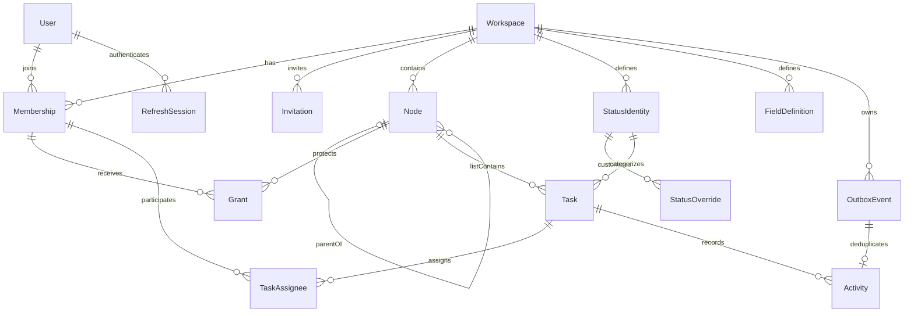
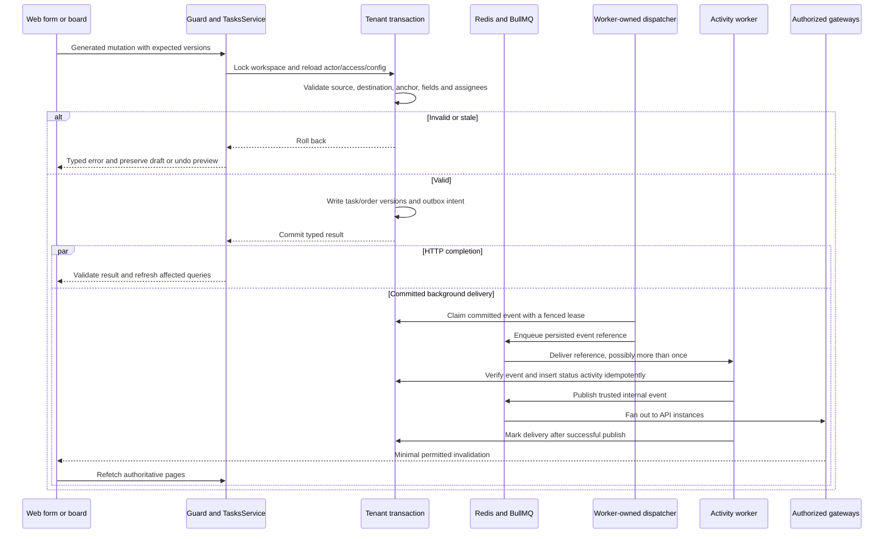

# Flowboard low-level design

Core baseline: `3cc62b0` (P19-01). Deployment/runtime review: `507a0a8`, 26 October 2026, including P38 worker ownership and the verified temporary demo. Read [HLD](HLD.md) first. This document explains implementation seams and invariants; [field reference](FIELD_REFERENCE.md), [database design](DATABASE_DESIGN.md), [API catalog](API_CATALOG.md) and generated [OpenAPI](../packages/openapi/openapi.json) retain the exhaustive definitions.

Current UI source links follow the P21-01 camelCase/module refactor, which preserves these public contracts.

The [diagram atlas](DIAGRAMS.md) provides focused rendered views and editable Mermaid sources, separating current implementation from hosting and promotion plans.

## Source map and dependency direction

| Concern                          | Implementation                                           | Responsibility                                                                                                                                     |
| -------------------------------- | -------------------------------------------------------- | -------------------------------------------------------------------------------------------------------------------------------------------------- |
| Transport contracts              | [contracts/src](../packages/contracts/src)               | Strict Zod request/response/event schemas and inferred types.                                                                                      |
| REST features                    | [api/src/modules](../apps/api/src/modules)               | Auth, workspaces, hierarchy, permissions, statuses, fields, tasks, activity, realtime and platform; outbox compatibility exports remain for tests. |
| Shared dispatch                  | [jobs/src](../packages/jobs/src)                         | Outbox polling, lease fencing, queue publication, health and cleanup without a Nest dependency.                                                    |
| Worker process                   | [worker/src](../apps/worker/src)                         | Owns shared dispatch, BullMQ consumption, activity persistence and invalidation publication.                                                       |
| HTTP infrastructure              | [api/src/core](../apps/api/src/core)                     | Configuration, cursor codec, shared decorators, errors, Swagger and validation infrastructure.                                                     |
| Persistence                      | [database/src](../packages/database/src)                 | Tenant/identity capabilities, repositories, migrations, ordering, events and seed.                                                                 |
| Generated transport              | [api-client/src](../packages/api-client/src)             | Generated operations/options; only transport setup/session helpers are hand-authored.                                                              |
| Web coordination                 | [web/src/features](../apps/web/src/features)             | Query composition, routing, domain forms, optimistic commands and realtime invalidation.                                                           |
| Shared presentation/form binding | [UI](../packages/ui/src), [forms](../packages/forms/src) | Controlled visual components and reusable typed RHF adapters.                                                                                      |

Dependencies flow from apps toward packages. Contracts have no framework/I/O dependencies. API services do not construct Prisma clients; UI does not call the API. `openapi` alone has a documented build-time API entry. See [backend structure](BACKEND_GUIDELINES.md) and [frontend structure](FRONTEND_GUIDELINES.md).

## Data model and relations

The physical schema has 15 models. Domain identifiers are UUIDs; joins may use composite UUID keys and `SeedState.version` is a string primary key. Tenant links use composite workspace keys, and every persisted table has `createdAt`/`updatedAt`. Database constraints/triggers supplement Prisma where needed. Schema source: [schema.prisma](../packages/database/prisma/schema.prisma); SQL source: [migrations](../packages/database/prisma/migrations).

This is a relationship overview, not a full foreign-key diagram. `SeedState` is independent operational metadata; refresh families are global identity records. Status/field owner scope can be workspace or an eligible node, so those scoped links are explained in the full schema rather than represented as one compulsory node edge here.

| Record group                  | Important fields/invariants                                                                                                                                                                                         |
| ----------------------------- | ------------------------------------------------------------------------------------------------------------------------------------------------------------------------------------------------------------------- |
| Workspace/Membership          | Membership is unique per workspace/user; role belongs here, not on User. Workspace tracks configuration/data revisions.                                                                                             |
| Node/Grant                    | Node stores type, parent, name, position, visibility, version and archive time. Space→folder→list parent rules are checked in the transaction. Grants refer to current membership and resource.                     |
| StatusIdentity/StatusOverride | Task references stable status identity. Scoped rows carry display/visibility overrides and never replace the task's identity.                                                                                       |
| FieldDefinition               | Key/type/required/options/owner/position form a complete definition; nearest scope replaces the ancestor definition.                                                                                                |
| Task/TaskAssignee             | Primary list, status identity, title, Markdown, priority, date, JSON values, position, version and audit fields. Assignees must be eligible members.                                                                |
| OutboxEvent/Activity          | Event intent is unique for its aggregate version; activity's event identity prevents duplicate history. Delivery leases are separate from the business transaction.                                                 |
| User/RefreshSession/SeedState | Narrow global identity or operational repositories. Password hashes and refresh digests never appear in responses; access JWTs are deliberate auth responses.                                                       |
| Invitation                    | Tenant-owned invitation with email, target role and expiry. Creation uses membership policy; acceptance crosses a narrow identity boundary. The creation response intentionally returns the one-time sharing token. |

Nodes and tasks archive through `archivedAt`; public delete does not erase historical activity. Descendant/task effects are validated and committed atomically. Workspace roots now have administrator recovery; container/task restoration remains outside the implemented API.

## Request boundary and API contracts

1. The controller uses a `nestjs-zod` DTO derived from a shared schema. Strict parsing rejects unexpected fields, including forged acting identity and audit values.
2. Authentication verifies the JWT and live session. The permission guard/service resolves the requested resource and current role. Public health/auth routes are explicit exceptions.
3. The service coordinates the operation; the tenant repository reads/writes inside the required transaction and repeats mutable access/configuration checks.
4. Typed response serialization and Swagger metadata describe the outgoing contract. The global [exception filter](../apps/api/src/core/common/filters/http-exception.filter.ts) sanitizes failures into `{ error: { code, message, details? } }`.
5. Spec-only [bootstrap](../apps/api/src/spec-bootstrap.ts) exports the real controller/DTO registry without connecting to DB/Redis. `pnpm gen:api` regenerates the committed spec/client. Drift and convention checks are separate commands.

The committed spec at this review contains 49 OpenAPI operations across 36 paths, including two health operations outside `/v1`. Entity responses use `{data}`, paginated responses use `{items,pageInfo}`, and resolved collections carry configuration revisions. `204` has no body. Read the [catalog](API_CATALOG.md) for each method, operationId, schema and permission policy.

| Failure     | Contract meaning                                                                                                              |
| ----------- | ----------------------------------------------------------------------------------------------------------------------------- |
| 400         | Invalid input, unavailable task status, invalid cursor/field value or hierarchy/placement input. Field errors include a path. |
| 401         | Missing/invalid/expired authentication. Client refresh is coordinated and retried at most once.                               |
| 403         | Authenticated actor lacks same-tenant access or current membership; forbidden Origin also fails closed.                       |
| 404         | Missing, archived or foreign-tenant resource/relation identifier.                                                             |
| 409         | Stale versions/cursors, in-use configuration, unsafe configuration change or other documented conflict.                       |
| 413/429/503 | Bounded payload, rate limit or unavailable dependency; retry policy stays explicit.                                           |

## Tenant transactions and permissions

[createDatabase](../packages/database/src/tenant-database.ts) exposes scoped read/write capabilities. Reads use read-only RepeatableRead transactions and reload membership. Writes lock the workspace row, reload membership and use ReadCommitted under that lock. A repository handle cannot be used after its transaction ends.

[PermissionService](../apps/api/src/modules/permissions/permission.service.ts) and [PermissionGuard](../apps/api/src/modules/permissions/permission.guard.ts) are the shared access policy. An admin bypasses visibility inside the active workspace. A member needs access at every ancestor: denies block, and each private ancestor needs an allow. Members may edit visible tasks; hierarchy, grants and raw status/field configuration are admin operations. Services recheck access inside the transaction to close the gap between initial guard evaluation and mutation.

Source, destination, anchor and assignee relationships are validated in the same tenant scope. A foreign ID cannot be used to discover or link another tenant's data. The special task `statusId` input is checked only against the destination's resolved set and returns 400 if unavailable, without probing a global status table for the caller.

## Authentication and session lifecycle

[AuthService](../apps/api/src/modules/auth/auth.service.ts) issues HS256 access JWTs carrying subject, session-family ID and active workspace. Their lifetime is at most 15 minutes; refresh families have a fixed seven-day lifetime. [Password hashing](../packages/database/src/password.ts) uses Argon2id. [Identity persistence](../packages/database/src/identity.ts) stores opaque refresh-token digests and rotates them atomically; replay revokes the family.

The host-only refresh cookie uses HttpOnly, Path=/ and SameSite=Lax, with Secure outside explicit local development. Cookie endpoints require an allowed Origin, including cookbook requests. Login/signup are public but bounded; domain access remains guarded. Workspace switching checks membership and changes the family's active workspace, making old-workspace access invalid.

[setup-client.ts](../packages/api-client/src/setup-client.ts) attaches in-memory access tokens to generated requests. A 401 coordinates one refresh and one retry; failure closes the session. [Session synchronization](../packages/api-client/src/session-sync.ts) uses Web Locks and revision signals, not stored access/refresh credentials. Identity/workspace changes fence stale requests and clear query data, drafts, notifications and sockets. The [Next proxy](../apps/web/src/server/apiProxy.ts) forwards to a validated fixed upstream; it does not implement auth/domain policy itself.

## Status and field resolution

| Algorithm         | Exact policy                                                                                                                                                                                                                                                                           | Source                                                                 |
| ----------------- | -------------------------------------------------------------------------------------------------------------------------------------------------------------------------------------------------------------------------------------------------------------------------------------- | ---------------------------------------------------------------------- |
| Status resolution | Walk workspace→space→folder→list. Merge by key/stable identity. Nearest non-null display values win; null inherits. Hidden state can hide or restore; provenance records where attributes came from. Sort deterministically. Every effective set retains not_started, active and done. | [status-resolution.ts](../packages/contracts/src/status-resolution.ts) |
| Field resolution  | Walk the same scopes. Nearest complete definition wins by key, including its type/options/required flag; there is no partial options merge.                                                                                                                                            | [field-resolution.ts](../packages/contracts/src/field-resolution.ts)   |
| Field values      | Validate against the resolved schema. Unknown keys, wrong types/options and missing required values fail. Zero and false are valid values. Omission preserves a PATCH value; explicit null clears an optional value.                                                                   | [field-values.ts](../packages/contracts/src/field-values.ts)           |
| Move status       | Keep an available status; otherwise choose the first destination status in the same category, ordered by position/key/ID. No category match rejects. An explicitly supplied unavailable status also rejects.                                                                           | [task-moves.ts](../packages/contracts/src/task-moves.ts)               |

[Status](../packages/database/src/status-repository.ts) and [field](../packages/database/src/field-repository.ts) configuration writes validate every affected descendant and live task before commit. Deleting/hiding an in-use status or changing/removing fields into an invalid resulting schema returns a conflict. Removing an override may reveal an ancestor, so fallback is validated too.

## Task mutation and event sequence

[TasksService](../apps/api/src/modules/tasks/tasks.service.ts) coordinates authorization. [task-repository.ts](../packages/database/src/task-repository.ts) checks expected task/configuration versions, validates the resulting values, applies dense ordering and updates task versions. [task-events.ts](../packages/database/src/task-events.ts) advances workspace `dataVersion` and records those supplied task versions in outbox intent within the transaction. Renumbered siblings are included in `changedTaskIds`; canonical no-ops do not manufacture versions/history. Cross-list moves revalidate status, required fields and source-only values before writing either list.

Subtasks use nullable `parentTaskId` in this same repository. The composite self-FK preserves workspace/list ownership; locked validation permits only a live top-level parent and rejects nesting a task with children. Submitted parent IDs pass PermissionService, and the child-page filter is part of the cursor fingerprint. Cross-list moves reject linked tasks; task-only parent archive rejects live children. Historical parent references remain after archive and are validated by workspace when consuming events. See [subtask policy and rollout](SUBTASKS.md).

## Pagination and web state

[Cursor encoding](../apps/api/src/core/common/cursor.ts) authenticates bounded opaque cursors. Task cursors bind actor, workspace, list, query and configuration/data revisions; they expire after 15 minutes. Collection APIs use cursor/limit, not offset/page. A changed snapshot returns `CURSOR_STALE` and restarts from the first page. Due-date sorting puts nulls last; stable IDs break ties.

Web extends generated query keys with session/user/workspace scope. Board and table assemblers verify response identities, revisions and field/status validity before display. Bounded retries prevent an endless changing-snapshot loop. URL state owns view/sort/filter; server data remains in TanStack Query. Optimistic placement is separate from canonical fetched data and cannot overwrite a newer confirmed result. Dirty drawers retain edits until an explicit conflict reload.

The task drawer reuses its dirty/busy navigation gate for parent and child links. `task-form-data.ts` owns the initial parent, omission on unrelated edits and explicit null detachment; `task-parent-field.tsx` preserves the selected ID outside loaded choices. `use-list-related-tasks-infinite-query.ts` reads bounded generated task pages, checks scope/filter/revision continuity and restarts stale chains. Local mutations and realtime invalidations refresh relations independently of the editable form baseline. The drawer retains the original board/table focus target across related navigation.

[TaskTable](../packages/ui/src/modules/tasks/TaskTable.tsx) is a presentational Community Data Grid. Its 25/50/100-row paginator only selects already-loaded rows; **Load more tasks** still performs a cursor request. Grid-local sort/filter is disabled. Stable IDs, title-button `tabIndex`, focus-return attributes and [measured rem geometry](../packages/ui/src/hooks/useRemSize.ts) preserve keyboard and font behavior.

## Async delivery, recovery and notifications

[Worker-owned outbox dispatcher](../packages/jobs/src/outbox.service.ts) leases due records via [outbox-repository.ts](../packages/database/src/outbox-repository.ts), using locking/lease fencing. Queue payloads contain only `{schemaVersion,eventId,workspaceId}`. [Activity processor](../apps/worker/src/activity.processor.ts) verifies those references against persistence; [event-consumer-repository.ts](../packages/database/src/event-consumer-repository.ts) prevents duplicate status activity and fences completion. Other supported events still publish invalidations without inventing status history.

Transient failures retry with capped backoff, even when the activity already exists. Malformed persisted events are quarantined as `failed` and excluded from automatic claims. This provides at-least-once work with idempotent effects, not a claim of exactly-once network delivery. `delivered` means successful internal publication, not receipt by a browser. An expired lease cannot complete a newer lease's work. Redis outage lowers readiness; services reconnect, and disconnected browser clients resync through REST. Shutdown drains/cleans up owned resources; tests exercise those paths.

Gateways authenticate JWTs, validate Origins, authorize subscriptions and recheck recipients before emitting. Public messages do not carry task content or inaccessible destination IDs. The optional recipient-relative `self` flag is negotiated for notification-capable clients; older clients retain the previous payload shape. Web deduplicates invalidations and clears listeners on scope changes. A successful current-connection subscription acknowledgement triggers another REST resync, catching writes committed during asynchronous authorization/join. Acknowledgements for disposed connections or no-longer-requested lists are ignored. Toastify renders action outcomes and eligible remote notices, while durable history remains the activity feed.

## Runtime startup and deployment wiring

[API startup](../apps/api/src/main.ts) validates configuration, runs database initialization, constructs request/auth/socket services, then listens. It does not construct the normal outbox runtime. The API `modules/outbox` exports preserve optional test injection into the application factory; they do not transfer production polling back to HTTP functions. [Spec bootstrap](../apps/api/src/spec-bootstrap.ts) remains separate and connects to neither database nor Redis.

[Worker startup](../apps/worker/src/main.ts) composes the activity consumer and shared jobs runtime. [Lifecycle coordination](../apps/worker/src/runtime.ts) waits for the consumer, starts dispatch, then waits for dispatch readiness. Startup failure and shutdown close both; readiness includes both components. The worker owns continuous polling because a Vercel API function can suspend after its request finishes. Shutdown and retry behavior remain part of the shared lifecycle and database fencing, not an in-memory promise attached to a request.

[Database initialization](../packages/database/src/initialize.ts) uses a dedicated PostgreSQL advisory lock, checked-in migrations and conditional demo seeding. `DATABASE_URL_UNPOOLED` selects the direct migration/lock connection when present; application repositories use pooled `DATABASE_URL`. [The client](../packages/database/src/client.ts) uses Prisma's `@prisma/adapter-pg` and `pg`, with a maximum of ten connections per client. This is the existing Node/PostgreSQL architecture; no Neon HTTP driver or Edge runtime is introduced. Connection counts must be considered across all API/worker instances.

| Mode                       | Startup and configuration boundary                                                                                                                                                                                                                                                  |
| -------------------------- | ----------------------------------------------------------------------------------------------------------------------------------------------------------------------------------------------------------------------------------------------------------------------------------- |
| Full local Compose preview | PostgreSQL/Redis become healthy, API migrates/seeds, then dependent apps start. Defaults require no manual env file; secrets and production URLs are unnecessary.                                                                                                                   |
| Native development         | Only PostgreSQL/Redis run in Docker. App-specific local files configure native processes; initialize an empty database through the API once before `pnpm run dev` starts all three apps.                                                                                            |
| Temporary Vercel demo      | Server-only project settings provide Neon/Upstash/auth values; web receives its private API binding at runtime. The database must be initialized before the daemon consumes events; do not assume Compose dependency ordering exists on Vercel. Hosted demo seeding stays disabled. |
| Future ECR production      | Per-app images and unchanged-digest promotion are planned. Inject settings/secrets at startup; the AWS runtime and registry integration are not configured.                                                                                                                         |

See [run modes](RUN_AND_DEPLOY.md) for exact local commands. The current [root API](../Dockerfile.api) and [worker](../Dockerfile.worker) Dockerfiles use Turbo pruning and repository-root build context for both Compose and Vercel. The [web Dockerfile](../apps/web/Dockerfile) supports Compose/image releases; the Vercel web service instead uses the native Next.js source builder. Current release publication targets GHCR, so the temporary source-built demo does not prove future ECR image promotion.

The planned ECR deployer consumes the existing per-app release plan: jobs/database/logger changes select API and worker, UI/forms/client changes select web, and contracts currently select all three. Build-only API/spec generation does not select web by itself. Pin the selected app versions and digests, compare them with each target's recorded image/configuration state, and update only differences. Retain unselected services at their existing target versions. Promote the same selected digests through dev/qa/stage/prod; a configuration-only change reuses its service's existing image. Compatibility checks, serialized target writes and resumable partial failures belong to the future deployer/promoter, not the current Vercel adapter. [The promotion contract](PROMOTION.md) specifies those requirements; P39-02/P00-11/P00-12 remain open.

### Public requests and private bindings

1. Browser requests use the generated client with base `/api`, producing `/api/v1/...` on the web origin. The [Next.js proxy](../apps/web/src/server/apiProxy.ts) forwards only the allowed request shape to `/v1/...` on runtime `API_INTERNAL_URL`; it owns no domain logic.
2. In Vercel, the sole service binding is web → api. It is injected into server request handling, never a browser bundle, build step or middleware. REST remains internal behind web; local direct API tools may use `http://localhost:3001/v1`.
3. Explicit public `/docs`, `/docs/*`, `/docs-json`, `/docs-yaml`, `/health/live`, `/health/ready` and `/socket.io/*` rewrites go to API before the catch-all goes to web. Swagger is opt-in via `API_DOCS=true`; `API_DOCS_BASE_PATH=/api` controls its runtime document without changing the committed spec. Browser sockets use the public project origin, WebSocket transport and an in-memory JWT; API guards still verify session, membership and subscription access.
4. Refresh cookies belong to the web origin, with the existing proxy allowlists and Origin checks. Neon URLs, Redis credentials and signing secrets remain server-only. The worker has no public ingress and no service binding; it uses PostgreSQL and Redis directly.

The [Vercel configuration](../vercel.json) declares a 1 GiB worker daemon in `iad1`. Vercel's technical production target is needed for that daemon; it is still a temporary project demo. Automatic Vercel Git deployments are disabled. The repository's separate main-only deployment job waits for checks/publication and remains gated by protected settings. P38-03 is evidence of the manual live rollout, not evidence that protected GitHub CD has run.

## Tests and limits

The [delivery summary](DELIVERY_SUMMARY.md#verification-and-execution-record) links the recorded pure-contract, real-PostgreSQL/API, worker and browser verification. Important cases include foreign IDs, private ancestors, stale configuration, status/field deletion in use, move rollback, refresh replay, duplicate delivery and dirty drafts. P20 and the [P39-03 deployment refresh](evidence/P39-03.md) check documentation; [P38-03](evidence/P38-03.md) records the separate live demo verification.

Deliberate limits are workspace-wide write serialization, dense reordering, bounded page chains, whole-workspace tree evaluation, and no durable socket replay. Search, general container/task restoration, OIDC, teams, outgoing webhooks and immutable multi-environment promotion are not implemented by these flows. See [open gates](DELIVERY_SUMMARY.md#open-gates-and-limits).

Workspace root read/rename/archive use the ordinary tenant boundary. Session-only restore uses a narrow identity-repository operation, with target administrator checks in the central permission service and repeated under user → workspace locks. See [lifecycle contracts](WORKSPACE_LIFECYCLE.md#contracts-and-modules). The management UI keeps a fixed revision for a dirty form; explicit reload disables editing while its read is pending. A refreshed archive-state change clears scoped queries and notifications and unmounts workspace views. Initial archived socket rejection carries only a sanitized code that triggers session refresh; ordinary network errors retain reconnect behavior.
