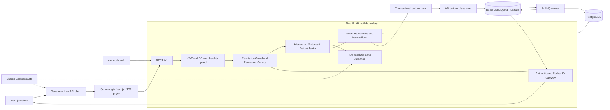

# Flowboard Implementation Plan

**Status:** Foundation present; backend/database/API and UI design documents reviewed. Updated 23 October 2026. The user authorized database, migrations and seed implementation followed by typed login and token flows.
**Goal:** Build a self-hosted project manager that teaches sound architecture while remaining manageable as a hobby project.
**Architecture:** A modular NestJS API and separate BullMQ worker share PostgreSQL persistence. A Next.js client uses generated REST clients and Socket.IO invalidations. Shared packages contain framework-independent contracts, pure resolution functions, and presentational UI.
**Stack:** pnpm, Turborepo, TypeScript, Next.js App Router, MUI, React Hook Form, Zod, TanStack Query, Hey API, NestJS, Prisma, PostgreSQL, Redis, Socket.IO, BullMQ, Jest, Supertest, Playwright.
**Requirements:** [REQUIREMENTS.md](REQUIREMENTS.md). Execution backlog: [TASKS.md](TASKS.md). Chosen defaults: [DECISIONS.md](DECISIONS.md). Agent rules: [../AGENTS.md](../AGENTS.md).

**Delivery harness:** [Architecture reference](../ARCHITECTURE.md), [requirement traceability](REQUIREMENTS_MATRIX.md), [development workflow](DEVELOPMENT_WORKFLOW.md), [quality gates](QUALITY_GATES.md), [templates](TASK_TEMPLATE.md), and [verification evidence](evidence/README.md). These organize implementation and proof without changing the product scope. Automated enforcement arrives in the tasks identified by the gate catalogue.

**Architecture detail:** [Comparable-product research](REFERENCE_ARCHITECTURES.md) separates published facts from proposed choices. [System design](SYSTEM_DESIGN.md) expands UI composition, database constraints/indexes, pagination, transaction flows and failure recovery. D57/P07-04 correct the hosted browser cookie boundary; the remaining domain scope is unchanged.

Implementation follows the task order, one task at a time. Future agentic workers should use the executing-plans workflow or a sequential implementer/reviewer workflow; parallel review is allowed, parallel implementation of separate backlog tasks is not. The user's latest instruction authorizes the foundation setup through shared configuration and Next.js/NestJS shells, with a commit after each task. The 23 October follow-up authorizes Docker and independent application releases (P00-04 through P00-06); domain implementation remains subsequent work. See [DELIVERY.md](DELIVERY.md) for release and hosted-environment behavior.

The implementation-ready [database and ER specification](DATABASE_DESIGN.md) defines all records, tenant keys, migrations and transaction invariants.

The [REST API catalog](API_CATALOG.md) lists operation IDs, schemas, permissions, errors and pagination for backend implementation.

The [Linear-inspired MUI guide](UI_DESIGN.md) maps public UI patterns to our components, screens, state and accessibility tests.

[Workspace RBAC and DTO/entity design](BACKEND_CONTRACTS.md) specifies workspace field inheritance, audit timestamps and decorator-driven Swagger → generated Next.js contracts.

P02-04 completed Swagger operation summaries/descriptions and schema/header/request/response examples through shared Zod metadata and Nest documentation decorators. The next user follow-up prioritizes P02-05: [feature-based backend rules](BACKEND_GUIDELINES.md) based on the supplied NestJS structure article. P02-06 aligns auth/platform modules, extracts common config/utilities/infrastructure and separates tests before P02-03 membership work. D86 records that common-folder choice; P02-13/D93 later separates config/utils/shared and moves features under modules.

P02-07 applies the user's blank-line convention after exported declarations, including NestJS module classes, through shared lint presets. It precedes further feature work and preserves runtime code and generated contracts (D87).

## 1. Scope and success

Deliver all requested hierarchy, authentication, tenancy, permissions, tasks, inherited configuration, board/list/drawer views, realtime, activity, generated contracts, seed data, and tests. The release runs with `docker compose up --build` and needs no host Node installation. Docker itself is a prerequisite.

Do not add billing, teams, email delivery, full-text search, file uploads, offline sync, production OIDC, public sharing, or a webhook delivery service. Invitations are expiring links returned to an admin for manual sharing; documentation contains webhook-shaped event examples. The search-index stub must be explicitly labeled and tracked; it must never claim searchable indexing exists.

## 2. Architecture and trust boundaries

PostgreSQL is authoritative. Redis provides queue transport and socket fanout; it is not the source of truth for tasks or permissions. Read paths initially resolve configuration from PostgreSQL without an application cache. This avoids invalidation complexity until measurements justify caching.

Feature source lives under `apps/api/src/modules/<feature>/` (D93). Auth and platform stay flat with grouped DTOs, feature settings and colocated `.unit.spec.mjs`/`.integration.spec.mjs` tests (D89/D90/D92); helpers and bootstrap tests remain under `test/`. P02-16/D96 adapts the requested feature-first article: foundations live in `src/core/{common,config,utils}`, while SharedModule and logging remain in `src/shared/`. Core cannot import shared/features, and shared cannot import features. Runtime and spec bootstrap explicitly use Express. Persistence remains in `packages/database`.

### Package ownership

| Path                         | Responsibility and permitted dependencies                                                                                                                                             |
| ---------------------------- | ------------------------------------------------------------------------------------------------------------------------------------------------------------------------------------- |
| `apps/api`                   | REST, authentication, permissions, orchestration, Socket.IO, outbox dispatch. Imports contracts, database and logger, never web/worker/client.                                        |
| `apps/worker`                | BullMQ activity processing and explicit search stub. Imports contracts/database/logger, never another app.                                                                            |
| `apps/web`                   | Routes, auth state, data hooks, board/list/drawer/config composition. Imports contracts/ui/api-client.                                                                                |
| `packages/contracts`         | Zod schemas, inferred types, enums, errors, pagination, event schemas, pure resolution/validation. Only external runtime dependency is Zod; no framework or other workspace imports.  |
| `packages/database`          | Prisma schema, migrations, seed, generated Prisma client, tenant repositories and transaction helpers shared by API/worker. Imports contracts and logger.                             |
| `packages/logger`            | Pino-backed structured logs and Node async request context shared by API/database/worker; no framework or other workspace imports.                                                    |
| `packages/openapi`           | Export, normalization, lint and drift checks for the API spec. Sole build-tool exception: imports API's exported spec bootstrap; never shipped into a browser/runtime API dependency. |
| `packages/api-client`        | Committed `src/generated/**` from Hey API; separate handwritten `src/setup-client.ts`. Exports SDK, types, query/mutation options.                                                    |
| `packages/ui`                | MUI theme/provider and presentational components; only contracts and UI libraries. No network, auth, Prisma, or app imports.                                                          |
| `packages/config-typescript` | Base, Node/Nest, Next, library compiler settings.                                                                                                                                     |
| `packages/config-eslint`     | Flat config, import ordering, package boundaries and restricted imports.                                                                                                              |
| `packages/config-prettier`   | Shared formatting rules for all workspaces and root documentation/configuration.                                                                                                      |
| `packages/config-jest`       | Shared test presets and test environment conventions.                                                                                                                                 |

All workspaces have `package.json`, explicit `exports`, a local `tsconfig`, and a real build or config-copy step. Config packages publish configuration subpaths; applications are private and expose only intentional tooling entry points. Public imports use package exports, never `../../other-package/src`.

All authored workspaces and root tooling use ESM with explicit module manifests and verbatim TypeScript syntax (D95). Keep NodeNext for Node-compatible output and ESNext/Bundler for Next.js. Shared lint rejects CommonJS loading/exports; compiler fixtures verify actual ESM execution and reject accidental CommonJS rewriting. Generated framework/vendor internals remain managed by their tools.

Shared Node, React and Next lint presets also enforce readable control-flow spacing (P02-17/D97): blank lines after complete if/else chains and before returns, plus after returns where another statement follows. Keep closing braces and else clauses attached and retain the existing export/module spacing. Autofix must preserve syntax and remain stable under Prettier.

Host development uses `localhost` for application URLs, default listeners and local datastore connection examples (P02-18/D98). Docker keeps numeric loopback port bindings and internal health probes; containers and hosted processes retain their explicit all-interface host override.

Local API/worker development and start scripts load optional per-app `.env` files through Node's native loader, with process variables taking precedence (P02-19/D99). Compose uses root `.env` and Next.js its `.env.local`; private configuration is ignored and excluded from Docker. Examples supply the required local auth settings, and local API startup migrates/seeds against host-accessible Docker datastores.

P02-21 adds an opt-in `compose.dev.yaml` for live code updates in Docker (D100). Development targets retain installed Linux dependencies and writable build output inside each container, mounting only authored source directories read-only. Next.js refreshes the web UI; dependency-aware Turbo watch rebuilds shared packages and restarts API/worker consumers. Release images and normal Compose remain immutable. Manifest, build-config and Dockerfile edits require an explicit rebuild; this works with the installed Compose 2.20 without a host tool upgrade.

### Module boundaries inside the API

Use feature-owned modules/controllers/services and focused local DTO adapters as specified in [BACKEND_GUIDELINES.md](BACKEND_GUIDELINES.md). Shared schemas, persistence and generated artifacts retain their package ownership. Folder conventions are review rules; only documented executable checks count as automated enforcement.

`core/config` owns reusable application/Redis settings; `core/utils` owns pure helpers; `shared` owns shared Nest modules/logging; `core/common` owns decorators, injection tokens, DTO helpers, exception mapping and Swagger support. Core cannot import shared/features, and shared cannot import features; shared ESLint checks these directions. Features live under `modules`: `platform` owns health and dependency probes; `auth` owns credentials, sessions and token verification; `workspaces` owns membership/invitations; `permissions` owns a single resource authorization policy; `hierarchy` owns container paths and archive operations; `statuses` and `fields` own scoped configuration; `tasks` composes both resolvers inside transactions; `activity` exposes stored events; `realtime` owns authenticated subscriptions and Redis fanout; `outbox` retries committed events.

Controllers translate HTTP and call services; they contain no business rules or Prisma calls. Repositories centralize tenant filters and relation checks. Services orchestrate transactions; pure functions hold deterministic domain logic.

## 3. Data model

Every stored model has immutable createdAt and server-maintained updatedAt, including joins, sessions, events and seed metadata. All IDs are opaque UUIDs. API dates are ISO UTC timestamps, except due dates and date custom fields which are calendar dates (`YYYY-MM-DD`). Ordered positions are integers managed by explicit move APIs. All tenant-owned records and join tables carry `workspaceId`; global `User` and global credential/session identity are exceptions by definition.

| Entity          | Important fields and constraints                                                                                                                                                                                        |
| --------------- | ----------------------------------------------------------------------------------------------------------------------------------------------------------------------------------------------------------------------- |
| User            | `id`, normalized unique `email`, `name`, `passwordHash`, timestamps. Never serialize credential material.                                                                                                               |
| Workspace       | `id`, `name`, `configVersion`, `dataVersion`, timestamps; serves as the tenant root and transaction lock.                                                                                                               |
| Membership      | `workspaceId`, `userId`, `role: admin\|member`; unique pair, scoped per workspace; createdAt/updatedAt.                                                                                                                 |
| RefreshSession  | `id`, `userId`, `familyId`, token digest, expiry, used/revoked timestamps. Global credential record; active workspace always revalidated against Membership.                                                            |
| Invitation      | `id`, `workspaceId`, normalized email, role, token digest, expiry, acceptedAt; admin-created.                                                                                                                           |
| Node            | `id`, `workspaceId`, `name`, `type: space\|folder\|list`, `parentId`, `position`, `visibility`, `archivedAt`, `version`. Root spaces have null parent; workspace is represented as a virtual root in the tree contract. |
| Grant           | `workspaceId`, `resourceId`, `userId`, `mode: allow\|deny`; unique resource/user. FK to current workspace membership.                                                                                                   |
| StatusIdentity  | `id`, `workspaceId`, immutable `key`, immutable `category`; unique workspace/key. This is the task's `statusId`.                                                                                                        |
| StatusOverride  | `id`, `workspaceId`, `statusId`, `ownerType`, `ownerId`, optional name/color/position, nullable `hidden` (null inherits, true hides, false restores). Unique owner/status. Root definitions provide all display fields. |
| FieldDefinition | `id`, `workspaceId`, `key`, `name`, `type`, `required`, options JSON, `ownerType`, `ownerId`, `position`; unique owner/key; workspace ownership is supported.                                                           |
| Task            | Requested fields plus `workspaceId`, `version`, `archivedAt`. `customFields` is JSONB. `statusId` references stable identity; `primaryListId` references a list.                                                        |
| TaskAssignee    | `workspaceId`, `taskId`, `userId`; unique task/user, membership FK. API exposes `assigneeIds[]`.                                                                                                                        |
| Activity        | `id`, `workspaceId`, `taskId`, `actorId`, `eventId`, `type`, payload, `createdAt`; unique eventId for idempotency.                                                                                                      |
| OutboxEvent     | `id`, `workspaceId`, aggregate ID/version, event type/schemaVersion, payload, delivery state, attempts, nextAttemptAt, createdAt.                                                                                       |
| SeedState       | Seed version and completion marker; first-boot initialization only.                                                                                                                                                     |

Add unique `(workspaceId,id)` keys and composite tenant foreign keys wherever possible. Polymorphic owner references use checked ownerType/ownerId combinations and repository validation; workspace owners must equal the tenant ID, other owners must resolve to a node of the correct type. DB checks enforce enum/shape basics; services enforce the hierarchy.

Initial indexes: nodes `(workspaceId,parentId,archivedAt,position,id)`; tasks `(workspaceId,primaryListId,archivedAt,statusId,position,id)`, `(workspaceId,primaryListId,dueDate,id)` and `(workspaceId,primaryListId,priority,id)`; scope/key indexes for status/field resolution; grants `(workspaceId,userId,resourceId)`; activity `(workspaceId,taskId,createdAt,id)`; outbox delivery state/next attempt. Use JSONB GIN only for supported containment filters when verified with query plans; do not promise it accelerates every JSON expression.

## 4. Tenancy, identity and permissions

`TenantContext` contains a verified user, workspace and DB membership role. `TenantDatabase.forWorkspace(context)` exposes scoped repositories, including transaction-bound variants. It fails if no tenant is present, injects workspace filters on all reads/writes, validates relation targets and rejects workspace overrides in payloads. Raw Prisma is private to this package and auth's narrow identity repository. Worker jobs receive validated event identity and use the same scoped access. Imports enforce this boundary; tests prove its behavior.

Use Argon2id passwords. Access JWTs live for 15 minutes and carry `sub`, `workspaceId`, session identity, audience and issuer; role comes from current membership, not the token/body. Refresh tokens are random, last 7 days, are stored as digests, rotate atomically, and revoke their family on reuse. HTTP-only SameSite=Lax cookies use Secure in HTTPS; local HTTP is an explicit development exception. Check allowed Origin on cookie-authenticated mutations, including refresh/logout, and restrict credentialed CORS. Rate-limit credential endpoints.

For the Vercel/Northflank default-domain preview, browsers use generated SDK requests through a same-origin web `/api/v1` proxy (D57/P07-04), rather than cross-site cookie fetches. The API emits host-only Path=/ cookies; the proxy preserves separate Set-Cookie headers, origin checks and no-store behavior. API upstream configuration is server-only and runtime-read. Direct API `/v1` remains available to non-browser clients; Socket.IO connects directly with the access JWT. CORS alone does not make SameSite=Lax cookies work across those sites.

Browser access tokens stay in memory. Reload obtains a token with the refresh cookie. Login/signup are public exceptions, refresh uses its cookie guard, health is operationally public, and Swagger uses a documented development-only exposure policy. Everything else is guarded by default. `401` means absent/expired authentication, `403` means forbidden in the active tenant, `404` means absent or outside that tenant. Never reveal another tenant's existence.

Signup atomically creates user, workspace, admin membership and default statuses. Admins invite or add existing users; invite acceptance verifies the authenticated email. Prevent deleting/demoting the last admin. Membership removal deletes its grants and task assignments under the workspace lock, increments affected task versions and emits task updates while retaining historical activity. A verified workspace-switch endpoint accepts a target workspace, checks membership and issues a new scoped token; clear browser caches/subscriptions on switch or logout. Management payloads may name a target role; they never establish the acting caller's authority.

Permission evaluation walks workspace membership, then space → folder → list. Admin bypass is limited to their current workspace. For members, any ancestor deny blocks the subtree; every private ancestor requires an explicit allow on that ancestor. A child allow never bypasses an ancestor restriction. Public containers are accessible unless denied. Visible containers allow task edits; status/field configuration, container management, grants and membership management are **admin-only** because the supplied grants do not contain an edit level. A future edit capability must be modeled explicitly.

`PermissionGuard` resolves route/body resource references through metadata and invokes `PermissionService`; multi-resource operations require source and destination access. The service is reused inside locked writes and socket subscription checks. Tree results prune forbidden subtrees. Aggregates, list counts, activity and socket payloads must not expose hidden data.

## 5. Domain algorithms and atomicity

### Status resolution

`resolveStatuses({ scopes, identities, overrides }): ResolvedStatus[]` is a pure contracts export. Scopes are supplied root-to-leaf: workspace, space, folder, list.

1. Start with an empty map keyed by immutable status key.
2. Apply each scope's records. Root/new definitions establish a stable identity and all display properties. Overrides patch only supplied name/color/position; category and identity never change.
3. A hidden record marks the inherited key invisible; a nearer explicit visible override can restore it. Keep hidden metadata during the walk so restoration is deterministic.
4. Emit visible entries sorted by position, then key, then ID. Include `sourceOwner`, `isInherited`, and effective override provenance for config previews.
5. Reject a resolved set without at least one `not_started`, `active`, and `done`. `closed` is optional. Validate every owning scope and affected descendant list after mutations.

Changing labels never changes a task's statusId. Hiding/deleting an override is rejected if the proposed effective result removes a status used by a live task. Physical identity deletion is blocked while any task, including archived tasks, references it. Archived task restore is outside MVP; adding it later must revalidate current configuration. Existing archived descendants are excluded from normal board reads.

Move policy: keep statusId if visible at destination; otherwise choose its first resolved status in the same category. If there is no match, return `400 STATUS_NOT_AVAILABLE`. The rejection test uses an optional `closed` source status because the other categories must always exist. Never create an orphan card or guess a different category.

### Custom-field resolution and validation

`resolveFields({ scopes, definitions }): ResolvedField[]` walks workspace → space → folder → list. Nearest key wins by replacing the **whole definition**, including type, required and options. Sort by position/key/ID and include provenance. A local field cannot partially merge option lists.

`validateTaskFields({ values, fields }): ValidationIssue[]` returns precise paths such as `customFields.effort` and `customFields.team[0]`. Accepted values: text string, finite number, stable option ID, unique array of valid option IDs, real ISO calendar date, boolean. Unknown keys are errors. Required text must have non-whitespace content; required multi-select must be nonempty; `0` and `false` satisfy required values. Optional `null` clears/removes a value. PATCH omission leaves it unchanged. Validate the complete resulting task on create/update/move.

Moving accepts an optional custom-field patch: callers must explicitly clear source-only keys and supply destination required values. Otherwise reject with paths and leave every field unchanged. Definition deletion is blocked while its effective key has stored non-null values on active tasks. Removing an override also checks any ancestor definition it would expose. Type/option/required changes validate all affected live tasks. To introduce a required field to populated lists, first create it optional, populate values, then mark it required; no silent defaults.

### Hierarchy, ordering and concurrent writes

Strict parent types: workspace → space → folder → list; tasks have exactly one primary list. No skip-level containers or cycles. Node moves stay within a workspace, require correct parent type and revalidate all affected task schemas/statuses. Archiving a node archives descendants/tasks in one transaction and removes them from reads; no restoration UI in MVP.

For the hobby scale, lock the workspace row for domain/config/grant writes, re-read membership/permissions, resolve and validate, then commit changes and outbox events together. Use one lock order across entry points. This simple policy deliberately serializes writes within a workspace; improve lock granularity only after measurement. Read endpoints use a consistent transaction snapshot for multi-query board/config responses.

Explicit reorder accepts neighbor IDs and expected version, never a client-chosen arbitrary position. Validate both anchors share the target sibling set or list/status column. Renumber that bounded set atomically. Task and node optimistic versions return `409 VERSION_CONFLICT` for stale edits. No partial moves; no mutation event before commit.

## 6. API conventions and contract pipeline

Domain routes start `/v1`. Route groups:

| Group     | Initial endpoints                                                                                                                                   |
| --------- | --------------------------------------------------------------------------------------------------------------------------------------------------- |
| Auth      | POST `/auth/signup`, `/auth/login`, `/auth/refresh`, `/auth/logout`, `/auth/switch-workspace`; GET `/me`                                            |
| Workspace | GET `/workspaces`, `/workspaces/:id/members`; POST invitations/members; PATCH/DELETE memberships; POST `/invitations/accept` with token in the body |
| Hierarchy | GET `/tree`; POST `/nodes`; GET/PATCH/DELETE `/nodes/:id`; POST `/nodes/:id/move`, `/nodes/:id/reorder`                                             |
| Grants    | GET/PUT `/nodes/:id/grants`; DELETE `/nodes/:id/grants/:userId`                                                                                     |
| Statuses  | GET/POST `/scopes/:ownerType/:ownerId/statuses`; PATCH/DELETE `.../:statusId`; GET `/lists/:id/resolved-statuses`                                   |
| Fields    | GET/POST `/scopes/:ownerType/:ownerId/fields`; PATCH/DELETE `.../:fieldId`; GET `/lists/:id/resolved-fields`                                        |
| Tasks     | GET/POST `/lists/:id/tasks`; GET/PATCH/DELETE `/tasks/:id`; POST `/tasks/:id/move`, `/tasks/:id/reorder`; GET `/tasks/:id/activity`                 |

`/health/live`, `/health/ready` and `/docs` are operational exceptions to `/v1`. Pagination is cursor-only: reject page/pageSize/offset/skip/take and duplicate query keys; complete bounded configuration sets reject pagination parameters. Lists use `{ items, pageInfo: { nextCursor, hasNextPage } }`, limit default 50/max 100. Cursor chains expire after 15 minutes and bind limit as well as canonical query context. Cursor is opaque and binds resource, sort/filter and final ID; reject malformed or mismatched cursors. Sort allowlist includes due date and priority (`urgent > high > normal > low > none`); null dates last, ID tie-breaker. Tree is a paginated flat visible-node traversal with parent IDs; the client assembles pages and never presents a partially loaded tree as complete. Resolved configuration is a bounded ordered set, not a collection pagination endpoint. Resolved-status/field responses use `{ items, configVersion }`; task pages extend their page envelope with `configVersion` and `dataVersion`. Task/tree cursors bind both revisions and return409 CURSOR_STALE after changes; per-column board task pages must match both before combining. Each response reads that version and its data from one consistent snapshot.

Global error envelope: `{ error: { code, message, details? } }`. Details is a typed issue array with `path`, `code`, `message`. Use 400 validation, 401 auth, 403 permission, 404 missing/out-of-tenant, 409 conflicts/in-use mutation, and sanitized 500 with request ID. Successful creates return 201, deletes/archives 204, reads/updates 200. Strict request schemas reject identity/role/workspace injection.

Every endpoint is done only when its contract schema, `nestjs-zod` DTO, typed response, explicit stable `operationId`, auth/permission metadata, OpenAPI output, generated client, and behavioral test agree. Response serialization uses schemas so secrets cannot leak through a broad object spread.

**Resolve the phase dependency early:** a minimal spec bootstrap/exporter, client generator and operation lint land in Phase 1 before domain endpoints. Phase 7 completes generation checks and browser refresh integration. Health endpoints are added only after the foundation contracts. Phase 0 uses process/TCP readiness instead of introducing undocumented API contracts.

API exposes a spec-only bootstrap using the real controllers/DTOs with inert dependency providers, no DB/Redis connections and no listening socket. It is a tooling composition root, never a fake runtime implementation. `nestjs-zod` performs Swagger cleanup before deterministic export (no timestamps/random metadata).

Normal build graph: contracts/database → API build → openapi build to `dist/openapi.json` → api-client generation/build to `dist` → web build. UI branches from contracts. Worker branches from database/contracts. Source synchronization is explicit: `pnpm gen:api` runs package-owned export/sync tasks to update committed `packages/openapi/openapi.json` and `packages/api-client/src/generated/**`. Builds may generate into ignored output directories, not silently rewrite committed sources. `pnpm openapi:check` and `pnpm client:check` regenerate to temporary paths and compare. Turbo declares these cross-package edges and hashed inputs explicitly; normal imports remain acyclic.

Root scripts delegate to `turbo run`. Generation/build are cached with declared output directories; DB integration, migrations, seed, E2E and drift comparisons are not cached. Lint/typecheck invalidation follows dependency inputs. Runtime secrets are not needed for spec/build steps. Pin compatible stable package versions and lockfile in Phase 0; verify Next/MUI, Zod/nestjs-zod and Hey API plugin compatibility rather than assuming skill example versions.

Hey API emits query/mutation options consumed by `useQuery`/`useMutation`; handwritten wrapper hooks may coordinate UI state but cannot reimplement endpoint requests. `setupClient()` creates a configured instance, adds credentials/access auth, handles 401 with one shared refresh attempt and retries each original request at most once. Refresh/logout do not recursively refresh. Coordinate browser-tab refresh through an origin-scoped lock where supported; a losing refresh causes reauthentication, never an infinite retry. Clear tokens, queries and sockets on failure. Tests cover concurrent failures, abort signals, failed refresh and replay-once mutations.

## 7. UI and interaction design

Choose a compact productivity workspace: restrained neutral surfaces, blue action/focus color, consistent MUI typography/spacing, text plus color for status/priority. Light theme ships first; semantic light/dark tokens exist without promising a dark-mode toggle. The selected design search returned marketing-oriented layouts, which are unsuitable here; no hero, sales CTA, animation framework or decorative dashboard charts are added.

Build `packages/ui` first: theme/provider with the MUI App Router Emotion cache, StatusChip, PriorityBadge, AssigneeAvatarGroup, DueDateLabel, CustomFieldInput, CustomFieldChip, KanbanColumn/Card, TreeItem, ConfirmDialog, EmptyState, ErrorState and form wrappers. A `/playground` development route supplies documented stories using plain fixture props; no API calls live in UI components.

`apps/web` owns one QueryClient per browser session, generated query keys scoped by workspace, URL state for selected list/view/sort/filter, local state for drawers/dragging, and form state in React Hook Form. Do not duplicate server data in a global store. Shell/layout may be Server Components; authenticated data is fetched client-side initially to keep cookie/token handling simple. Never share mutable authenticated state across server requests.

Forms use shared schemas via `zodResolver`, typed `useForm`, complete defaults, onBlur/onTouched validation, Controller for MUI controlled inputs, stable field-array IDs, and focused field subscriptions. Map server issue paths into inline errors; preserve edits on failure. Dirty task drawers must not be reset by realtime updates; show a conflict/refetch affordance.

Board columns come from the current list's resolved statuses, including empty columns. Fetch statuses, fields and tasks in parallel after list selection; render them together only when `configVersion` matches. Configuration writes increment that workspace version, including reparenting that changes inherited configuration. A mismatch refetches the bundle, with a bounded retry and visible retry state during continuous changes. Cards show the requested metadata and one selected field chip. Pointer and keyboard drag use dnd-kit; explicit move/status controls provide a non-drag alternative. Optimistic changes cancel matching queries, snapshot only affected data, serialize pending changes per task, rollback on error and reconcile with authoritative server responses/version. Switching lists mid-request must not update the wrong cache.

The list table includes at least two effective custom-field columns, deterministic server sorting and a schema-aware custom-field filter. Drawer supports all built-in fields and each custom-field type. Config screens at workspace/space/folder/list show inherited/local/hidden states, effective previews, and in-use validation errors. Admin-only controls reflect server permissions but do not replace them.

Verify keyboard navigation, visible focus, drawer focus trap/return, accessible labels/errors/live announcements, 4.5:1 normal-text contrast and non-color status cues. Test 320, 768, 1024 and 1440px layouts, reduced motion and long titles/labels. Sidebar becomes a drawer on small screens; the board may scroll horizontally with reachable controls. Add no speculative memoization/virtualization before profiling.

## 8. Realtime and asynchronous activity

Task mutations insert a versioned `task.updated` outbox event inside the DB transaction; status-change payload includes previous/new status IDs. Dispatcher claims undelivered events and enqueues BullMQ jobs using event ID as the deduplication key. Failed enqueue and stale incomplete deliveries remain retryable in PostgreSQL. Worker verifies the job against the persisted outbox record, derives tenant scope from it, creates activity idempotently, publishes a compact invalidation after persistence, and only then marks delivery complete. On retry, an existing Activity does not skip an unconfirmed publish. A crash between steps may duplicate delivery; consumers deduplicate by event ID/version. Publish completion means Redis accepted publication, not that every browser received it; reconnect refetch covers disconnected clients.

Socket handshake verifies JWT plus membership. Each list subscription checks PermissionService, and writes to grants/membership revoke affected rooms across the Redis adapter. Source and destination move invalidations contain only IDs/version appropriate to each room; never send an inaccessible destination's name/content to a source-only viewer. Reauthorize before fanout and expire/disconnect sockets at access-token expiry. Reconnect refetches visible queries; Pub/Sub alone is not durable catch-up.

Use WebSocket transport for the MVP, Redis adapter with separate publisher/subscriber connections, and a separate BullMQ connection. Document that enabling Socket.IO polling with multiple replicas requires load-balancer affinity. Redis stays on the private Compose network, with persistence and an eviction policy compatible with durable queues. Monitor queue failures, outbox backlog and worker heartbeats. Activity remains eventually consistent; task writes survive Redis downtime.

## 9. Docker, seed and operations

Compose contains exactly the five normal services: web 3000, API 3001, worker internal health port, PostgreSQL 5432 internal, Redis 6379 internal. Publish web/API to localhost by default; expose DB/Redis only through an opt-in development override. Multi-stage Dockerfiles use `turbo prune --docker`; runners are non-root and contain only required output/dependencies. Use named DB/Redis volumes and graceful signal shutdown.

Phase 0 starts empty runnable shells and TCP/process health checks. Phase 1 introduces real liveness/readiness endpoints. API entrypoint runs `prisma migrate deploy`, then the transactional seed-once process under an initialization lock, before reporting ready. Worker waits for API readiness (therefore migrations); web waits for API. Failure is visible and prevents false readiness. Compose defaults support one-command local demo; `.env.example` documents all keys and labels development credentials. API/worker/web receive only their own environment variables. Production disables demo seed and requires configured secrets.

Seed the main tenant with Alice admin, Bob/Carol members, 2 spaces, 2 folders, 3 lists, 24 varied tasks, default workspace statuses and one list override/extension. Include an optional closed status to test rejected moves. Put at least 3 fields across workspace/space/folder/list, including single-select and a required numeric/text field; all seed tasks satisfy their effective schema. A private list allows Carol but not Bob; Bob also has an explicit deny on another list. Add a second tenant with another user and tasks. Seed IDs/labels are deterministic fixtures, passwords are documented development-only values, reruns preserve edits, and resets require an explicit destructive command.

## 10. Test strategy and execution gates

The user's requested public test seams are: pure contracts functions, real-Postgres REST endpoints through Jest/Supertest, and browser user flows through Playwright. Additional seams cover generated transport behavior and worker event processing. Tests assert externally observable outcomes, not private method calls. Use fresh schemas/databases and deterministic fixtures; never use a developer database or SQLite as a substitute.

| Suite                                   | Must prove                                                                                                                                                                                                                 |
| --------------------------------------- | -------------------------------------------------------------------------------------------------------------------------------------------------------------------------------------------------------------------------- |
| Contracts Jest                          | Root/child hide/unhide and override stability; sibling sets; mandatory categories; nearest field wins; wrong type/option/required/date/unknown key; `0`/`false`; PATCH clear semantics.                                    |
| API Jest/Supertest + Postgres container | 401/403/404 distinctions, rotation/reuse, private and denied access, forged identity rejection, tenant reads/writes/relations/anchors isolated, exact status/field edge cases, archive behavior, pagination and conflicts. |
| Concurrency integration                 | Concurrent config/move cannot commit invalid state; stale versions conflict; reorder deterministic; last-admin removal cannot race.                                                                                        |
| Client/UI Jest + RTL                    | One refresh for concurrent requests; no refresh loop; cache separation/logout; optimistic rollback; labels/focus; dynamic inputs preserve edits.                                                                           |
| Worker + Redis/Postgres                 | Retry creates one activity; outbox recovers enqueue failure; event ordering/dedup; revoked clients and cross-tenant rooms receive nothing.                                                                                 |
| Playwright                              | Login → list → exact expected columns → task drawer → custom-field edit → save → reload confirms persistence. Also Alice/Bob private-list visibility and two-client realtime update.                                       |

`pnpm test` runs all suites through Turbo after they are introduced; infra-dependent suites fail clearly if Docker is unavailable rather than silently skip. Root `pnpm build`, `pnpm lint`, `pnpm test` run after every implementation task. During initial scaffold, package verification checks real exports/build graph until behavioral suites exist. Tests are added with the owning feature, not postponed to Phase 12. Test Compose override supports a disposable test runner and isolated volumes; it does not change the five normal services.

Review focus: (1) `closed` fallback absence (P04-02/P06-03), (2) permission revocation during subscription/mutation (P03-02/P11-03), (3) parent config changes affecting descendants (P04-03/P05-03), (4) concurrent refresh/move/reorder races (P02-02/P06-03/P07-03), (5) first-boot retries and duplicate events (P01-05/P11-01/P11-02). These must have regression tests.

## 11. Phased delivery

| Phase                         | Exit criterion                                                                                                 |
| ----------------------------- | -------------------------------------------------------------------------------------------------------------- |
| 0 Foundation                  | All workspaces build; boundaries enforced; five Compose shells start and health is honest.                     |
| 1 Data and contracts          | Foundation schemas, early spec/client pipeline, migrations, tenant layer, real DB harness and repeatable seed. |
| 2 Identity                    | Signup/login/refresh/logout, workspace membership and invitations tested.                                      |
| 3 Hierarchy and authorization | Correct tree, archive/reorder, grants and one consistent permission policy.                                    |
| 4 Statuses                    | Stable IDs, scoped resolution, safe mutations and required edge tests.                                         |
| 5 Fields                      | Resolved schemas, typed values and safe config mutations.                                                      |
| 6 Tasks                       | CRUD, filters, ordering and atomic moves with durable mutation events.                                         |
| 7 API tooling                 | Complete lint/drift/generated-client checks and resilient refresh transport.                                   |
| 8 UI foundations              | Presentational library, form inputs, auth shell and accessible sidebar.                                        |
| 9 Task experience             | Board, optimistic drag, list, drawer and early browser path passing.                                           |
| 10 Configuration UI           | Inherited/local status and field management with effective previews.                                           |
| 11 Collaboration              | Outbox delivery, activity worker, permission-safe realtime and reconnect.                                      |
| 12 Release                    | Full E2E, clean Docker acceptance, README/cookbook and remaining polish.                                       |

Task detail and commits live in TASKS.md. Dependency IDs explain technical prerequisites; execution still follows document order. Do not skip ahead to a UI or infrastructure task that looks independent.

## 12. Documentation, tradeoffs and later growth

README will contain one-command startup, ports/default users, Mermaid architecture and load/drag flow, model and resolution rules, authorization table, API examples, Docker testing, and operations/reset instructions. Curl examples use the same login/refresh cookie contract, explicit workspace and typed JSON bodies. Document `task.updated` JSON examples, event schema version and delivery semantics without claiming an outbound webhook sender exists.

OIDC later replaces password credential verification and token issuance behind auth interfaces while preserving internal user IDs, Membership and PermissionService. Team grants later extend principal types; do not redefine allow/deny precedence accidentally. Consider separate notification/integration or search workers first; split task/config services only when deployment/ownership/load requires it. The API stays stateless except open socket connections; PostgreSQL connections and lock contention, then fanout, are the first scaling concerns.

Initial tradeoffs: central application tenancy rather than DB RLS; JSONB fields rather than EAV; coarse workspace write locks; integer renumbering; client-side authenticated fetching; admin-only config; no email provider; no restore or search UI. Each is explicit and revisitable, not an unfinished hidden feature.

### Implementation references

Compatibility will be rechecked against pinned versions before implementation. The current primary sources confirm the capabilities this plan relies on:

- [Hey API TanStack Query plugin](https://heyapi.dev/docs/openapi/typescript/plugins/tanstack-query): generates typed query and mutation options; app hooks consume these options.
- [Hey API Fetch client](https://heyapi.dev/docs/openapi/typescript/clients/fetch): client configuration/interceptor extension points; generated files are not edited for runtime setup.
- [nestjs-zod](https://github.com/BenLorantfy/nestjs-zod): shared-schema DTOs, request validation, response serialization and Swagger cleanup.
- [Turborepo prune](https://turborepo.dev/docs/reference/prune): scoped Docker build context and lockfile.
- [Compose startup order](https://docs.docker.com/compose/how-tos/startup-order/): dependencies must be healthy, not merely started.
- [Socket.IO Redis adapter](https://socket.io/docs/v4/redis-adapter/): cross-node fanout, polling affinity and lack of durable connection recovery; reconnect refetch is a Flowboard design choice.

### Independent delivery follow-up (23 October 2026)

P00-04 through P00-06 add per-app Docker images, selective semantic releases and CI publication before domain development continues. `packages/release-tools` is CI-only; it compares committed app/runtime/compiler inputs against each app's published baseline. The selected hosted topology is Vercel, Northflank and Neon, while local development keeps PostgreSQL/Redis in Compose. Product implementation order remains unchanged. [DELIVERY.md](DELIVERY.md) defines versioning, image identity, recovery and provider configuration.

P00-08 established conditional CD after release publication. The user’s initial-preview clarification is implemented by P00-13: a GitHub `preview` environment, Vercel preview builds from released commits and Northflank preview services from immutable digests. P00-14 owns initial live verification after sign-in, resource setup and publication. Pending per-app releases still recover across later merges. Four-environment work does not block this preview; no cloud resource or database migration is created by CI.

### Future build-once promotion (23 October 2026 clarification)

Docker remains the local development/test topology. If four-environment trunk-based delivery is adopted, build a candidate once and promote that exact artifact through `dev → qa → stage → prod`, injecting each target's validated runtime settings. Do not use environment branches, rebuilds or environment-specific public bundle constants. [PROMOTION.md](PROMOTION.md) defines the artifact/runtime contract and identifies the current Vercel source-build gap. P00-10 documents this direction; P00-11/P00-12 remain future implementation tasks.
