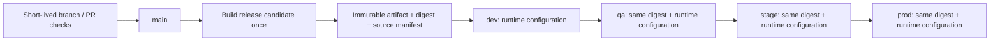

# Build once, promote unchanged

Status: agreed direction from the user's 23 October 2026 clarification; future four-environment execution is planned, not implemented. This document supersedes the assumption that deploying the same Git commit is sufficient artifact promotion.

## Shared preview comes first

The selected target is now [Render with Neon](RENDER.md). Start with one shared preview, then implement ordered promotion separately. Current CD code still uses the earlier Vercel/Northflank adapter; it must be replaced and verified before claiming a Render deployment. [Delivery operations](DELIVERY_OPERATIONS.md) connects this contract to the actual release/runtime code.

## What stays separate

Docker Compose is the local development/test environment for web, API, worker, PostgreSQL and Redis. It does not require every hosted environment to use Docker. The portable Dockerfiles remain useful, but the production artifact format and host must support the same immutable bytes across environments.

The target trunk-based development model means one `main` trunk and short-lived feature branches. `dev`, `qa`, `stage` and `prod` are deployment targets, not long-lived source branches. Their configuration and approval rules do not create new application versions.

## Artifact contract

- Build each changed application once for a release candidate. Preserve its version, source SHA, dependency lock and artifact SHA-256/digest. Independent API/web/worker versions remain supported.
- Test the candidate artifact itself before promotion. PR builds are disposable validation builds; they are not promoted release candidates.
- Promotion takes an explicit existing release/artifact reference. It never runs `next build`, TypeScript compilation, dependency installation, image building or a source-based deployment endpoint.
- Deploy exactly the same bytes in every target. A Git SHA, mutable `latest` tag or environment-specific rebuild is not proof of artifact identity.
- Record application version, artifact digest, environment, configuration revision and deployment result. Moving to another environment does not mint a new application tag.
- Advance only after the preceding environment's acceptance checks pass for that same artifact. Approval policy is configurable; staging/production can require approval without changing the artifact.
- Promote explicitly selected candidates rather than whichever release happens to be newest. A new trunk commit must not silently replace a candidate that is progressing through QA/staging.
- Serialize changes within an environment. Reject conflicting or stale promotion attempts. A rollback selects a previously verified artifact; database compatibility must be considered separately.

## Runtime configuration

| Concern               | Contract                                                                                                                                                                               |
| --------------------- | -------------------------------------------------------------------------------------------------------------------------------------------------------------------------------------- |
| Node execution mode   | `NODE_ENV=production` for every hosted target; do not set it to `qa` or `stage`                                                                                                        |
| Environment identity  | A future `APP_ENV` label may name dev/qa/stage/prod; current application code does not consume this selector. Provider service/configuration identity identifies the environment today |
| Server settings       | Load and validate database/Redis URLs, auth settings and service origins when the process starts; inject through the host's runtime configuration/secrets                              |
| Browser settings      | Serve only a typed, explicitly allowed public configuration from dynamic Next.js server rendering/bootstrap; initialize the generated client from that configuration                   |
| Browser secrets       | Never expose database URLs, Redis credentials, signing keys or provider tokens                                                                                                         |
| Build inputs          | No environment-specific API origins, feature flags or secrets baked into client bundles or static HTML                                                                                 |
| Next.js restrictions  | Do not use `NEXT_PUBLIC_*` or `next.config` `env` for values that differ between deployment targets; those are build-time substitutions                                                |
| Caching               | Public runtime bootstrap/config must not be statically prerendered or shared between environments; immutable JS/CSS can keep long-lived caching                                        |
| Configuration changes | Restart/redeploy the same artifact with new runtime settings; no source edit or rebuild                                                                                                |

Use shared schemas and a narrow public configuration type. Read server values at startup or a deliberately dynamic request boundary; merely moving a value to `process.env` is insufficient if the route is prerendered during build. Do not rewrite compiled bundles with search-and-replace at container startup.

Each environment needs isolated database data and a separate Redis instance. Current fixed queue/channel/auth namespaces are not configurable; a Redis logical database alone does not isolate Pub/Sub. Neon remains the hosted PostgreSQL choice; separate projects/branches/databases and credentials must be chosen when environments are provisioned. Migrations are an environment-specific deployment step using backward-compatible changes, not part of artifact rebuilding. Demo seed data must remain excluded from production.

## Current implementation versus this target

| Current component                                       | Compatibility                                                                                                                                                             |
| ------------------------------------------------------- | ------------------------------------------------------------------------------------------------------------------------------------------------------------------------- |
| Local Compose and per-app Dockerfiles                   | Keep for local use and optional portable packaging                                                                                                                        |
| Independent release tags and digest manifests           | Reuse as the foundation                                                                                                                                                   |
| Legacy Northflank API/worker deployment by digest       | Preserves image identity for a given release                                                                                                                              |
| Vercel deployment from `gitSource`                      | Builds the source again; **does not satisfy build-once promotion**                                                                                                        |
| Shared-preview CD job and latest-release reconciliation | Does not implement ordered four-environment promotion of an explicitly selected candidate                                                                                 |
| Public runtime bootstrap                                | REST uses the runtime-only server proxy (P07-04); validated `REALTIME_PUBLIC_URL` is read at server request time for Socket.IO (P11-03). Full promotion remains separate. |

The current `CD_ENABLED=true` gate enables only the legacy provider adapter with its configured targets. It does not enable Render or provide the four-environment contract above. P00-08 is historical evidence of the earlier production-only design; P00-13 supersedes its target without claiming future promotion is implemented.

## Selected hosting path

The new Render plan uses image-backed web, API and worker services. Publish the final container once, retain its registry digest and deploy that digest with each target's runtime settings. The existing `linux/amd64` publication and dynamic web origins are foundations; a Render adapter, environment gates and live same-digest acceptance remain unimplemented.

Do not use a Render Git-backed service that rebuilds source for each target when proving this contract. Do not confuse a successful deploy-hook request with a ready, digest-verified deployment. Persistent worker/storage capacity and four environments require a separate budget decision; see [RENDER.md](RENDER.md).

## Acceptance proof for the future implementation

Build a candidate once, disable compilation and dependency downloads during promotion, and deploy it to two isolated target configurations. Artifact registry access, provider deployment APIs and runtime test traffic remain allowed. Assert identical artifact hashes, different allowed runtime settings, no secret in browser assets, no configuration leakage through caches, and successful rejection of invalid/missing settings. Extend the same proof to `dev → qa → stage → prod`, approvals, failed promotion/retry, and rollback. Record the exact tested candidate in deployment evidence.

## References

- [Next.js self-hosting and runtime environment variables](https://nextjs.org/docs/app/guides/self-hosting)
- [Next.js environment variables and build-time public substitution](https://nextjs.org/docs/app/guides/environment-variables)
- [Vercel build targets](https://vercel.com/docs/cli/build)
- [Vercel prebuilt deployment](https://vercel.com/docs/cli/deploy#prebuilt)
- [Vercel environment and promotion behavior](https://vercel.com/docs/deployments/promoting-a-deployment)

Render references and current provider limits were checked on 25 October 2026 and are linked in [RENDER.md](RENDER.md). The Vercel references above explain the legacy source-build limitation.
