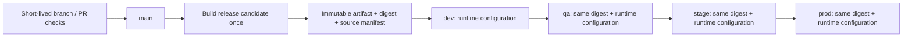

# Build once, promote unchanged

Status: agreed direction from the user's 23 October 2026 clarification; future four-environment execution is planned, not implemented. This document supersedes the assumption that deploying the same Git commit is sufficient artifact promotion.

## Initial preview comes first

The user subsequently clarified that an initial hosted preview should run now on Vercel, Northflank and Neon. [CI_CD.md](CI_CD.md) defines that shared preview: Vercel builds a released commit as a preview, and Northflank runs released API/worker digests. This initial source-build exception is intentional and does not claim build-once promotion. P00-13/P00-14 implement and verify it without waiting for P00-11/P00-12. No production deployment is enabled by this preview workflow.

## What stays separate

Docker Compose is the local development/test environment for web, API, worker, PostgreSQL and Redis. It does not require every hosted environment to use Docker. The portable Dockerfiles remain useful, but the production artifact format and host must support the same immutable bytes across environments.

Trunk-based development, if adopted, means one `main` trunk and short-lived feature branches. `dev`, `qa`, `stage` and `prod` are deployment targets, not long-lived source branches. Their configuration and approval rules do not create new application versions.

## Artifact contract

- Build each changed application once for a release candidate. Preserve its version, source SHA, dependency lock and artifact SHA-256/digest. Independent API/web/worker versions remain supported.
- Test the candidate artifact itself before promotion. PR builds are disposable validation builds; they are not promoted release candidates.
- Promotion takes an explicit existing release/artifact reference. It never runs `next build`, TypeScript compilation, dependency installation, image building or a source-based deployment endpoint.
- Deploy exactly the same bytes in every target. A Git SHA, mutable `latest` tag or environment-specific rebuild is not proof of artifact identity.
- Record application version, artifact digest, environment, configuration revision and deployment result. Moving to another environment does not mint a new application tag.
- Advance only after the preceding environment's acceptance checks pass for that same artifact. Approval policy is configurable; staging/production can require approval without changing the artifact.
- Promote explicitly selected candidates rather than whichever release happens to be newest. A new trunk commit must not silently replace a candidate that is progressing through QA/staging.
- Serialize changes within an environment. Reject conflicting or stale promotion attempts. A rollback selects a previously verified artifact; database compatibility must be considered separately.

## Runtime configuration

| Concern               | Contract                                                                                                                                                             |
| --------------------- | -------------------------------------------------------------------------------------------------------------------------------------------------------------------- |
| Node execution mode   | `NODE_ENV=production` for every hosted target; do not set it to `qa` or `stage`                                                                                      |
| Environment identity  | Use `APP_ENV` with `dev`, `qa`, `stage` or `prod`; the initial preview may use `preview`, and local tooling may use `local`                                          |
| Server settings       | Load and validate database/Redis URLs, auth settings and service origins when the process starts; inject through the host's runtime configuration/secrets            |
| Browser settings      | Serve only a typed, explicitly allowed public configuration from dynamic Next.js server rendering/bootstrap; initialize the generated client from that configuration |
| Browser secrets       | Never expose database URLs, Redis credentials, signing keys or provider tokens                                                                                       |
| Build inputs          | No environment-specific API origins, feature flags or secrets baked into client bundles or static HTML                                                               |
| Next.js restrictions  | Do not use `NEXT_PUBLIC_*` or `next.config` `env` for values that differ between deployment targets; those are build-time substitutions                              |
| Caching               | Public runtime bootstrap/config must not be statically prerendered or shared between environments; immutable JS/CSS can keep long-lived caching                      |
| Configuration changes | Restart/redeploy the same artifact with new runtime settings; no source edit or rebuild                                                                              |

Use shared schemas and a narrow public configuration type. Read server values at startup or a deliberately dynamic request boundary; merely moving a value to `process.env` is insufficient if the route is prerendered during build. Do not rewrite compiled bundles with search-and-replace at container startup.

Each environment needs isolated database data and Redis/queue namespaces or instances. Neon remains the hosted PostgreSQL choice; separate projects/branches/databases and credentials must be chosen when environments are provisioned. Migrations are an environment-specific deployment step using backward-compatible changes, not part of artifact rebuilding. Demo seed data must remain excluded from production.

## Current implementation versus this target

| Current component                                       | Compatibility                                                                             |
| ------------------------------------------------------- | ----------------------------------------------------------------------------------------- |
| Local Compose and per-app Dockerfiles                   | Keep for local use and optional portable packaging                                        |
| Independent release tags and digest manifests           | Reuse as the foundation                                                                   |
| Northflank API/worker deployment by digest              | Preserves image identity for a given release                                              |
| Vercel deployment from `gitSource`                      | Builds the source again; **does not satisfy build-once promotion**                        |
| Shared-preview CD job and latest-release reconciliation | Does not implement ordered four-environment promotion of an explicitly selected candidate |
| Public runtime bootstrap                                | Not implemented; introduce before environment-specific browser configuration is needed    |

The shared preview can be enabled with `CD_ENABLED=true` once its own targets and credentials are ready. It does not provide the four-environment contract above. P00-08 is historical evidence of the earlier production-only design; P00-13 supersedes its target without claiming future promotion is implemented.

## Hosting decision before implementation

There are two viable paths to evaluate when four-environment execution is requested:

1. Publish a portable application artifact (for example Next standalone with its assets, plus deployed Node dependencies for API/worker) and run it on hosts that accept unchanged artifacts. If a host requires a container, package it once before fixing the release candidate identity: the container has its own digest. Promote the selected final artifact unchanged; do not repackage it for each environment. Local Docker does not force that choice.
2. Keep Vercel for the UI only if a tested prebuilt artifact path proves identical output across the selected environment targets, with runtime-only configuration. `vercel --prebuilt` can upload existing Vercel Build Output API files, which are different from Next standalone output. Its CLI checks the build target against the deployment target: the documented prebuilt flow pairs `vercel build --target=<environment>` with `vercel deploy --prebuilt --target=<same-environment>`. A QA/preview artifact cannot simply be relabeled as production; ordinary preview-to-production promotion rebuilds with production settings. The supported staged-production promotion keeps the existing production configuration snapshot; it is not four distinct runtime environments. Never bypass provider metadata/validation to make an artifact appear compatible. Account/plan and environment restrictions must be checked before committing to this path.

Four persistent environments also need more capacity than the currently proposed hobby allocation; provider eligibility and cost must be re-evaluated. Do not silently replace Vercel, assume a paid four-environment plan, or claim that a repeated source build is artifact promotion. Choose the hosting path only when implementation is requested and its constraints are verified.

## Acceptance proof for the future implementation

Build a candidate once, disable compilation and dependency downloads during promotion, and deploy it to two isolated target configurations. Artifact registry access, provider deployment APIs and runtime test traffic remain allowed. Assert identical artifact hashes, different allowed runtime settings, no secret in browser assets, no configuration leakage through caches, and successful rejection of invalid/missing settings. Extend the same proof to `dev → qa → stage → prod`, approvals, failed promotion/retry, and rollback. Record the exact tested candidate in deployment evidence.

## References checked 23 October 2026

- [Next.js self-hosting and runtime environment variables](https://nextjs.org/docs/app/guides/self-hosting)
- [Next.js environment variables and build-time public substitution](https://nextjs.org/docs/app/guides/environment-variables)
- [Vercel build targets](https://vercel.com/docs/cli/build)
- [Vercel prebuilt deployment](https://vercel.com/docs/cli/deploy#prebuilt)
- [Vercel environment and promotion behavior](https://vercel.com/docs/deployments/promoting-a-deployment)
