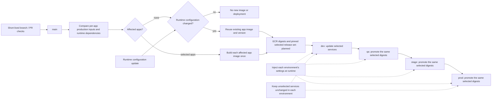

# Build once, promote unchanged

Status: D171 selects Docker images stored in ECR for future production; D173 requires selective per-service deployment. Four-environment execution and ECR integration are planned, not implemented. Deploying the same Git commit is not sufficient proof of artifact promotion. [Run modes](RUN_AND_DEPLOY.md) defines development, local preview, temporary demo and production separately.

## Shared demo comes first

The current temporary demo uses [Vercel Services](VERCEL.md), Neon and Upstash. It is separate from the long-term Docker/ECR production target. Vercel builds from repository source and does not satisfy the unchanged-artifact contract. Its technical production target enables the worker daemon; that platform label does not redefine Flowboard's future production architecture. [Delivery operations](DELIVERY_OPERATIONS.md) connects this contract to the actual release/runtime code.

## What stays separate

Full Docker Compose is the local preview/test environment. Everyday development runs web/API/worker through `pnpm run dev` with only PostgreSQL and Redis in Docker. Future hosted environments run the selected immutable Docker images from ECR. The AWS application runtime is not yet selected; ECR is the image registry, not a container scheduler.

The target trunk-based development model means one `main` trunk and short-lived feature branches. Selective delivery and promotion are policies layered on that branching model. `dev`, `qa`, `stage` and `prod` are deployment targets, not long-lived source branches. Their configuration and approval rules do not create new application versions. Repository CI may still validate all apps/packages in parallel; passing CI does not require deploying every service.

## Which services deploy

Use the existing [release planner](../packages/release-tools/src/index.ts) and committed package manifests. Compare each app with its own last published baseline, following direct/transitive runtime dependencies and relevant build inputs. Commit scope text or a rule that only examines the most recent commit is insufficient. The first publication/bootstrap has no baseline and initializes the required services; later unchanged fingerprints produce no new version or image.

| Production change                                                   | Affected services under the current graph                                                |
| ------------------------------------------------------------------- | ---------------------------------------------------------------------------------------- |
| API implementation only                                             | API                                                                                      |
| Worker implementation only                                          | Worker                                                                                   |
| Web implementation, shared UI, forms or generated API client        | Web                                                                                      |
| Shared jobs, database or logger                                     | API and worker                                                                           |
| Shared contracts                                                    | Web, API and worker; all currently consume contracts, including worker job/event schemas |
| One app's Dockerfile                                                | Its owning app                                                                           |
| Shared compiler/toolchain or runtime dependency lock change         | Only apps whose production fingerprints change; this can be all three                    |
| Documentation, tests or lint-only changes with no production effect | None                                                                                     |

API changes do not deploy web merely because OpenAPI generation builds API. When a change also changes the committed generated client or shared runtime contracts, include their actual consumers. The current graph is conservative at package granularity; this plan does not claim field-level contract impact analysis. Thus the requested contracts → web/API case also includes worker while it consumes that package.

## Deploy selected services and retain the rest

A future ECR deployment plan contains the selected app versions/digests, source identities and compatibility constraints. Each environment also records its complete deployed app/configuration state. Apply only the selected changes to that environment; do not copy unrelated services from dev into QA, stage or production.

For a jobs change, for example:

| Service | Deployment action                                     | Image identity                                    |
| ------- | ----------------------------------------------------- | ------------------------------------------------- |
| Web     | Keep the version already deployed in that environment | Unchanged                                         |
| API     | Deploy the new selected API release                   | The same API digest in dev, QA, stage and prod    |
| Worker  | Deploy the new selected worker release                | The same worker digest in dev, QA, stage and prod |

Before each step, compare selected desired digests and configuration revisions with the target's recorded state. Skip services already at that state; deploy only the remaining differences. A configuration-only change restarts/redeploys only its affected service with the existing image and version. If neither image nor configuration changed, do not redeploy it. Service URLs, database/Redis credentials, secrets and other environment settings are injected at startup or the documented dynamic server boundary; they are not new build inputs.

Promotion stays pinned to that selected release set after it enters dev. A newer merge to main creates a separate candidate and must not invalidate, replace or expand the one moving through QA/stage/prod. The current demo adapter's current-main guard is not the future promoter's selection policy. Serialize mutations per environment, validate the expected target state, enforce prior-stage acceptance/approvals, resume partial failures without redeploying completed services, and retain per-service rollback history.

Independence does not remove compatibility requirements. Check selected API/worker releases against unselected web versions, event consumers and database migrations. Use backward-compatible changes or explicitly include a compatible additional release; never silently upgrade unrelated services. Preserve isolated data and Redis for each environment. No executable ECR selector/deployer/promoter is claimed by this document: P39-02 and P00-11/P00-12 implement and verify it.

## Artifact contract

- Build each changed application once for a release candidate. Preserve its version, source SHA, dependency lock and artifact SHA-256/digest. Independent API/web/worker versions remain supported.
- Test the candidate artifact itself before promotion. PR builds are disposable validation builds; they are not promoted release candidates.
- Promotion takes an explicit existing release/artifact reference. It never runs `next build`, TypeScript compilation, dependency installation, image building or a source-based deployment endpoint.
- Deploy exactly the same bytes in every target. A Git SHA, mutable `latest` tag or environment-specific rebuild is not proof of artifact identity.
- Record application version, artifact digest, environment, configuration revision and deployment result. Moving to another environment does not mint a new application tag.
- Advance only after the preceding environment's acceptance checks pass for that same artifact. Approval policy is configurable; staging/production can require approval without changing the artifact.
- Promote explicitly selected candidates rather than whichever release happens to be newest. A new trunk commit must not silently replace a candidate that is progressing through QA/staging.
- Serialize changes within an environment. Reject conflicting or stale promotion attempts. A rollback selects a previously verified artifact; database compatibility must be considered separately.

## Runtime configuration

| Concern               | Contract                                                                                                                                                                               |
| --------------------- | -------------------------------------------------------------------------------------------------------------------------------------------------------------------------------------- |
| Node execution mode   | `NODE_ENV=production` for every hosted target; do not set it to `qa` or `stage`                                                                                                        |
| Environment identity  | A future `APP_ENV` label may name dev/qa/stage/prod; current application code does not consume this selector. Provider service/configuration identity identifies the environment today |
| Server settings       | Load and validate database/Redis URLs, auth settings and service origins when the process starts; inject through the host's runtime configuration/secrets                              |
| Browser settings      | Serve only a typed, explicitly allowed public configuration from dynamic Next.js server rendering/bootstrap; initialize the generated client from that configuration                   |
| Browser secrets       | Never expose database URLs, Redis credentials, signing keys or provider tokens                                                                                                         |
| Build inputs          | No environment-specific API origins, feature flags or secrets baked into client bundles or static HTML                                                                                 |
| Next.js restrictions  | Do not use `NEXT_PUBLIC_*` or `next.config` `env` for values that differ between deployment targets; those are build-time substitutions                                                |
| Caching               | Public runtime bootstrap/config must not be statically prerendered or shared between environments; immutable JS/CSS can keep long-lived caching                                        |
| Configuration changes | Restart/redeploy the same artifact with new runtime settings; no source edit or rebuild                                                                                                |

Use shared schemas and a narrow public configuration type. Read server values at startup or a deliberately dynamic request boundary; merely moving a value to `process.env` is insufficient if the route is prerendered during build. Do not rewrite compiled bundles with search-and-replace at container startup.

Each environment needs isolated database data and a separate Redis instance. Current fixed queue/channel/auth namespaces are not configurable; a Redis logical database alone does not isolate Pub/Sub. Neon remains the hosted PostgreSQL choice; separate projects/branches/databases and credentials must be chosen when environments are provisioned. Migrations are an environment-specific deployment step using backward-compatible changes, not part of artifact rebuilding. Demo seed data must remain excluded from production.

## Current implementation versus this target

| Current component                                   | Compatibility                                                                                                                                                             |
| --------------------------------------------------- | ------------------------------------------------------------------------------------------------------------------------------------------------------------------------- |
| Local Compose and per-app Dockerfiles               | Full local preview and the Docker artifact foundation for future ECR production                                                                                           |
| Independent release tags and digest manifests       | Reuse as the foundation                                                                                                                                                   |
| Existing Northflank API/worker deployment by digest | Historical provider path; not the selected deployment topology                                                                                                            |
| Vercel Services deployment from source              | Builds the source for the deployment; **does not satisfy build-once promotion**                                                                                           |
| Gated one-project Vercel source deployment          | Does not implement ordered four-environment promotion of an explicitly selected candidate                                                                                 |
| Public runtime bootstrap                            | REST uses the runtime-only server proxy (P07-04); validated `REALTIME_PUBLIC_URL` is read at server request time for Socket.IO (P11-03). Full promotion remains separate. |

The current `CD_ENABLED=true` gate enables only the configured Vercel Hobby Services deployment after verification and GHCR publication. P38-03 verifies a manual live demo; protected main-branch CD activation remains separate. The gate does not provision credentials or implement the four-environment contract. P00-08/P00-13 describe superseded provider paths; P38-02 implements the current one-project adapter.

## Selected hosting path

The temporary Vercel demo is documented in [VERCEL.md](VERCEL.md). Current image publication uses GHCR. P39-02 will integrate ECR; P00-11/P00-12 retain promotion gates and live same-digest acceptance. No ECR repository, IAM role or AWS application runtime is claimed as configured.

## Acceptance proof for the future implementation

Build a candidate once, disable compilation and dependency downloads during promotion, and deploy it to two isolated target configurations. Artifact registry access, provider deployment APIs and runtime test traffic remain allowed. Assert identical artifact hashes, different allowed runtime settings, no secret in browser assets, no configuration leakage through caches, and successful rejection of invalid/missing settings. Extend the same proof to `dev → qa → stage → prod`, approvals, failed promotion/retry, and rollback. Record the exact tested candidate in deployment evidence.

## References

- [Next.js self-hosting and runtime environment variables](https://nextjs.org/docs/app/guides/self-hosting)
- [Next.js environment variables and build-time public substitution](https://nextjs.org/docs/app/guides/environment-variables)
- [Vercel build targets](https://vercel.com/docs/cli/build)
- [Vercel prebuilt deployment](https://vercel.com/docs/cli/deploy#prebuilt)
- [Vercel environment and promotion behavior](https://vercel.com/docs/deployments/promoting-a-deployment)

Vercel Services and daemon limits are documented in the [Vercel deployment guide](VERCEL.md). The Vercel references above explain why source builds are not the future build-once promotion path.
