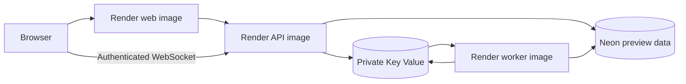

# Render deployment plan

Updated 25 October 2026. **Planned provider target, not a live deployment or implemented Render adapter.** The user selected Render after the earlier Vercel/Northflank plan. Neon remains PostgreSQL because no database-provider change was requested. The current [CD code](../packages/release-tools/src/deploy-cli.ts) still uses the old providers; setting `CD_ENABLED=true` does not deploy to Render.

## Proposed shared preview topology

| Component                  | Render target                                   | Artifact/configuration                                                        |
| -------------------------- | ----------------------------------------------- | ----------------------------------------------------------------------------- |
| Web                        | Image-backed Web Service                        | Published web digest; Next standalone server with runtime API/socket origins. |
| API                        | Image-backed Web Service                        | Published API digest; HTTPS/WebSockets; `/health/ready` readiness.            |
| Worker                     | Image-backed Background Worker                  | Published worker digest; default image command; no public ingress.            |
| Redis-compatible transport | Private Render Key Value                        | Same-region endpoint for API/worker; queue-safe persistence and `noeviction`. |
| PostgreSQL                 | Existing choice: dedicated Neon database/branch | Pooled application URL and API-only direct migration URL.                     |

Render accepts prebuilt images from GHCR for web services and background workers, including digest references. Its required `linux/amd64` platform matches Flowboard's publisher. Use **Existing Image**, not a Git-source build, for the unchanged-image design. Retain the image in GHCR for future restarts and rollback. [Render image deployment requirements](https://render.com/docs/deploying-an-image).

Render Key Value is Redis-compatible; newly created instances use Valkey. Compatibility with this app's pinned clients must be proven in live acceptance. For queue workloads choose `noeviction`; a persistence-enabled service reduces queue loss across restarts. [Key Value behavior](https://render.com/docs/key-value).

## Cost and preview limits

A complete always-running Flowboard stack on Render is **not promised to be free**. Render's free service types exclude background workers. Free web instances can sleep after inactivity and share a monthly usage allowance; free Key Value loses its data on restart. These limits can delay activity processing and realtime updates. Do not disguise a worker as a free web service or use keep-alive traffic to imply an always-on guarantee. Select suitable worker and persistent storage capacity only with explicit budget approval. [Current free-instance limits](https://render.com/docs/free).

Start with one shared environment named `preview`; this is an operational label, not the paid automatic full-stack preview feature. Render's automatic Preview Environments require Pro or higher and create additional resources. Per-PR multi-service stacks and four persistent environments need a separate capacity/cost decision. [Preview Environment requirements](https://render.com/docs/preview-environments).

This documentation neither provisions resources nor enables a paid plan. A budget of zero remains an unresolved constraint for the full proposed Render worker topology.

## Runtime settings, same image

[Delivery operations](DELIVERY_OPERATIONS.md#where-environment-settings-enter) is the authoritative setting map. Configure values on each Render service or an environment-specific group; never store secret values in a Blueprint or repository. Render supports redeploying the existing build with changed environment settings. Choose that path rather than a source rebuild for an environment-only change. [Runtime settings and deploy options](https://render.com/docs/configure-environment-variables).

| Setting            | Web                                                                                       | API                                                                                                                     | Worker                                                                    |
| ------------------ | ----------------------------------------------------------------------------------------- | ----------------------------------------------------------------------------------------------------------------------- | ------------------------------------------------------------------------- |
| Binding            | `HOSTNAME=0.0.0.0`; use the assigned `PORT`                                               | `HOST=0.0.0.0`; use assigned `PORT`                                                                                     | Existing `HOST=0.0.0.0`, `PORT=3002` can remain; no public port required. |
| API access         | `API_INTERNAL_URL` = selected API origin; `REALTIME_PUBLIC_URL` = public HTTPS API origin | Exact public web origins in `AUTH_ALLOWED_ORIGINS`                                                                      | None.                                                                     |
| Proxy safety       | Exact public web origins in `WEB_ALLOWED_ORIGINS`                                         | None.                                                                                                                   | None.                                                                     |
| Database           | None.                                                                                     | Neon `DATABASE_URL`; direct `DATABASE_URL_UNPOOLED` for migrations                                                      | Same environment's `DATABASE_URL`.                                        |
| Redis              | None.                                                                                     | Private `REDIS_URL`                                                                                                     | Same environment's private `REDIS_URL`.                                   |
| Security/operation | No DB, Redis or signing secrets                                                           | Fresh `AUTH_SECRET`; `AUTH_ALLOW_INSECURE_HTTP=false`; `DEMO_SEED=false`; normally `API_DOCS=false`; chosen `LOG_LEVEL` | Chosen `LOG_LEVEL`.                                                       |

Keep `NODE_ENV=production` in every hosted target. Web refresh cookies stay first-party through `/api/v1`; Socket.IO connects to the public API origin. Do not put a private Render hostname into a browser setting. If a free API cannot receive private-network traffic, the server proxy may need its public HTTPS origin; exact origin validation still applies. Services in separate environments must not share data, signing keys or the fixed Redis namespace.

API startup currently runs checked-in migrations before serving traffic. Start it successfully before relying on worker processing. Do not also add an uncoordinated second migration command to the worker. A future pre-deploy migration job would be an explicit change to ownership/rollout, not implied by this guide. [Migration/runtime behavior](DELIVERY_OPERATIONS.md#data-promotion-and-rollback).

## Implementation and rollout sequence

1. **Confirm capacity and region.** Choose the worker/storage plans and a Render region near the Neon database. Do not provision while the cost decision is unresolved.
2. **Use published identities.** Obtain each app's version, SHA and digest from verified `release.json` records. Do not assume that a tag in Git means a completed publication exists.
3. **Create isolated preview services.** Configure image-backed web/API/worker, private Key Value and preview-only Neon data. Use existing image commands and explicit runtime settings. Keep independent application identities.
4. **Implement P22-02.** Add a Render provider adapter/configuration and tests. It must validate resource ownership/IDs before writes, deploy the specified digest, preserve other settings, fail on stale main or digest mismatch, bound polling, and safely reuse successful deployments. Only then replace the legacy workflow's credentials/variables and enable its Render path.
5. **Verify P22-03.** Record the actually running digests and URLs; exercise HTTPS login/refresh/logout, tenant isolation, task updates, stored activity, a second authorized client, denied sockets, worker restarts and retry behavior with disposable data.
6. **Later implement ordered promotion.** P00-11/P00-12 add explicit candidate selection, environment gates/config revisions and identical-image dev → qa → stage → prod acceptance. The initial shared preview does not prove this future workflow.

An image-backed Render service does not automatically deploy a newly pushed registry tag. The future adapter can use Render's deployment API or a protected deploy hook with an explicit digest, then verify the result. Hooks are secrets; do not log their URLs or treat an HTTP trigger response as a ready deployment. [Deploy-hook behavior](https://render.com/docs/deploy-hooks). Render background workers run continuously and do not accept incoming requests; their operational checks differ from public web services. [Worker service model](https://render.com/docs/background-workers).

## What this change does not activate

No `render.yaml`, Render API integration, resource creation, secret upload, billing change or live acceptance is included. The old Vercel/Northflank implementation remains available as historical/current code, not the new target setup instructions. Keep its CD gate disabled unless deliberately using those old resources. See [current CI/CD](CI_CD.md), [independent releases](DELIVERY.md) and [promotion gaps](PROMOTION.md).
