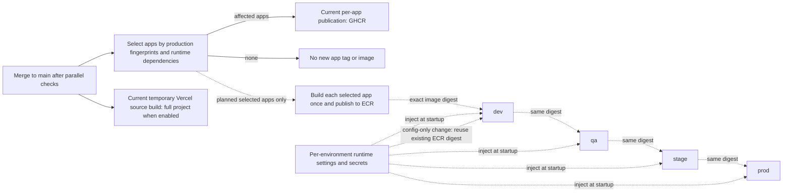

# Run modes and deployment targets

Updated 26 October 2026. This is the current environment contract (D171). Historical hosting proposals do not override these modes.

| Mode                  | Application processes                                                    | PostgreSQL / Redis                                   | Status                                                                  |
| --------------------- | ------------------------------------------------------------------------ | ---------------------------------------------------- | ----------------------------------------------------------------------- |
| Everyday development  | `pnpm run dev` runs web, API and worker on the host                      | Local Docker services only                           | Implemented                                                             |
| Local preview         | `docker compose up --build` runs all five services                       | Local Docker services and persistent volumes         | Implemented; no manual env setup in a clean checkout                    |
| Temporary hosted demo | Vercel web/API services and worker daemon                                | Neon and Upstash                                     | Verified temporary demo; not the long-term production platform          |
| Future production     | Per-app Docker images stored in Amazon ECR, deployed by immutable digest | Environment-specific runtime connections and secrets | Planned; ECR integration and AWS application runtime are not configured |

## Local preview: one command

With Docker running, execute from the repository root:

```sh
docker compose up --build
```

Open `http://localhost:3000`; Swagger is `http://localhost:3001/docs`. Compose builds web/API/worker, starts PostgreSQL/Redis, and lets the API apply migrations and seed the demo before dependent services start. A clean checkout needs no `.env`, local Node installation or manual database commands. Existing optional `.env` values and shell variables can override the defaults; hosted credentials are not required. Named volumes retain edits between runs.

The default preview keeps datastore ports private. Public example accounts and passwords are listed in the [README](../README.md#initialization-and-demo-accounts) and are for local use only.

## Everyday development: native apps, Docker datastores

Use the pinned Node/pnpm toolchain. One-time setup copies local examples without replacing existing private files:

```sh
pnpm install --frozen-lockfile
cp -n apps/api/.env.example apps/api/.env
cp -n apps/worker/.env.example apps/worker/.env
cp -n apps/web/.env.example apps/web/.env.local
docker compose -f compose.yaml -f compose.local.yaml up -d --wait postgres redis
```

The datastore override exposes `localhost:5432` and `localhost:6379`. Keep app connection values aligned with any customized local ports or credentials. The root `.env` is optional with the default Compose values. Production copies such as `.env.vercel.local` are not the normal development configuration.

For a newly empty development database, allow the API to finish initialization once before launching the apps in parallel:

```sh
pnpm build --filter=@flowboard/api
pnpm --filter @flowboard/api start
```

Wait for API readiness at `http://localhost:3001/health/ready`, then stop that first API process with Ctrl+C. It applies migrations and the local seed automatically. This avoids the worker querying tables before the first migration finishes. Normal development then uses:

```sh
pnpm run dev
```

Web, API and worker run locally with their existing development watchers. Only PostgreSQL and Redis run in Docker. This workflow does not require rebuilding application images for source changes. Stop a full Compose preview before starting native apps on the same ports. `compose.dev.yaml` remains an optional container-reload mode, not the default development workflow.

## Temporary Vercel demo

The current public demo and provider details are in [VERCEL.md](VERCEL.md). Vercel uses its technical `production` target because that platform runs daemons there; this label does not make Vercel the project's long-term production architecture. Its source-based builds are a demo exception to the future image-promotion flow.

Keep Vercel/Neon/Upstash credentials separate from normal local development. No migration to ECR, AWS provisioning or change to the running demo is implied by this document. Existing free-tier limits still apply.

## Future production: ECR images and runtime configuration

The selected long-term artifact is a Docker image for each independently versioned app. Publish images to Amazon ECR and deploy by immutable digest. ECR is the registry; the AWS service that runs the containers is a separate decision. Account, region, repositories, IAM/OIDC role, application runtime and environment stores must be selected before implementation.

Current release automation publishes to **GHCR**. It has not been switched to ECR. [P39-02](TASKS.md#phase-39--environment-modes-and-long-term-hosting) tracks that integration; [PROMOTION.md](PROMOTION.md) and P00-11/P00-12 track promotion and its verification.

D173 makes ECR deployment selective: jobs changes affect API/worker, UI changes affect web, and shared contracts affect their actual runtime consumers (currently all three). Compare each app with its own published baseline. Build/version only affected apps; skip an unchanged service entirely. [The promotion contract](PROMOTION.md#which-services-deploy) defines the full mapping, config-only updates and compatibility checks.

Pin the selected app digests through dev → qa → stage → prod. Each target keeps its unselected services; do not copy an unrelated new web release from dev when promoting only API/worker. Inject that target's settings at runtime, without rebuilding or retagging the images. Current GHCR publication is selective; current Vercel demo deployment still replaces the whole project when it runs.



For future `dev → qa → stage → prod`, promote the same selected image bytes without rebuilding. Runtime configuration, credentials and data differ by environment; app versions and digests do not change during promotion. Preserve independent app releases, compatibility checks, approvals and rollback history. See [delivery operations](DELIVERY_OPERATIONS.md) for the current implementation boundary.
