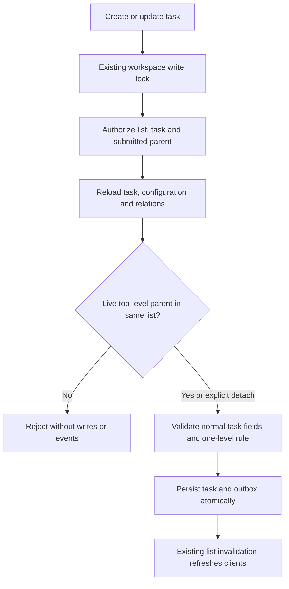

# One-level subtasks design and implementation plan

R157 is selected by D155. NEXT-03 records this design; [P30-01](evidence/P30-01.md) verifies the API/persistence implementation. [P30-02](evidence/P30-02.md) verifies the drawer controls and real-client acceptance. Both implementation slices are complete.

## Goal and approach

Break a task into smaller tasks without introducing another hierarchy or changing list ownership. Add a nullable `parentTaskId` to the existing task. A parent remains a normal top-level task; its children retain independent statuses, ordering, dates, fields and assignees. Board and table results stay flat.

Engineering default: use a same-list self-relation. A separate subtask entity would duplicate task validation and transport. Cascading a parent move to its children would require a larger multi-task command and destination validation, so this increment rejects that move instead. These choices are implementation defaults under the user's instruction to complete the backlog, not a claim that the user selected a new cascade policy.

Keep the current stack, public package boundaries, native ESM, generated client, workspace write lock, optimistic revisions and atomic outbox. No new dependency, endpoint, queue, role or background backfill is required.

## Data and validation

| Field or constraint | Contract                                                                                                                                                               |
| ------------------- | ---------------------------------------------------------------------------------------------------------------------------------------------------------------------- |
| `Task.parentTaskId` | UUID or null in every task response; normalize UUID case like other task identities.                                                                                   |
| Create input        | Optional UUID/null; omission means null.                                                                                                                               |
| Update input        | Optional UUID/null; omission preserves the current relation, explicit null detaches.                                                                                   |
| Same-list relation  | Composite FK `(workspaceId, primaryListId, parentTaskId)` references Task `(workspaceId, primaryListId, id)`, with restrictive update/delete behavior.                 |
| Identity/indexes    | Add the referenced compound unique key, a parent lookup index, and a SQL check rejecting self-parenting.                                                               |
| Maximum depth       | Repository validation under the workspace lock requires a live top-level parent and rejects attaching any task that already has children, including archived children. |
| Audit data          | Keep existing task IDs, timestamps, versions and values when adding the nullable column.                                                                               |

Every mutation reloads relations inside the existing workspace-locked transaction. The API uses PermissionService for submitted parent identities before exposing relationship errors. Foreign/missing identifiers return 404; an inaccessible same-workspace parent returns 403. A live parent in another list, a self-link, a child used as parent, or a proposed child with existing children returns 400 `INVALID_PARENT` with `details[].path = ['parentTaskId']`.

The database FK prevents cross-workspace/list references and SQL-level self-linking is rejected. The repository enforces depth and archive policy; raw database callers must not bypass it for domain writes.

## Move, archive and no-op rules

- A child can change status and reorder within its list independently.
- Cross-list moves reject a task with a non-null parent or any children, including archived children, with 409 `TASK_RELATION_IN_USE`.
- Detach a live child explicitly before moving it to another list. Parent movement is available only after it has no child references.
- Task-only parent archive rejects live children with `TASK_RELATION_IN_USE`. Archiving a child retains its parent reference. A parent whose children are all archived can itself be archived.
- Container subtree archive keeps its existing atomic behavior and may archive parents and children together. Workspace archive only changes the root flag.
- An archived child retains history and therefore continues to prevent moving its parent or making that parent a child. This increment does not add restoration, purging or hidden detachment of archived tasks.
- Reapplying the same valid parent is a no-op: retain task/config/data versions, timestamps and outbox. A real attachment/detachment increments only the changed task, using existing revision/event handling.
- Any failed command rolls back task data, positions, assignments, versions and outbox together.



## API and events

Reuse `POST /v1/lists/:listId/tasks`, `PATCH /v1/tasks/:taskId` and task responses. `GET /v1/lists/:listId/tasks` accepts optional UUID `parentTaskId` and returns only matching live children when supplied. It authorizes that parent, verifies the list relation, and includes the normalized filter in the cursor fingerprint. Without the filter, existing flat results are unchanged. Existing cursor limits, sort and data/configuration revision checks still apply.

Example changes to existing bodies:

```json
{ "expectedConfigVersion": 4, "expectedVersion": 2, "parentTaskId": null }
```

The example detaches a child; unrelated edits omit the property. Create-child inputs still supply a title, valid status and any required custom fields. The server never invents values for required fields.

Extend the optional `task.updated.changes` vocabulary with `parentTaskId: {before: UUID|null, after: UUID|null}`. Reject equal before/after values. Existing created/list invalidations already refresh a new child's list. Keep old persisted events readable; no event backfill is needed. Consumers validate non-null historical parent IDs against the event workspace, without requiring them to remain live or in the historical list. A detached parent can move before queued work is consumed. The status-only activity feed does not invent a status event for a relationship edit.

Deploy compatible contract readers in API/worker before enabling new writes. Ship matching API/web contracts together: older strict clients can reject the added response field. Shared strict task response schemas and all test fixtures gain the nullable field; do not silently default a missing server response field. Regenerate Swagger and Hey API from the schemas.

## Browser behavior

The task drawer shows a parent link for children and a paginated live-child section for top-level tasks. Root tasks offer **Add subtask** using the existing create form with the chosen parent. Required fields use the resolved schema as normal. Provide explicit parent selection/clearing through RHF/Zod and generated task operations; preserve omitted-versus-null semantics.

Opening a related task uses the existing dirty-draft confirmation. Do not infer “no children” or complete parent eligibility from a partially loaded page. Keep API validation authoritative; stale or invalid selections retain form values and show the existing typed error. Relationship changes use the existing list invalidation and version-conflict handling. No separate subtask board or nested drag behavior is introduced.

## P30-01 — Contracts, persistence and API

Files: `packages/contracts/src/{tasks,task-mutations,events,errors}.ts`; `packages/database/prisma/schema.prisma` and migration `202610250003_task_parent`; task/event repositories; `apps/api/src/modules/tasks/` and typed error mapping; generated OpenAPI/client; strict task fixtures and focused tests.

- [x] Add failing contract tests for nullable output, create/update omission/null, parent UUID validation, query filter and old/new event compatibility.
- [x] Add migration/schema tests proving existing rows remain unchanged except for the null column, and foreign list/tenant/self references fail.
- [x] Add real database/API cases for create, attach, detach, no-op, invalid depth, inaccessible/archived parents, required fields, filtered cursor pages and cross-filter cursor rejection.
- [x] Test task-only versus container archive, archived-child move restrictions, failed outbox rollback, and parent move/archive racing child creation. Serialized competing attachments must not create depth two or a cycle.
- [x] Implement the nullable relation, repository checks and PermissionService calls inside existing transaction boundaries. Include the filter in task query SQL and cursor binding; extend historical event-reference validation.
- [x] Update source-backed field/API notes and affected strict fixtures. Regenerate spec/client; run focused tests, root build/lint/type/format/test and contract drift checks; record actual outcomes and commit.

Primary test files: new `packages/database/test/subtasks.integration.test.mjs`, migration preservation test, `apps/api/src/modules/tasks/subtasks.integration.spec.mjs`; extend schema/event tests and contract task/query/job tests. Use existing isolated PostgreSQL and Supertest harnesses. Tests must observe expected red behavior before implementation.

## P30-02 — Drawer and creation controls

Files: `apps/web/src/features/tasks/`, generated-query hooks, existing shared task presentation/form controls as needed, browser fixtures/tests and application documentation.

- [x] Add a failing browser flow: create a child with required values, reload, open its parent, navigate back and detach explicitly.
- [x] Add negative paths: required field missing, stale parent/configuration, rejected depth/move, pending duplicate submission and dirty related-task navigation. Load multiple child/parent pages without false completeness claims.
- [x] Implement relation controls using existing form and editor patterns, generated operations and scoped query keys. Keep flat board/table ownership and independent child status/order.
- [x] Verify another open client observes attachment/detachment through existing invalidation. Check keyboard interaction and narrow/wide layouts.
- [x] Run root gates and React review, update evidence and commit. Mark R157 verified only when both implementation tasks pass.

## Review focus and handoff

Watch archived references, hostile parent IDs, omission versus clearing, stale pagination, and parent/child races. Each is covered explicitly above. Partial relation responses and old workers must not turn into silently valid state.

Follow [TASKS.md](TASKS.md) and the repository task protocol for execution. The required checks are defined in [QUALITY_GATES.md](QUALITY_GATES.md); a plan or test file is not passing implementation evidence.
