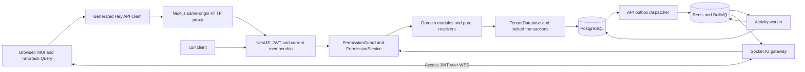
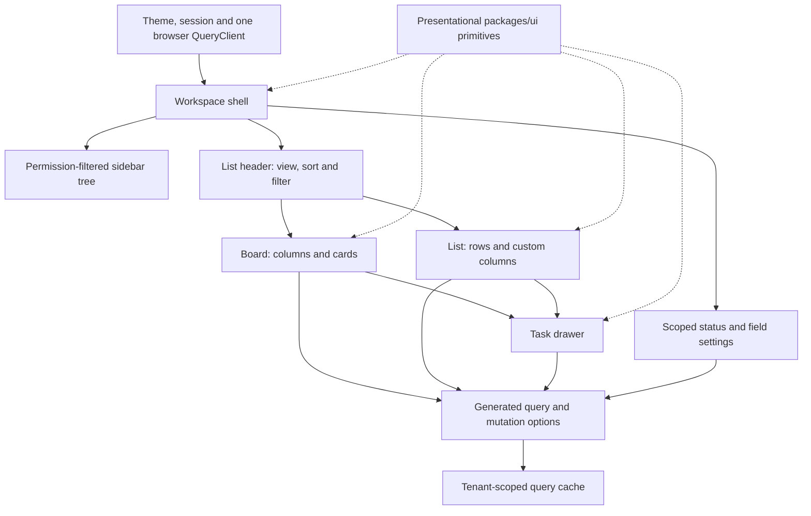
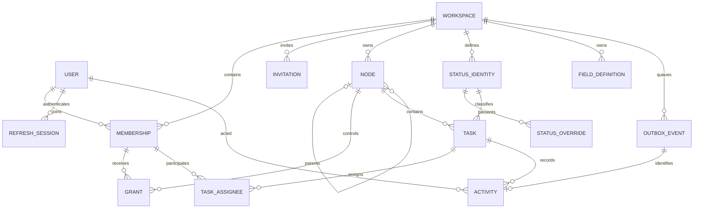
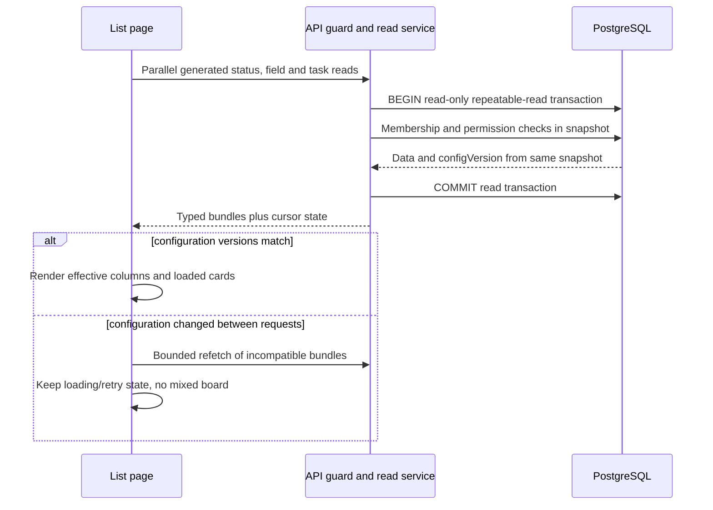
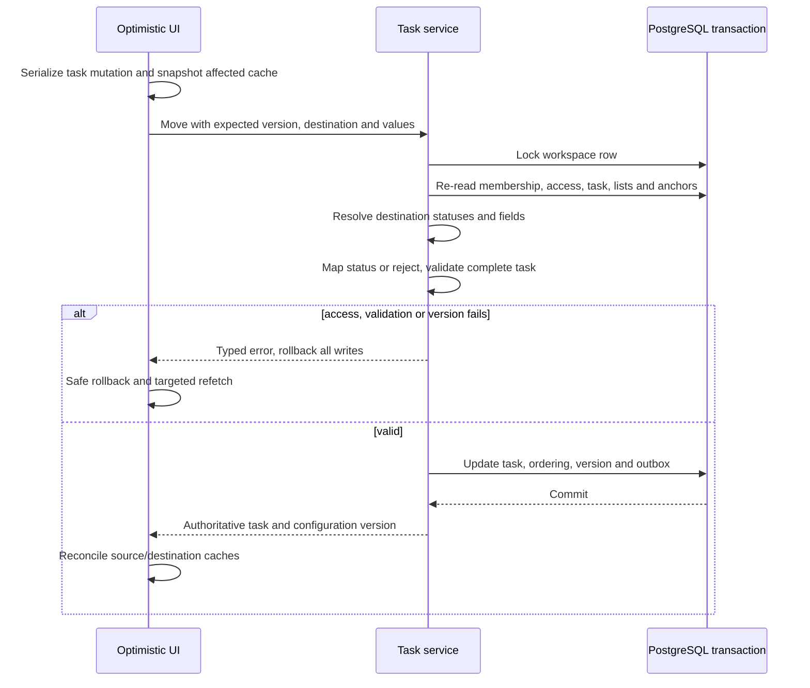
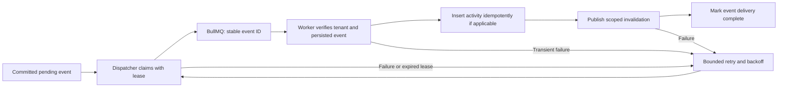

# Flowboard UI, backend and database design

**Status: target design, not implemented product behavior. Updated 23 October 2026.** The repository currently has application/build/delivery foundations; domain features and the browser proxy below remain future tasks. This document makes [PLAN.md](PLAN.md) concrete. [REQUIREMENTS.md](REQUIREMENTS.md) and [DECISIONS.md](DECISIONS.md) remain canonical. Vendor observations are separated into [REFERENCE_ARCHITECTURES.md](REFERENCE_ARCHITECTURES.md).

The implementation-ready [database and ER specification](DATABASE_DESIGN.md) defines all records, tenant keys, migrations and transaction invariants.

The [REST API catalog](API_CATALOG.md) lists operation IDs, schemas, permissions, errors and pagination for backend implementation.

The [Linear-inspired MUI guide](UI_DESIGN.md) maps public UI patterns to our components, screens, state and accessibility tests.

## 1. System and deployment boundaries

Use one modular NestJS API, one worker and one PostgreSQL database. Redis transports work and realtime notifications. The Next.js app coordinates generated queries and MUI views. The same domain API serves the UI and curl clients.

Local Docker has `web`, `api`, `worker`, `postgres`, `redis`. Hosted preview uses Vercel for web, Northflank for API/worker/Redis and Neon for PostgreSQL. Provider availability and live deployments remain subject to the existing delivery tasks. API instances share PostgreSQL/Redis; no sticky in-process task state is authoritative.

### Browser auth across separate hosts

Vercel and Northflank default domains are different sites. `SameSite=Lax` cookies are not sent on cross-site fetch requests, even with credentials enabled. The planned browser transport is therefore same-origin, rather than assuming CORS solves cookie policy. [Cookie semantics](https://developer.mozilla.org/en-US/docs/Web/HTTP/Reference/Headers/Set-Cookie)

| Boundary              | Planned behavior                                                                                                                                                                                                                                                                                                 |
| --------------------- | ---------------------------------------------------------------------------------------------------------------------------------------------------------------------------------------------------------------------------------------------------------------------------------------------------------------- |
| Browser → web         | Generated SDK base URL `/api`; OpenAPI paths retain `/v1`. Requests become `/api/v1/...` on the web origin.                                                                                                                                                                                                      |
| Web → API             | One server-only route forwards to a fixed runtime `API_INTERNAL_URL` and `/v1/...`; it contains no business logic, Prisma or duplicated DTOs.                                                                                                                                                                    |
| Cookie handling       | API emits a host-only refresh cookie, Path=/, httpOnly, SameSite=Lax and Secure under HTTPS. Forward only the named refresh cookie upstream; accept only approved Set-Cookie names and preserve each header separately. The browser stores it for the web host. No Domain attribute or token in browser storage. |
| Origin and forwarding | Validate allowed browser Origin on cookie mutations; preserve it to the API. Allowlist forwarded headers, strip caller-supplied forwarding headers, disallow arbitrary destinations/redirects, propagate cancellation and use no shared cache.                                                                   |
| WebSocket             | Connect directly to API using a short-lived access JWT in Socket.IO auth. Validate membership and each subscription; never put refresh credentials or tokens in the URL.                                                                                                                                         |
| Other clients         | The same API remains directly available at `/v1`; curl uses its own token/cookie jar and documented Origin for cookie mutations.                                                                                                                                                                                 |

Next.js Route Handlers provide the server request/response boundary. The generic proxy is the narrowly documented transport exception to the no-handwritten-API-call rule; feature code still uses only generated SDK operations. Runtime upstream configuration is server-only and must not be baked into a public bundle. **P07-04 implements and tests this design.** [Next.js Route Handlers](https://nextjs.org/docs/app/api-reference/file-conventions/route)

## 2. UI architecture and state ownership

| Layer/location                                            | Owns                                                                                               | Must not own                                     |
| --------------------------------------------------------- | -------------------------------------------------------------------------------------------------- | ------------------------------------------------ |
| `apps/web/app/(auth)`                                     | Login/signup routes and session bootstrap UI                                                       | Password hashing or authorization decisions      |
| `apps/web/app/(workspace)/w/[workspaceId]/lists/[listId]` | Selected workspace/list; Board/List and drawer composition                                         | Its own copy of task data                        |
| `apps/web/src/features/{tree,board,tasks,config}`         | Generated data hooks, command coordination and feature states                                      | Handwritten endpoint fetches                     |
| `packages/ui`                                             | Theme/SSR provider, cards, columns, fields, chips, tree items, dialogs, loading/error/empty states | Network access, session state or backend imports |
| `packages/contracts`                                      | Zod input/response schemas, enums and pure status/field algorithms                                 | React, Nest, Prisma or environment access        |
| `packages/api-client`                                     | Generated SDK/options and `setupClient` refresh/retry handling                                     | Domain rules or a second client cache            |

The route is a proposed file layout for P08; it does not claim a route exists today. Shared UI primitives and their playground land before data-aware views.

| State                | Source of truth           | Examples and lifecycle                                                                                                                |
| -------------------- | ------------------------- | ------------------------------------------------------------------------------------------------------------------------------------- |
| Server data          | TanStack Query            | Tasks, tree pages, effective statuses/fields, activity. No duplicate global store.                                                    |
| Shareable navigation | URL                       | Workspace/list IDs, `view=board                                                                                                       | list`, allowed sort/filter, optional `taskId` for the drawer. Validate query parameters. |
| Session              | In-memory session adapter | Access token/user/workspace; rotate refresh cookie through the generated client. Clear query data and subscriptions on logout/switch. |
| Unsaved edits        | React Hook Form           | Full defaults, shared resolver, dirty state and server field errors. Remote updates never silently reset dirty fields.                |
| Transient UI         | Local React state         | Expanded tree branches, menus, drag overlay, focus origin.                                                                            |

Cache isolation belongs to one adapter around generated options: include the active workspace scope in query keys while retaining their generated endpoint/path/query identity. Pass that identical scoped option/key through reads, prefetches, optimistic updates and invalidation. Never patch generated files. Configuration is keyed by **list**, not merely its common folder. Requests from an old session cannot repopulate the new session's cache.

Board columns are the exact effective status set, even when empty. Table custom columns come from the same effective field schema. Cards show a small subset; the drawer shows complete editable fields and activity. MUI semantic tokens provide restrained navigation and stronger content emphasis. Every drag command has button/keyboard alternatives; narrow screens use a temporary sidebar and a full-width drawer. Test 320/768/1024/1440px, long titles, visible focus, reduced motion and color-independent state.

### Pagination is part of the interface

`GET /v1/lists/:id/tasks` uses the agreed cursor envelope, default 50/max 100. All columns render from the complete bounded configuration; task pages are incremental. Until `hasNextPage` is false, counts mean **loaded tasks**, not totals, and an apparently empty column must not claim there are no matching tasks. Display load-more state and retain filters/sort in the cursor identity.

A page boundary is not the end of a column. Reordering uses server-validated anchors or an explicit server-resolved beginning/end placement. Do not infer the final position from the last loaded card. Load the missing region or disable ambiguous drop positions. Both source/destination lists and anchors are authorized and rechecked in the transaction; stale anchors produce a conflict and refetch.

## 3. Backend modules and request contract

| Module                             | Responsibility                                                  | Storage boundary                                                  |
| ---------------------------------- | --------------------------------------------------------------- | ----------------------------------------------------------------- |
| `platform`                         | Configuration, health, request IDs, global error serialization  | Infrastructure state only                                         |
| `auth` / `workspaces`              | Credentials/session rotation; membership/invitations/switching  | Narrow global identity repository; tenant membership repositories |
| `permissions`                      | One guard/service; hierarchy visibility and admin policy        | Tenant nodes, grants and current membership                       |
| `hierarchy`                        | Parent rules, tree/reorder/reparent/archive                     | Node subtree operations                                           |
| `statuses` / `fields`              | Scope configuration; validate affected descendants              | Identities/overrides/definitions plus affected tasks              |
| `tasks`                            | CRUD, move/reorder, assignees, status and custom values         | Transaction-bound task repositories                               |
| `outbox` / `realtime` / `activity` | Durable dispatch, authorized subscriptions, feed reads          | Outbox and stored activity; Redis is transport                    |
| Worker process                     | Verify event, idempotently write activity, publish invalidation | Same tenant repositories, no import of API application            |

Write request path: authenticated identity/current membership → guarded resource resolution → DTO validation → domain service → transaction → locked permission/configuration recheck → pure validation → repository writes + outbox → commit → typed response. Guard-safe identifier checks precede full DTO pipes; malformed input never bypasses authentication. Every endpoint also needs operationId, spec/client generation and a real behavioral test.

Use `400` for invalid status/field input, `401` for failed authentication, `403` for same-tenant denied access, `404` for missing/foreign-tenant IDs, and `409` for stale versions or in-use configuration conflicts. Serialize `{ error: { code, message, details? } }`; field issues retain paths such as `customFields.effort`.

## 4. Relational model

This is the logical model for the Prisma migration task, not generated DDL. `workspaceId` is present on every tenant-owned row. `Workspace` is the tenant root; `User` and `RefreshSession` are global identity records. The workspace tree root is virtual; Node stores only spaces, folders and lists.

ERD edges express the logical relationship. Composite tenant keys, nullable root parent and polymorphic scope limitations below determine actual foreign keys. Field/status scope owners and generic outbox aggregates are not represented as ordinary Node foreign keys.

| Records                             | Key fields and constraints                                                                                                                                         | Delete/history policy                                                                                                                                |
| ----------------------------------- | ------------------------------------------------------------------------------------------------------------------------------------------------------------------ | ---------------------------------------------------------------------------------------------------------------------------------------------------- |
| User / RefreshSession               | Normalized email unique; password hash; session token digest/family/expiry/used/revoked timestamps                                                                 | Revoke credentials. Account hard deletion is outside MVP; never expose credential material.                                                          |
| Workspace / Membership / Invitation | Workspace configVersion/dataVersion; membership PK `(workspaceId,userId)`; invitation digest/expiry/email/target role                                              | Last admin protected; removing membership removes current grants/assignees, not past actor history.                                                  |
| Node                                | UUID, workspaceId, parentId, type, name, integer position, visibility, archivedAt, version; unique `(workspaceId,id)`                                              | Composite parent FK; service enforces space→folder→list and same tenant. Archive subtree in one transaction.                                         |
| Grant                               | `(workspaceId,resourceId,userId)` unique; mode allow/deny                                                                                                          | FK to node and membership through workspaceId. Grant never bypasses an ancestor restriction.                                                         |
| StatusIdentity                      | `(workspaceId,id)` unique; `(workspaceId,key)` unique; immutable category                                                                                          | Referenced by task statusId. Block physical deletion while any task, including archived tasks, references it.                                        |
| StatusOverride                      | workspaceId, statusId, ownerType/ownerId; unique owner/status; nullable display overrides and visibility (null inherits)                                           | FK to identity; locked scope validation handles polymorphic owners. Removing a row must validate the revealed inherited result.                      |
| FieldDefinition                     | workspaceId, ownerType/ownerId, key, type, required, options JSON, position; unique owner/key                                                                      | Nearest key replaces the whole definition. Definition/options changes validate affected live values before commit.                                   |
| Task                                | UUID, workspaceId, primaryListId, stable statusId, title≤500, markdown, priority, date-only dueDate, JSONB customFields, position, version, timestamps, archivedAt | Composite tenant FKs to list node and status. Node type and effective status/field membership require service validation. Archive rather than erase. |
| TaskAssignee                        | `(workspaceId,taskId,userId)` unique                                                                                                                               | Composite task/membership FKs. API maps rows to `assigneeIds[]`.                                                                                     |
| Activity                            | workspaceId, taskId, actorId, eventId unique, type, payload, timestamp                                                                                             | Task and global User references preserve history; actor is not an FK to current Membership.                                                          |
| OutboxEvent                         | UUID, workspaceId, aggregate identity/version, schemaVersion, payload, delivery state/attempts/nextAttemptAt                                                       | Generic aggregate checked by event schema and repository. Retain enough event identity for idempotent activity/retries; no MVP purge job.            |
| SeedState                           | Seed version/completion marker                                                                                                                                     | Operational bootstrap record; idempotent first-boot seed never overwrites user edits.                                                                |

For polymorphic owners, SQL can check ownerType values and workspace-owner equality, but cannot use a normal foreign key that conditionally references either Workspace or Node. Repositories validate the matching tenant, type and live owner under the workspace lock. JSONB custom-field keys/options likewise need effective-schema validation; JSON storage alone does not enforce it. Tests must cover both boundaries.

### Query-to-index plan

| Read path                    | Candidate index/access path                                                                                      | Correctness/performance caveat                                                                                                 |
| ---------------------------- | ---------------------------------------------------------------------------------------------------------------- | ------------------------------------------------------------------------------------------------------------------------------ |
| Visible tree                 | Node `(workspaceId,parentId,archivedAt,position,id)`; Grant `(workspaceId,userId,resourceId)`                    | Fetch/prune allowed ancestors and paginate the visible traversal; filtering a page after pagination can lose visible results.  |
| Board                        | Task `(workspaceId,primaryListId,archivedAt,statusId,position,id)`                                               | All status IDs resolved independently; keyset cursor matches the selected sort.                                                |
| Due-date order               | Task `(workspaceId,primaryListId,dueDate,id)`                                                                    | Explicit nulls-last ordering and cursor representation; live-task partial index is a migration optimization to measure.        |
| Priority order               | Task `(workspaceId,primaryListId,priority,id)`                                                                   | Persist enum ordering as urgent/high/normal/low/none, not alphabetical string order; test SQL and cursor ordering together.    |
| Resolved configuration       | StatusOverride `(workspaceId,ownerType,ownerId,statusId)`; FieldDefinition `(workspaceId,ownerType,ownerId,key)` | Query the bounded ancestor chain once; avoid a per-card schema/status lookup.                                                  |
| Activity                     | Activity `(workspaceId,taskId,createdAt,id)`                                                                     | Keyset ordering includes id for equal timestamps.                                                                              |
| Outbox polling               | Delivery state/nextAttemptAt with bounded claim batches                                                          | Locked claims/leases prevent unbounded competing workers; committed event identity stays stable.                               |
| Selected custom-field filter | Tenant/list scope plus JSONB containment; optional GIN                                                           | GIN helps compatible containment expressions, not every arbitrary cast/sort. Add it only with representative EXPLAIN evidence. |

The first migration tests inspect FK rejection and ordering on real PostgreSQL. Query plans and load measurements decide extra indexes, projections or caches; the design does not claim benchmarked performance.

## 5. Configuration inheritance and examples

Resolve root-to-leaf, but retain the nearest provenance for the UI. Status identities remain stable across labels and visibility overrides. Field collisions replace the complete definition.

| Example                                            | List A                        | Sibling List B                           | Required result                                                                                           |
| -------------------------------------------------- | ----------------------------- | ---------------------------------------- | --------------------------------------------------------------------------------------------------------- |
| Workspace `doing` identity, category active        | Name “Doing”                  | Local name “Building”                    | Both tasks store the same statusId; labels differ.                                                        |
| Local `review`, category active, only defined in A | Visible                       | Absent                                   | Move from review to B selects B's first active status.                                                    |
| Optional `closed` status visible only in A         | Visible                       | Hidden; other required categories remain | Move a closed task to B rejects; source remains unchanged.                                                |
| Space field `effort`, number, required             | Inherited                     | Inherited                                | Creation/move without a finite number fails; 0 is valid.                                                  |
| Folder field `channel`, single-select              | Options `web`, `api`          | Local replacement with only `ops`        | Values are option IDs. An inherited `web` value is invalid in B; it is not relabeled or silently dropped. |
| Local field definition removed                     | Falls back to ancestor if any | Unchanged                                | Validate every affected live task against the resulting schema before deletion.                           |

Every effective status set needs not_started, active and done. Block changes hiding an in-use status; do not create an “unknown status” column. Unknown custom keys fail. Omission on PATCH preserves a value, explicit optional null clears it. Moves must explicitly clear source-only keys and supply missing destination-required values.

## 6. Reading a board consistently

A single response containing multiple SQL reads uses one consistent snapshot, not independent read-committed statements. Membership/access checks belong in that response transaction too. Separate HTTP responses can still race: match configVersion for configuration, plus dataVersion across all task pages/columns; discard mismatches and retry within a bounded limit. Authorization is rechecked on every read, not inferred from possession of a cached tree node.

## 7. Atomic writes and cross-list movement

The workspace row serializes writes at hobby scale. Lock it first, then use stable identifier ordering when additional locks are required. After the lock, re-read access/configuration instead of trusting earlier guard results. No HTTP success or socket publication precedes commit.

| Operation                       | Locked validation                                                              | Atomic changes and failure behavior                                                                                                                       |
| ------------------------------- | ------------------------------------------------------------------------------ | --------------------------------------------------------------------------------------------------------------------------------------------------------- |
| Signup                          | Unique normalized identity and valid defaults                                  | User, workspace, admin membership and baseline statuses succeed together or roll back.                                                                    |
| Create/edit task                | List access, assignees, current status/field schema; expectedVersion for edits | Task/assignments/version and event together. Wrong field path or foreign relation leaves no partial rows.                                                 |
| Move/reorder                    | Source/destination/anchor access and type, version, destination schema         | Preserve or same-category-map status, apply explicit values, update positions and one task version; invalid move leaves both lists unchanged.             |
| Edit status/field configuration | Admin; proposed effective sets for all live affected descendants               | Reject invalid required categories, in-use removal or invalid existing values; otherwise configuration and configVersion update with notification intent. |
| Archive subtree                 | Admin, descendants and active tasks                                            | Set archivedAt coherently and invalidate tree/list data after commit. References/history remain.                                                          |
| Remove member/change grants     | Admin/last-admin rules; current affected resources                             | Remove grants/assignments as needed, version affected tasks, record events and revoke/recheck subscriptions. Historical activity remains.                 |

Invalidation for config/access/hierarchy writes is a typed outbox event as well; the activity writer handles only supported task activity events, rather than fabricating a task event for every write. Event contracts and rejection tests belong to the owning endpoint tasks and P11.

## 8. Realtime, activity and crash recovery

An event/job is at-least-once. Enqueue acceptance is not completed delivery. Unique activity eventId prevents duplicate feed rows. A crash after activity insertion must still retry publication; finding an existing activity row does not mean delivery completed. Publishing successfully means Redis accepted the message, not that every browser received it. Reconnect always refetches; bounded retries end in an inspectable failure state rather than false success. Invalid/untrusted jobs are rejected without applying data changes.

Socket rooms and event IDs are tenant scoped. The gateway validates JWT expiry/current membership and requested list/task access at subscription and again immediately before fanout, using the current PermissionService result. A workspace-wide broadcast must not disclose private resource identifiers; use authorized resource subscriptions. Access changes re-evaluate existing subscriptions, and failed rechecks remove them. If current authorization cannot be established, suppress the resource event including identifiers. Client cache cleanup alone is not an authorization control.

| Event/result                   | Client action                                                                                                                                                                                                                                                                                                |
| ------------------------------ | ------------------------------------------------------------------------------------------------------------------------------------------------------------------------------------------------------------------------------------------------------------------------------------------------------------ |
| Task edit/status change        | Invalidate relevant list pages, detail and activity; use entity versions to ignore older responses.                                                                                                                                                                                                          |
| Cross-list move                | Invalidate both list scopes only for viewers allowed to access both. A source-only viewer receives source removal/detail cleanup without the destination ID; a destination-only viewer receives only its allowed update. Optimistic rollback restores only the matching pending mutation, never newer state. |
| Status/field change            | Invalidate affected lists' resolved bundles and pages; require matching configVersions again.                                                                                                                                                                                                                |
| Hierarchy/access change        | Refetch permitted tree and active resource; close inaccessible detail and clear forbidden cached content.                                                                                                                                                                                                    |
| Reconnect/session switch       | Reauthorize and refetch; session switch destroys old query data and subscriptions.                                                                                                                                                                                                                           |
| Remote edit while drawer dirty | Keep unsaved form values; show that remote data changed and require a version-aware save/reload decision.                                                                                                                                                                                                    |

Socket.IO's Redis adapter supplies fanout across API instances. Use WebSocket-only transport initially or configure sticky routing if HTTP polling is enabled. The adapter does not provide durable replay. Queue verification never accepts a job's workspaceId as sufficient authority without its persisted event.

## 9. Implementation and proof map

This adds detail to existing tasks, not a second competing backlog. Execute one task at a time and keep its evidence.

| Slice                                     | Existing task owners | Proof required before claiming implementation                                                                                                 |
| ----------------------------------------- | -------------------- | --------------------------------------------------------------------------------------------------------------------------------------------- |
| Contracts, tables and scoped repositories | P01-01–05            | Real migrations/seed, composite-FK tests, tenant A/B reads/writes, bad relation IDs and repeatable boot                                       |
| Auth, membership and access               | P02, P03             | Rotation/replay, last admin, ancestor deny/private visibility, foreign IDs and direct denied access                                           |
| Status/field rules                        | P04, P05             | Sibling-list differences, identity stability, required categories, bad types/options/required values and in-use safety                        |
| Task transactions                         | P06                  | Move fallback/rejection, rollback, anchors, stale versions, assignments and outbox atomicity                                                  |
| Generated transport and browser origin    | P07-01–04            | Spec/client drift, retry once, malicious proxy inputs and real browser cookie behavior across distinct sites                                  |
| UI shell and views                        | P08, P09, P10        | Shared presentational components first; loading/empty/error/forbidden, pagination, dirty-form handling, keyboard and optimistic failure cases |
| Delivery and realtime                     | P11                  | Worker crash windows, duplicate events, revoked subscriptions and two-client updates                                                          |
| Full acceptance                           | P12                  | Login → list → exact columns → edit field → save; Alice/Bob access differences and clean Docker startup                                       |

Measure before adding tenant shards, extra caches, per-domain services or a full offline replica. Likely future split candidates are notification/search workers and the realtime gateway; each needs a measured bottleneck and a stable contract first. API, web and worker already release independently, which is different from splitting domain consistency across services.
