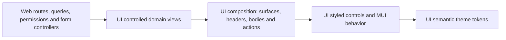

# Composable MUI component system

Source: user refinement, 24 October 2026. Status: implemented and verified ([P13-01](evidence/P13-01.md), [P13-02](evidence/P13-02.md), [P13-03](evidence/P13-03.md)).

## Intent and architecture

Keep MUI 9, React 19, Next App Router and Emotion. Give Flowboard a restrained shadcn/Headless UI-inspired appearance: neutral surfaces, fine separators, compact typography, clear focus, modest corners, and minimal elevation. Tailwind and Headless UI are visual/composition references; no additional styling engine or widget framework is needed.

Use `styled` from `@mui/material/styles` for reusable visual components. MUI's Emotion engine and existing AppRouterCacheProvider retain server rendering. This means styled components, not a migration to the separate styled-components package. MUI documents SSR limitations with that alternate engine: https://mui.com/material-ui/integrations/styled-components/.



`packages/ui` owns all reusable presentation, the public primitive entry point, theme tokens, styled slots and controlled domain views. `apps/web` owns generated queries/mutations, URL/session state, permission decisions, RHF controllers and DnD orchestration. A web component that binds those concerns is an adapter, not a shared visual primitive. Never move API clients, router hooks, tenant decisions or server data into UI.

## Decisions and component contracts

P21-01 organizes UI implementation under camelCase module-owned files. `modules/layout` owns Surface, Toolbar, AuthPanel and the workspace shell; `modules/primitives` owns authored controls; `modules/forms` owns visual field renderers; `modules/tasks`, `board`, `configuration`, `activity`, `notifications`, `overlays`, `feedback`, `navigation`, `content` and `theme` own their related presentation. This use of “modules” is a folder convention, not Nest dependency injection. Generic RHF bindings remain in the separate forms package.

Each independent public component has its own file. Surface and Toolbar retain their small private styled slots as cohesive compound components. Toast host, region, display and context are separated while sharing one context instance. Numeric/select/checkbox renderers keep their value/ref semantics. `src/index.ts` remains the package API; consumers do not import module paths. Stories/tests retain their own top-level directories, and current source links follow the new paths.

- Preserve MUI accessibility, focus trapping, keyboard behavior, refs and standard DOM props. Headless composition separates behavior from styling; it does not rebuild accessible controls by hand.
- Simple structures use children and named parts. `Surface.Root/Header/Title/Description/Body/Footer` and `Toolbar.Root/Group` let callers arrange their content. Context is used only when parts share real state, such as a controlled overlay; do not add context to static layout.
- The UI primitive entry point owns the MUI controls used by web. Layout-only primitives can retain MUI's implementation; reusable styling belongs in named styled components and the theme. Web does not import Material controls directly after migration. `sx` remains for genuinely local layout and DnD-provided positioning stays intact.
- Domain views consume shared contract types and callbacks. Tables receive items/statuses/fields and `onOpenTask`; shells and drawers receive children, labels and controlled visibility. They do not infer authorization or fetch data.
- Use semantic HSL palette tokens, rem spacing, 6px corners and no default card shadow. Standard desktop controls use 3.6rem height; coarse-pointer targets use at least 4.4rem. Navigation may retain larger hit areas. Inputs/focus need discernible boundaries; subtle decorative dividers do not replace accessible input outlines.
- Neutral light/dark surfaces replace the previous blue-gray palette. Status/priority colors retain their meanings; text labels never rely on color alone.
- Export typed public APIs, never package source paths. Prefer explicit variants and compound parts over accumulating boolean layout flags. Busy/disabled/open remain legitimate control state.

## Creating a shared component

| Responsibility                 | Location                                 | Naming                                                                          |
| ------------------------------ | ---------------------------------------- | ------------------------------------------------------------------------------- |
| Reusable presentation          | `packages/ui/src/modules/<area>/`        | camelCase file, PascalCase component; for example `taskTable.tsx` / `TaskTable` |
| Generic UI helper/hook         | `packages/ui/src/utils/` or `src/hooks/` | camelCase; for example `useRemSize.ts` / `useRemSize`                           |
| React Hook Form bindings       | `packages/forms/src/`                    | Follow that package's existing conventions; do not put RHF in UI                |
| API/session/URL-aware adapter  | `apps/web/src/features/<feature>/`       | Kebab-case file; PascalCase component, named query hooks in `.ts`               |
| Component stories              | `packages/ui/stories/`                   | `<camelCase>.stories.tsx` with typed CSF                                        |
| UI rendering/interaction tests | `packages/ui/test/`                      | `<camelCase>.test.mjs`, using the public exports                                |

1. Check existing exports and choose the owning UI area. Reuse or compose an existing control when it already provides the behavior. UI `modules` are presentation folders, not Nest modules or an instruction to move web's `features` directory.
2. Define plain typed props and callbacks. Reuse contract types for domain values and the underlying element/control props for native attributes and refs. Keep API clients, routing, session/permission decisions and form-library wiring outside UI.
3. Create one independent public component per camelCase file. Use PascalCase for the component and its props type, for example `TaskSummary` / `TaskSummaryProps` in `taskSummary.tsx`. Small private styled parts of one compound component may stay together.
4. Compose accessible MUI behavior and style reusable parts with MUI `styled`. Use children/named slots when callers need layout composition; use context only for genuinely shared state. Preserve labels, keyboard operation, focus restoration, refs and busy/disabled behavior.
5. Apply [semantic tokens and units](STYLE_TOKENS.md): theme palette values, rem spacing/dimensions, HSL palette definitions and px borders/radii. Support both themes and browser font scaling; do not hardcode light-mode colors in a component.
6. Export the public component and relevant props through `src/index.ts`. Internal modules use leaf imports; web imports the package public API. Extend `src/primitives.ts` only when maintaining that internal primitive facade, not as a second public package path.
7. Add public rendering/interaction tests and a typed Storybook story with local props. Cover meaningful empty/error/disabled or long-content states, keyboard/focus, light/dark and responsive behavior as applicable. No API calls or web fixtures in UI stories.
8. Consume the component from web's feature adapter. Keep named query hooks, Zod/RHF orchestration, optimistic writes and toasts in their owning layers. Run root build/lint/type/test/format and the applicable Storybook checks for an implementation change.

Use the existing [Surface implementation](../packages/ui/src/modules/layout/surface.tsx), [field stories](../packages/ui/stories/fields.stories.tsx) and [public composition tests](../packages/ui/test/composition.test.mjs) as source examples. The module/file split is checked by the UI source-layout suite; deciding the correct responsibility and a useful component API still requires review.

## Ordered implementation

1. P13-01: shared neutral tokens, styled controls and stateless composition parts; auth/workspace selection use them, with focused behavior and SSR checks.
2. P13-02: extract controlled reusable workspace/domain views, style existing domain components, and compose them in web without moving data logic.
3. P13-03: enforce the package boundary, expand the playground, run browser interaction/responsiveness/accessibility checks, and reconcile R134.

## Verification seams and risks

Use existing public seams: Testing Library on UI exports, lint boundary fixtures, and Playwright on the built app/playground. Cover composed children, custom refs/DOM props, keyboard/disabled behavior, labels and descriptions, overlays and focus return, long text, 320/768/1024/1440px, both themes and reduced motion. Preserve existing authentication, custom-field validation, dirty edits, optimistic rollback and DnD tests. Test selectors based on intended appearance change deliberately; do not remove behavior assertions.

Each implementation task runs root build, lint, types and tests. No API contract, database, worker or Docker runtime change was needed; the test fixture now waits for real dependency readiness. Runtime Docker builds are not necessary for this presentation-only refinement.

## Using the public API

Web routes and adapters import controls and views from `@flowboard/ui`. The existing root `ThemeProvider` supplies the MUI/Emotion cache and theme; keep it above the app. Shared components accept values, children and callbacks. They do not fetch data or decide access.

```tsx
import { Button, Surface, TaskTable, Toolbar } from '@flowboard/ui';

<Surface.Root component="section" aria-label="Project tasks">
  <Surface.Header>
    <Toolbar.Root>
      <Surface.Title component="h2">Tasks</Surface.Title>
      <Toolbar.Group>
        <Button onClick={createTask}>New task</Button>
      </Toolbar.Group>
    </Toolbar.Root>
    <Surface.Description>Work planned for this list.</Surface.Description>
  </Surface.Header>
  <Surface.Body>
    <TaskTable items={tasks} statuses={statuses} fields={fields} onOpenTask={openTask} />
  </Surface.Body>
</Surface.Root>;
```

`WorkspaceLayout`, `DrawerPanel`, `ActivityPanel`, `ActivityTimeline`, `StatusPreview`, `FieldPreview`, `MarkdownContent` and the board wrappers follow the same boundary. `FieldPreview` receives its values and change callback. `DrawerPanel` receives visibility and close behavior. Activity times display explicitly in UTC so initial server markup and browser rendering agree. The `dateTime` attribute retains the original event timestamp.

The development-only `/playground` page demonstrates controls, compound parts and domain views without making API calls. Its examples are validated sample props, separate from runtime data. Browser tests exercise both themes, four viewport widths, focus, contrast, reduced motion, callback behavior and safe Markdown. The production build keeps this route unavailable.

The executable ESLint boundary rejects direct `@mui/*` imports/reexports/dynamic imports in web `src` and `app`. MUI imports belong in UI; test fixtures remain allowed. UI also rejects data clients, router hooks and React Hook Form. Existing package-layer checks continue to reject app imports and package source-path shortcuts. Review is still needed for component ownership, visual quality and excessive local layout styles; those cannot be proved by an import rule.

## Task Data Grid

`TaskTable` uses MUI X Data Grid Community and keeps the same plain `items`, `statuses`, `fields` and `onOpenTask` props. UI owns the grid, title row headers, keyboard task actions, metadata renderers and inherited/local custom-field labels. Web owns URL-backed sort/filter controls, generated requests and cursor loading. Grid-local sort/filter/menu controls stay disabled so partial loaded results never imply server-wide ordering.

The visible Community paginator offers 25/50/100 rows per page over the rows already loaded. Web's **Load more tasks** action retrieves the next cursor page; grid page changes make no API request. Keep the paginator visible so every loaded row remains reachable beyond 100. Do not add offset endpoints or paid grid features for this presentation.

The bounded rem-sized container uses virtualized, content-height rows. Numeric grid geometry derives from an observed one-rem element, preserving browser font preferences. Keep `data-open-task` on title buttons for drawer focus restoration and use the grid's supplied `tabIndex` for its roving keyboard focus. Storybook covers keyboard activation, empty data, appended pages, reset and font scaling.

References: [Community pagination](https://mui.com/x/react-data-grid/pagination/), [grid accessibility](https://mui.com/x/react-data-grid/accessibility/), [row height](https://mui.com/x/react-data-grid/row-height/).

## Form bindings

The later [P14 form system](FORM_SYSTEM.md) puts reusable React Hook Form bindings in `packages/forms`, above this UI layer. Web retains schema/default selection, requests, field arrays, resets and conflict decisions. This refines the earlier web-only controller ownership; the UI prohibition on RHF remains. UI controls can receive hint/value/error/ref callbacks from the shared adapter without depending on the form library.

## Color and unit refinement

[P15-01 and D140](STYLE_TOKENS.md) refine the original 4px/16px scale: palette declarations use HSL, fixed dimensions use rem, and 1rem/one MUI spacing unit is 10px at the normal browser default. Existing spacing multipliers were adjusted to preserve layout. Borders/radii stay px, and larger browser font preferences remain effective. This supersedes earlier source-unit examples without changing component ownership or interaction behavior.

P27-01/D153 revises the former 4.4rem desktop control height toward the compact shadcn reference. Text fields and selects explicitly default to small outlined controls; single-line text and native menus are 3.6rem, while multiline fields grow with content. Coarse-pointer targets remain at least 4.4rem. Actual input padding/line height are normalized, since a smaller minimum alone cannot override MUI padding.

Status chips fill with their stored color; a selected field option uses its optional option color. An omitted option color uses the neutral filled variant. Text chooses the more readable black/white contrast token. Missing/invalid options and mixed multi-select values use neutral fill. Priority fills use error/warning/info/success semantics. Labels keep names/categories so color is never the only cue. Application palette values, including severity and contrast choices, live in `tokens.ts`; `theme.ts` maps them to MUI.

## Action and live notifications

The standalone [Storybook](STORYBOOK.md) demonstrates UI controls, domain presentation, shared overlays and notifications using local props and the shared theme. Its browser checks complement the application playground and end-to-end journeys.

`ToastHost` wraps the application with one React Toastify renderer. Web passes a plain message and dismissal callback; UI owns themed styling and registers the innermost drawer/dialog as the toast's accessible region. Arrival never moves focus. Alt+T focuses the notification; its Dismiss button or Escape closes it. Escape from a focused toast leaves the underlying dialog open. Errors remain until dismissed; success/info use six seconds with hover/window-focus pause and reduced-motion styling.

Web's notification store accepts one result per captured action, keeps at most five messages, and invalidates captured reporters on session changes. Existing form errors and conflict/retry controls remain visible. HTTP success alone does not produce a toast: task/config response validation must finish first. Ordinary reads, session refreshes and reconnect resync remain quiet.

Realtime clients opt into a recipient-relative `self` flag with the public `notifications=v1` handshake query. The token-only auth payload remains compatible with older servers. Only authorized, subscribed changes marked `self: false` produce a content-free notification, deduplicated across move endpoints. The flag refers to the acting account, including other tabs. Legacy clients receive the original payload so independent API/web releases remain compatible. Toasts are transient UI feedback; the activity feed remains the durable task history.
