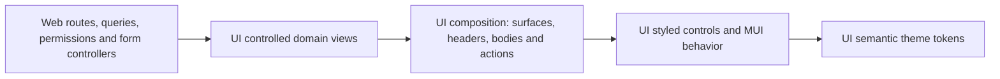

# Composable MUI component system

Source: user refinement, 24 October 2026. Status: implementation in progress (P13-01–03).

## Intent and architecture

Keep MUI 9, React 19, Next App Router and Emotion. Give Flowboard a restrained shadcn/Headless UI-inspired appearance: neutral surfaces, fine separators, compact typography, clear focus, modest corners, and minimal elevation. Tailwind and Headless UI are visual/composition references; no additional styling engine or widget framework is needed.

Use `styled` from `@mui/material/styles` for reusable visual components. MUI's Emotion engine and existing AppRouterCacheProvider retain server rendering. This means styled components, not a migration to the separate styled-components package. MUI documents SSR limitations with that alternate engine: https://mui.com/material-ui/integrations/styled-components/.

`packages/ui` owns all reusable presentation, the public primitive entry point, theme tokens, styled slots and controlled domain views. `apps/web` owns generated queries/mutations, URL/session state, permission decisions, RHF controllers and DnD orchestration. A web component that binds those concerns is an adapter, not a shared visual primitive. Never move API clients, router hooks, tenant decisions or server data into UI.

## Decisions and component contracts

- Preserve MUI accessibility, focus trapping, keyboard behavior, refs and standard DOM props. Headless composition separates behavior from styling; it does not rebuild accessible controls by hand.
- Simple structures use children and named parts. `Surface.Root/Header/Title/Description/Body/Footer` and `Toolbar.Root/Group` let callers arrange their content. Context is used only when parts share real state, such as a controlled overlay; do not add context to static layout.
- The UI primitive entry point owns the MUI controls used by web. Layout-only primitives can retain MUI's implementation; reusable styling belongs in named styled components and the theme. Web does not import Material controls directly after migration. `sx` remains for genuinely local layout and DnD-provided positioning stays intact.
- Domain views consume shared contract types and callbacks. Tables receive items/statuses/fields and `onOpenTask`; shells and drawers receive children, labels and controlled visibility. They do not infer authorization or fetch data.
- Use semantic palette tokens, 4px spacing, 6px corners, no default card shadow, and at least 44px interactive targets. Inputs/focus need discernible boundaries; subtle decorative dividers do not replace accessible input outlines.
- Neutral light/dark surfaces replace the previous blue-gray palette. Status/priority colors retain their meanings; text labels never rely on color alone.
- Export typed public APIs, never package source paths. Prefer explicit variants and compound parts over accumulating boolean layout flags. Busy/disabled/open remain legitimate control state.

## Ordered implementation

1. P13-01: shared neutral tokens, styled controls and stateless composition parts; auth/workspace selection use them, with focused behavior and SSR checks.
2. P13-02: extract controlled reusable workspace/domain views, style existing domain components, and compose them in web without moving data logic.
3. P13-03: enforce the package boundary, expand the playground, run browser interaction/responsiveness/accessibility checks, and reconcile R134.

## Verification seams and risks

Use existing public seams: Testing Library on UI exports, lint boundary fixtures, and Playwright on the built app/playground. Cover composed children, custom refs/DOM props, keyboard/disabled behavior, labels and descriptions, overlays and focus return, long text, 320/768/1024/1440px, both themes and reduced motion. Preserve existing authentication, custom-field validation, dirty edits, optimistic rollback and DnD tests. Test selectors based on intended appearance change deliberately; do not remove behavior assertions.

Each implementation task runs root build, lint, types and tests. No API contract, database, worker or Docker startup change is planned. Runtime Docker builds are not necessary for this presentation-only refinement.
