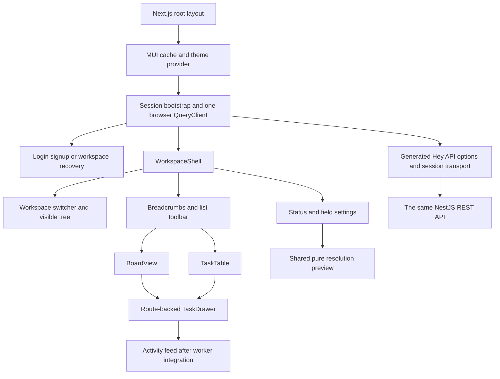

# Flowboard UI design: Linear-inspired, built with MUI

Status: **implementation guide, not a shipped interface**. Research checked 23 October 2026. This document maps publicly documented Linear interactions to Flowboard's existing requirements, [API catalog](API_CATALOG.md), [system design](SYSTEM_DESIGN.md) and P08–P11 tasks. No signed-in Linear workspace, private source code or proprietary design file was accessed. Measurements below are proposed Flowboard defaults, not extracted Linear tokens.

## 1. What the public research supports

| Evidence                                                                                           | Observed pattern                                                                                                                                | Flowboard decision                                                                                                                     |
| -------------------------------------------------------------------------------------------------- | ----------------------------------------------------------------------------------------------------------------------------------------------- | -------------------------------------------------------------------------------------------------------------------------------------- |
| [Linear workspaces](https://linear.app/docs/workspaces)                                            | Workspace navigation/settings live behind the upper-left workspace control.                                                                     | Put a workspace switcher above our collapsible hierarchy. Settings entry is permission-aware.                                          |
| [Linear board layout](https://linear.app/docs/board-layout)                                        | Board/list layouts share issues; status is the default board grouping, column headers offer creation, and keyboard actions complement dragging. | One list resource feeds board/table. Fixed status grouping and explicit create/move controls cover the MVP.                            |
| [Linear display options](https://linear.app/docs/display-options)                                  | Ordering, grouping and displayed properties are distinct from filters; manual order is shared.                                                  | Separate view/sort/filter controls. Persist order on the API; keep shareable view choices in the URL.                                  |
| [Linear issue assignment](https://linear.app/docs/assigning-issues)                                | Issue properties are accessible from detail views and cards; Linear assigns one human owner.                                                    | Use a compact properties section, but preserve Flowboard's multiple assignees and show initials/avatar groups.                         |
| [Linear board detail guidance](https://linear.app/docs/board-layout)                               | Cards omit long descriptions and offer a quick detail preview.                                                                                  | Keep cards concise and open the required Flowboard task drawer. The drawer is our adaptation, not a claim that Linear always uses one. |
| [Linear's March 2026 refresh](https://linear.app/now/behind-the-latest-design-refresh)             | The published refresh reduces visual emphasis on navigation and uses softer separation.                                                         | Quiet navigation and dividers support task content. Exact colors, spacing and typography remain our choices.                           |
| [Linear's August 2026 StyleX article](https://linear.app/now/styling-linear-for-the-future-stylex) | Linear reports moving its React apps from styled-components to StyleX and making styling contracts more explicit.                               | Keep the required MUI stack. Use semantic theme tokens and explicit component variants rather than deep external overrides.            |

These observations support interaction and composition decisions; they do not establish Linear's current database schema, component implementation or accessibility conformance. [Earlier architecture research](REFERENCE_ARCHITECTURES.md) covers disclosed backend patterns separately. Avoid copying branding, logos, product text or proprietary assets.

## 2. Product scope and information architecture

The main object is a **List inside Workspace → Space → Folder → List**. Board and table are two views of that list; neither creates a new database object. A task belongs to one primary list. Statuses and fields can differ between sibling lists, so context always follows the selected list.

Proposed routes, implemented in the Next.js App Router:

| URL                                                                  | Purpose / state                                                              |
| -------------------------------------------------------------------- | ---------------------------------------------------------------------------- |
| `/login`, `/signup`                                                  | Credential forms and clear auth errors.                                      |
| `/workspaces`                                                        | Select a membership after sign-in; handle no-membership/invitation recovery. |
| `/w/:workspaceId/lists/:listId?view=board`                           | List board; default view when view is omitted.                               |
| `/w/:workspaceId/lists/:listId?view=list&sort=dueDate&direction=asc` | Same list as a sorted table.                                                 |
| The list route with `task=:taskId`                                   | Open a shareable detail drawer over the selected view.                       |
| The list route with `fieldKey`, `fieldOperator`, `fieldValue`        | Typed single custom-field filter; values mirror API semantics.               |
| `/w/:workspaceId/settings/:ownerType/:ownerId/statuses`              | Admin status editor; workspace/space/folder/list owners.                     |
| `/w/:workspaceId/settings/:ownerType/:ownerId/fields`                | Admin field editor; workspace defaults plus space/folder/list overrides.     |

Workspace IDs in URLs are navigation targets, not proof of access. A URL for another available workspace must complete `switchWorkspace` before loading its data; never issue domain queries with an old active-workspace token. A forbidden target renders access denied without names from stale cache. Browser Back closes a route-opened drawer and restores the prior list/filter state.

Do not encode refresh/access tokens or invitation secrets in query strings. Invitation links may carry a fragment that the acceptance form exchanges using the catalog contract, then removes from visible navigation/history.

## 3. Screen composition

Desktop arrangement: navigation left, list name/breadcrumbs and actions across the top, task content below, and task details in a right-side overlay. The toolbar contains Board/List, one field filter and Create task; due-date/priority sort controls appear only in the table. The board stays manually ordered. Entering board view normalizes/removes table-only sort parameters from the URL, so URL and visible order agree. Keep secondary configuration behind a clearly labeled settings menu. Avoid a dashboard full of empty summary panels or unrelated metrics.

### Workspace shell and tree

- Workspace button exposes current name, available workspaces, settings and logout. While switching, suspend queries, close details, clear the previous tenant cache and socket subscriptions, then initialize the new context. Other independent login families can stay in their own workspace.
- Sidebar groups the exact Flowboard hierarchy. Separate expand/collapse from selecting a List; selecting Space/Folder exposes their context and an admin settings action rather than inventing a task list for them.
- Only server-visible nodes render. Never show denied/private labels as disabled placeholders. A visible private node may show a lock with accessible text; that icon never replaces authorization.
- Assemble the paginated flat tree by IDs/parent IDs. Show loading/load-more state until complete; refresh from the first page on stale revisions. Do not mark an unreturned branch empty prematurely.
- Use actual navigation lists and buttons with `aria-expanded`/`aria-current`; no `role=tree` unless full tree keyboard semantics are implemented. Preserve focused item across expansion and refresh where possible.

### Kanban board

Columns are exactly the list's resolved visible statuses, ordered position/key/ID. Render empty columns too. Each header has status name, color+text category cue, **loaded** count and labeled Create task action. Counts are not totals while pages remain. Cards show title, assignee initials, priority, due date and an optional selected custom-field chip. No descriptions or large property forms on cards.

Load columns independently using generated `listTasks` options with statusId/manual sort. Configuration and all task responses must agree on configVersion; all task pages/columns must also agree on dataVersion. Refresh mismatches with a bounded retry, then show a recoverable “Board changed while loading” state. A task whose status cannot be resolved is an error/refetch condition, never an invented “Unknown” column.

Use dnd-kit for pointer and keyboard moves. Each card also has a Move menu: choose status/list, move to start/end or before/after an available neighbor. One generated move/reorder mutation handles both input methods. The move form can collect required destination fields and explicit source-field clears before submission; do not pretend a cross-list move succeeded before validation.

Serialize in-flight mutations per task. Snapshot only affected cache entries, cancel matching queries and apply an optimistic version-tagged change. On failure, rollback only if that optimistic version still owns the cache; otherwise preserve the newer event/result and refetch. On success, reconcile the returned task and invalidate changedTaskIds/source/destination order. A switch/removed permission aborts old work and prevents a response entering the new tenant cache. Disable contradictory controls while that task saves; do not freeze unrelated cards.

### List table

Use an accessible MUI Table, not a paid grid dependency. Columns: title, status, assignees, priority, due date, and at least **two effective custom fields** on the seeded demonstration list. Field column labels/types come from resolved schema; long values truncate visually with accessible full content. If a real list has fewer than two definitions, render its actual fields rather than inventing data.

Due-date and priority sorting runs on the server and resets the cursor. Priority order is urgent/high/normal/low/none; dates are nulls-last. The field-filter control is schema-aware: select an effective field, operator and typed value. “Clear filter” restores the unfiltered query. View switches retain list, task and compatible filter state. Never sort only the loaded page and label it a global order. Show accessible Load more and loaded-count text; no made-up total.

### Task create/detail drawer

The drawer contains title, safe Markdown description editor/preview, status, priority, multiple assignees selected from listWorkspaceMembers with assignableToListId, calendar due date and resolved custom inputs. Detail actions include Save, Cancel and Archive with confirmation. The route identifies the task; a direct link loads it after auth and checks that its list matches the route. If it moved elsewhere, use the authorized returned list metadata/ID to navigate or show a permission-safe unavailable state.

Forms use typed React Hook Form with shared Zod and zodResolver, complete defaults and onBlur/onTouched validation. MUI controlled components use Controller; stable field-array IDs preserve option inputs. Keep form adapters data-aware in web, presentational input primitives in ui. The resolved schema supplements the static task contract for dynamic required/type rules; the API revalidates everything.

| Field         | Input                                      | Empty/value mapping                                                                                                            |
| ------------- | ------------------------------------------ | ------------------------------------------------------------------------------------------------------------------------------ |
| Text          | Labeled TextField                          | Empty optional value clears explicitly; required whitespace fails.                                                             |
| Number        | TextField with decimal input mode          | Parse intentionally; empty clears, invalid intermediate text stays editable, finite `0` is valid. Never convert empty to zero. |
| Single select | Select or accessible Autocomplete          | Store option ID, not label; no selection clears optional value.                                                                |
| Multi select  | Multiple Autocomplete with removable chips | Unique option IDs; required empty array fails.                                                                                 |
| Date          | Labeled date input                         | Calendar YYYY-MM-DD, no UTC conversion that shifts a day; empty clears.                                                        |
| Checkbox      | Checkbox + visible label                   | `false` is a value; optional unset has an explicit Clear action if needed.                                                     |

A server path such as customFields.effort maps to that input's error. A failed save preserves every dirty value. A realtime update must not reset an open dirty form: show “This task changed” and offer reload/discard or an explicit retry against freshly reviewed data; no silent overwrite. Successful save replaces defaults with the authoritative response. Unsaved close/route change asks Keep editing or Discard, restoring focus to the opener on close. Archive removes the card/row after success and returns to list context.

Safe Markdown renders without raw HTML; sanitize links and allowed protocols. This is text editing, not a general embedded HTML editor. Activity starts with loading/empty/error states; after P11 it displays actor, status change and timestamp from the real feed, with eventual consistency and a retry action. Before P11, omit that feature from usable UI or label the explicit tracked TODO; never show fake events.

### Status and field configuration

Workspace settings expose default fields; space/folder/list settings expose local definitions and inherited workspace values. Only admins receive editable config routes/actions. Nonadmins may inspect the effective list schema through read-only detail inputs; a direct admin route returns a proper forbidden state. The API remains authoritative for every mutation.

A scope header shows Workspace/Space/Folder/List breadcrumbs. Display rows with explicit **Inherited**, **Local**, **Overridden** or **Hidden** text, not color alone. Status editing separates shared stable identity from this scope's label/color/position/visibility. “Remove local override” explains that inherited values return; it does not imply deleting the global identity. Hidden inherited entries remain discoverable in configuration with an Unhide action.

Field resolution starts with workspace defaults, then space, folder and list. Field overrides replace the complete definition for a key, including options/type/required. Show that consequence before save; removing a local row previews the inherited replacement if one exists. A required marker always has text and semantic required state. Option rows retain stable IDs, and “Add option” creates a new ID rather than renumbering existing values.

Fetch local rows for the scope and its authorized ancestor chain with a matching configVersion. Use the shared pure resolvers for previews. Server rejection of an in-use status, invalid category set or field schema keeps the draft, identifies the relevant row and refreshes the effective baseline. Do not offer destructive auto-remapping absent the API contract. Successful save refetches descendant list/config data and notifies active views.

## 4. Shared components and theme

Keep `packages/ui` free of network/session knowledge. It receives plain values, loading/error flags and callbacks. `apps/web` owns generated queries, mutation lifecycles, route state and permission-derived props. Use composition for Card content/actions and Dialog content/actions, avoiding large boolean-prop variants or speculative wrapper layers.

| Shared UI component               | Responsibility / MUI building blocks                                  | Web feature owner               |
| --------------------------------- | --------------------------------------------------------------------- | ------------------------------- |
| ThemeProvider                     | App Router cache integration, CSS baseline, semantic theme            | Root providers                  |
| StatusChip / PriorityBadge        | Chip/Box + accessible label; text and color cues                      | Board/table/detail              |
| AssigneeAvatarGroup               | AvatarGroup with initials, names and overflow summary                 | Task presentation               |
| DueDateLabel                      | Typography/time element; explicit overdue label and calendar date     | Task presentation               |
| CustomFieldChip                   | Type-aware compact read-only value                                    | Board/table                     |
| CustomFieldInput / field wrappers | Controlled TextField/Select/Checkbox primitives and helper/error text | RHF task/config adapters        |
| KanbanColumn / KanbanCard         | Paper/Box/Card structure with action slots and focus states           | Board drag/mutation coordinator |
| TreeItem                          | ListItemButton, disclosure button, depth and selection props          | Visible-tree navigation         |
| ConfirmDialog                     | Dialog, labels, focus restoration and action slots                    | Archive/unsaved changes         |
| EmptyState / ErrorState           | Clear message and explicit next action                                | Every data-aware screen         |

Use official [MUI App Router integration](https://mui.com/material-ui/integrations/nextjs/) to collect streaming styles correctly. Pin compatible MUI/Next/Emotion versions during P08 and choose the documented matching cache-provider entry point; this document does not prescribe an unverified import version. ThemeProvider is the single public wrapper. Keep layout/server components on the server when possible; interactive session/query/form/drag areas are client boundaries.

Proposed starting tokens (validate on rendered screens before finalizing):

| Token group | Flowboard proposal                                                                                                       |
| ----------- | ------------------------------------------------------------------------------------------------------------------------ |
| Surfaces    | canvas #F7F8FA, paper #FFFFFF, selected #EAF1FF; decorative divider #D9DEE7; control border #65738B                      |
| Text        | primary #17202E, secondary #4D5B6F; disabled is never the only unavailable-state cue                                     |
| Action      | primary #245CC5, strong focus ring #174EA6; error #B42318, success #146C43                                               |
| Typography  | System sans or a licensed local font; body14/line20, controls14, section16, page22; readable 12px metadata minimum       |
| Spacing     | 4,8,12,16,24,32px rhythm, mapped to semantic component spacing                                                           |
| Shape       | 6px controls, 8px cards, 12px dialogs; restrained shadows and visible boundaries                                         |
| Layout      | 256px desktop sidebar, 304px board columns with12px gaps, 560px desktop drawer, 44px minimum interactive row/target goal |
| Motion      | 120–180ms subtle transitions; reduce/disable translation and drag animations under prefers-reduced-motion                |

Map these through palette, typography, spacing, shape and component variants/overrides; feature code uses semantic tokens. User-defined status colors are untrusted presentation choices: keep a readable neutral text label/icon and use the selected color as an accent, or compute a verified contrast pair. Do not assume every chosen color is accessible. P08-01 defines both light/dark tokens and exercises both in the playground, as the existing task requires. Proposed dark counterparts are canvas #10151D, paper #18202B, text #E7EDF6, secondary #A9B6C8, action #8AB4FF and control border #63758F. A product mode switch remains optional until both themes pass rendered-state checks; do not ship partially inverted screens.

A simple internal playground route in web, available only in development, demonstrates each shared component with long content, errors, empty states and keyboard usage before P09 composition. This satisfies the requested stories/playground without adding another deployment/service. No product sample data is used as a runtime API substitute.

## 5. State ownership and query flow

| State                                  | Owner                                                | Rules                                                                                                                                                     |
| -------------------------------------- | ---------------------------------------------------- | --------------------------------------------------------------------------------------------------------------------------------------------------------- |
| Active identity/workspace/access token | Session coordinator in web + server session contract | In-memory token; no localStorage credential. No global cross-request SSR token.                                                                           |
| Tasks, tree, schemas, members, feed    | TanStack Query generated options                     | Keys include active workspace and resource/filter/sort/cursor. Use generated key factories plus a tenant prefix/wrapper, not duplicated endpoint strings. |
| View/sort/filter/selected task         | Validated URL/search-param schema                    | Back/share semantics; reject invalid values and reset incompatible cursors.                                                                               |
| Drawer/config draft                    | Local RHF state                                      | Preserve dirty values; explicit server conflict handling.                                                                                                 |
| Expanded sidebar branches / open menu  | Local component state                                | No server-state mirror or new global store.                                                                                                               |
| Optimistic edit bookkeeping            | Per-task mutation coordinator                        | Scoped snapshots and session-generation guards.                                                                                                           |

Load session → select/verify workspace → visible tree → selected list metadata/statuses/fields/tasks in parallel. Use matching response revisions before combining. On401, setupClient may refresh and retry once in the original session generation; on403 show permission recovery, not a refresh loop. On409 version/config/cursor conflict, preserve drafts, refetch authoritative context and require a reviewed retry. Never automatically replay a stale move after a configuration change.

After P11, Socket.IO authenticates with the access token and subscribes only to authorized list rooms. Invalidation events refetch matching generated queries; they do not replace server authorization. Ignore older task versions; a version gap/reconnect triggers refetch. A config/access event clears incompatible schema/tree data; permission loss closes sensitive details and cancels mutations. Activity insertion may trail the successful task update; communicate that without fabricating a completed event.

## 6. Responsive, accessibility and failure acceptance

| Condition                             | Required behavior / check                                                                                                                                                          |
| ------------------------------------- | ---------------------------------------------------------------------------------------------------------------------------------------------------------------------------------- |
| 320px                                 | Sidebar is a temporary drawer; task detail is full width; toolbar wraps or uses labeled menus. Board/table may scroll horizontally within content; page controls remain reachable. |
| 768px                                 | Navigation can collapse; detail does not squeeze task content into unusable columns; explicit close/back remains visible.                                                          |
| 1024/1440px                           | Stable left navigation and content hierarchy; drawer overlays or uses sufficient remaining width. Long titles/field labels wrap without covering actions.                          |
| Keyboard                              | Logical tab sequence; all menu/move/archive actions reachable; drawer trap and return focus; Escape respects unsaved-state dialog; no shortcut fires while typing.                 |
| Assistive technology                  | Landmarks/headings, named icon buttons, linked errors, status announcements and textual priority/status/overdue indicators. Announce move success/failure once.                    |
| Contrast/motion                       | Test normal text4.5:1, large text3:1 and control/focus boundaries3:1; verify user colors and all states. Reduced-motion mode keeps state changes understandable without animation. |
| Loading                               | Skeletons follow layout; no prior-tenant data flash; incomplete tree/columns identify further loading.                                                                             |
| Empty / filtered empty                | Distinct “No tasks yet” + Create and “No matching tasks” + Clear filter; neither claims a total until paging completes.                                                            |
| Offline/server failure                | Keep safe readable cached state with stale indication; save failures retain drafts; Retry is explicit. No offline mutation queue.                                                  |
| Forbidden / missing                   | Explain access loss or unavailable resource without stale labels; navigate back to an authorized list/workspace.                                                                   |
| Concurrent edit/config change         | 409 is actionable; never discard dirty values or show cards under an invalid status.                                                                                               |
| Repeated drag/save / workspace switch | No duplicate pending mutation per task, no old response in new tenant, no rollback over a newer authoritative version.                                                             |

## 7. Ordered implementation and test evidence

| Task          | Build first                                     | API operations                                                                                          | Acceptance focus / requirements                                                                                  |
| ------------- | ----------------------------------------------- | ------------------------------------------------------------------------------------------------------- | ---------------------------------------------------------------------------------------------------------------- |
| P08-01        | Theme/display primitives and playground         | None                                                                                                    | Tokens, contrast, long text, status/priority/date/assignee presentation; R23,R70                                 |
| P08-02        | Controlled field/card/tree/dialog primitives    | None                                                                                                    | Six field types, keyboard/focus, zero/false/clear and option IDs; R23,R68,R70                                    |
| P08-03        | Auth shell, switcher and tree                   | signUp, logIn, refreshSession, logOut, switchWorkspace, getCurrentUser, listWorkspaces, listVisibleTree | No prior-tenant flash; Alice/Bob visibility; URL selection; R28–R30,R33–R34,R40,R62,R69                          |
| P09-01        | Read-only board with real list schema/data      | getNode, getListResolvedStatuses, getListResolvedFields, listTasks                                      | Exact sibling-specific columns, complete/empty/error states, both revisions; R49,R63,R71                         |
| P09-02        | Optimistic moves and explicit controls          | moveTask, reorderTask                                                                                   | Rollback races, required destination values,403/409 and keyboard; R46–R47,R64,R70                                |
| P09-03        | Table and filters                               | listTasks                                                                                               | Two effective custom columns, server sort/filter, cursor reset; R49,R65,R69                                      |
| P09-04        | Drawer/create/archive and first Playwright flow | getTask, createTask, updateTask, archiveTask, listWorkspaceMembers                                      | Full defaults, dirty preservation, sanitized Markdown, persistent edit after reload; R44–R45,R48,R66,R68–R70,R84 |
| P10-01/P10-02 | Scoped config forms and preview                 | Scope status/field CRUD and resolved-list reads                                                         | Inherited/local/hidden, in-use errors, sibling isolation and admin guard; R41,R67,R68                            |
| P11-02/P11-03 | Real activity and reconnect behavior            | listTaskActivity plus shared socket contracts                                                           | One persisted status event, two-client update, revoked access and reconnect; R72–R76                             |

Follow each existing task's full definition of done and commit separately. Do not jump directly from docs to a broad UI implementation. At P09-04, Playwright logs in → selects a list → verifies exact column labels → opens a task → edits a custom field → saves → reloads and verifies persistence. Add Alice→Bob private-list absence; P11 adds the two-client update path. Screenshots at all four sizes supplement behavioral checks; screenshots alone do not prove permissions or persistence.

Defer personalized navigation, saved/shared views, cycles, triage, bulk editing, a universal command palette, offline replication, AI features, swimlanes and drag-only hidden columns. They are not required to deliver the current Flowboard task workflow. Future additions need a real task and acceptance criteria, not a decorative disabled control.
