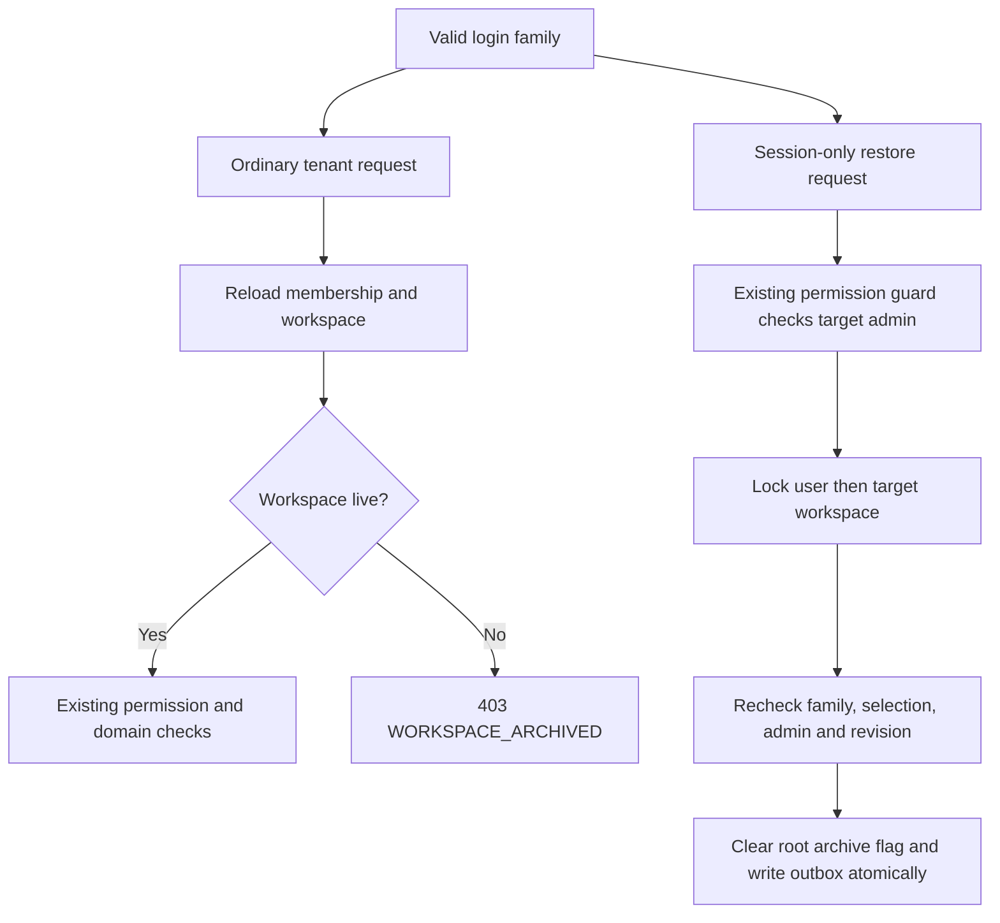

# Workspace lifecycle design

R156 is selected by D155. NEXT-02 defines the policy; P29-01 implements and verifies the API, and P29-02 implements the management screens and live client recovery. Their evidence records distinguish design from executed verification.

## Behavior and data

Administrators can rename the current workspace, archive it, and restore an archived workspace they still administer. Add nullable `Workspace.archivedAt` (`timestamptz(3)`), retaining every membership, grant, node, task and history row. Archive changes only the workspace root; restore clears only that root flag. Individually archived containers/tasks stay archived. No hard delete or automatic restoration of descendants is introduced.

All mutations require the last-read `expectedConfigVersion`. Rename trims/validates the existing NameSchema and preserves revisions on a no-op. Archive/restore advance configuration and data revisions once when changed; restoring an already-live root with its current revision is a no-op. Repeated archive calls use the ordinary access policy and return WORKSPACE_ARCHIVED. Emit the existing `workspace.config.updated` outbox event with reason `hierarchy` in the same transaction. The existing event shape is sufficient; no new payload exposing workspace content is needed.

New ordinary tenant transactions fail with 403 `WORKSPACE_ARCHIVED` after archive commits. Check after the existing workspace write lock and membership reload, and in ordinary identity authentication. This protects HTTP, sockets and direct repository consumers. An already-running repeatable-read transaction may complete against its earlier snapshot; archival does not promise cancellation of in-flight reads. Outbox processing remains available for persisted events.

## Session and recovery boundary

Keep the selected workspace ID in existing refresh rows and JWT claims. Session-only current-user, workspace-list, refresh, logout and recovery paths remain usable, and return safe archive metadata when the selected membership still exists. Never replace an archived selection with null without also coordinating the persisted session: that would break refresh/JWT identity matching. A fresh login chooses the first live membership, or null when none exist.

Workspace listing keeps its existing live cursor policy. It shows live memberships and archived memberships only for current administrators. Put visibility and keyset predicates in separate AND clauses so their OR conditions cannot overwrite each other. Reload the picker pages after lifecycle actions; this is not snapshot pagination.

Restoration is a narrow identity-repository capability, not a generic bypass for tenant repositories. The existing PermissionGuard/PermissionService handles its policy and checks the current target administrator membership. The mutation repeats all checks under locks: user first, target workspace second, then live session family/selected workspace, current membership role, and expected revision. Unknown or unrelated workspace IDs return 404; current non-administrators return 403; stale revisions return 409. A failed check leaves workspace state, revisions and events unchanged.

Restore does not change the selected workspace. If the caller logged in with no live workspace, the UI explicitly switches to the restored workspace after success. Invitations cannot be accepted into archived workspaces, and workspace switching rejects archived targets. Keep the current fail-closed client policy after an unsuccessful switch: clear the local session and offer sign-in, rather than claiming the switch succeeded.

## Contracts and modules

| Operation                                  | Contract and policy                                | Result                                   |
| ------------------------------------------ | -------------------------------------------------- | ---------------------------------------- |
| GET `/v1/workspaces/:workspaceId`          | Current live workspace; `workspace.read`           | Safe root metadata and current revisions |
| PATCH `/v1/workspaces/:workspaceId`        | Name + expectedConfigVersion; current admin        | Renamed root and current revisions       |
| POST `/v1/workspaces/:workspaceId/archive` | expectedConfigVersion; current admin               | Archived root and resulting revisions    |
| POST `/v1/workspaces/:workspaceId/restore` | Session-only target recovery; current target admin | Restored root and resulting revisions    |

Shared contracts own request/response shapes, archive metadata and the error code. Thin grouped `workspaces.*.dto.ts` adapters feed Swagger. The workspaces service orchestrates; the database package owns all Prisma/SQL. Normal root reads/writes use tenant-scoped repositories. The identity repository owns only the explicit cross-selection recovery capability, with no raw client exported. Regenerate OpenAPI and Hey API operations before introducing web consumers.

Active-workspace session metadata adds archive state. Picker entries also expose the configuration revision needed for restore. Do not accept server-owned timestamps, user identity, acting role or tenant context in mutation bodies.

## Browser behavior

The workspace settings page uses generated operations and RHF/Zod forms. Rename has explicit save. Archive confirmation names the workspace and explains retained data and blocked access. It returns to the picker after success. Only archived administrator cards expose Restore. Failed or stale mutations preserve the draft and require an explicit reload; no automatic stale-write retry.

Administrators open **Workspace settings** in the sidebar (`/w/:workspaceId/settings/workspace`). The form keeps its original configuration revision until a successful save or explicit reload. Background reads cannot silently advance a dirty form's precondition. Reload confirms discarding edits, disables inputs while pending, and retains the draft if the read fails. A stale restore in the picker offers **Reload workspaces** before retrying. A fresh login with no live workspace can restore an administrator membership, then explicitly select it.

Treat a selected workspace's archive-state change as a client scope change: cancel/clear queries, clear pending notifications, advance the local revision and unmount cached workspace children. Do this before rendering another board/drawer. Do not create sockets for an archived selection.

The server checks authorization before delivering a workspace event, so the archive event itself cannot reliably notify a revoked socket. Existing connections discover archive through disconnect/recheck; the client refreshes its session once. A first handshake after archive must also surface a sanitized `WORKSPACE_ARCHIVED` code so the client refreshes. Generic network/Redis connect errors must not trigger repeated refresh rotations. Preserve existing Redis-outage reconnect behavior and session single-flight coordination.

## Implementation tasks and failure checks

P29-01 owns migration, contracts, scoped root repository, identity recovery/session handling, guarded endpoints, generated artifacts and real-PostgreSQL/API tests. Cover rename/no-op/stale versions, sole-workspace archive → refresh → list → restore, fresh login with null selection, non-admin/former-admin/foreign IDs, rejected invitations/switches, direct tenant and socket denial, archive versus waiting write, restore versus logout/switch, and retained individually archived data. Test rollback when outbox insertion fails.

P29-02 owns management forms/picker, generated query hooks, archive-aware session/cache/socket behavior and browser tests. Cover keyboard/confirmation/cancel, dirty stale form, double submission, a remotely archived open board/drawer, handshake after archive, recovery from null selection, denied switch, and existing Redis outage recovery. Shared UI remains presentational; no domain transport moves into it.

Both tasks require root build, lint, typecheck, format and tests; endpoint changes also require generated-contract checks. Each task records actual evidence and commits independently. Read [TASKS.md](TASKS.md) for order and [DECISIONS.md](DECISIONS.md#d157--workspace-root-archive-and-explicit-recovery) for the selected policy.

Rollout adds a nullable root column and required archive-state response metadata. Apply migrations before the new API and ship matching API/web contracts together; older API responses omit metadata required by the new client. Existing rows default to live. This task does not migrate or reset a running developer dataset.
