# System and data

[Atlas index](../DIAGRAMS.md). Source snapshot: `cc0e3d6`; render/update details are in the [diagram guide](README.md).

## C01 — System context

**Status: Implemented.** The browser uses the web proxy for REST and a direct authenticated socket for realtime. It never connects to Redis or PostgreSQL. The worker stores activity and publishes invalidations through the API.

[Editable Mermaid source](sources/c01-system-context.mmd). References: [Architecture](../../ARCHITECTURE.md), [HLD](../HLD.md).

## C02 — Package dependency boundaries

**Status: Implemented.** Solid arrows show permitted runtime imports. The OpenAPI-to-API exception is build-only; apps do not import other apps. The contracts package stays framework-free.

[Editable Mermaid source](sources/c02-package-dependency-boundaries.mmd). References: [Package matrix](../../ARCHITECTURE.md#package-boundary-matrix).

## C03 — Core data relationships

**Status: Implemented.** This selected relationship map emphasizes tenant keys and task/activity links. It omits refresh sessions, invitations, grants, status overrides and seed metadata; the full schema and all audit timestamps remain in the database reference. Owner references on field definitions are polymorphic, not an implied Node foreign key.

[Editable Mermaid source](sources/c03-core-data-relationships.mmd). References: [Complete database model](../DATABASE_DESIGN.md), [Prisma schema](../../packages/database/prisma/schema.prisma).

## C04 — Contract to generated client

**Status: Implemented.** One contract feeds server DTOs and client generation. Spec export uses isolated providers rather than connecting to production data. Generated transport operations are not handwritten in UI components.

[Editable Mermaid source](sources/c04-contract-to-generated-client.mmd). References: [API conventions](../API_CATALOG.md), [API client](../../packages/api-client/src/setup-client.ts), [OpenAPI package](../../packages/openapi/package.json).
