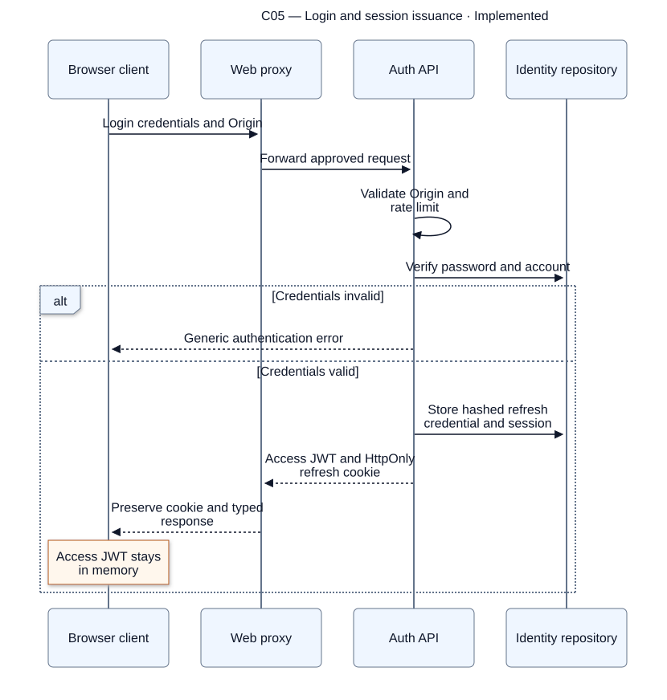
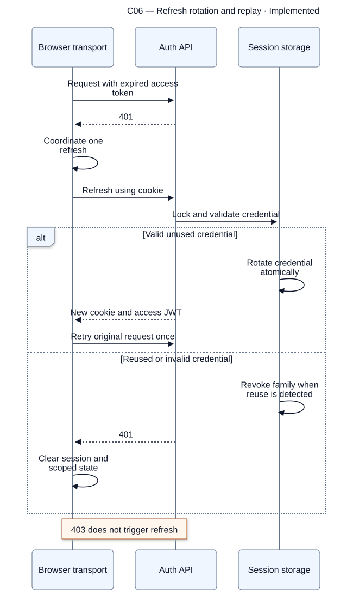

# Authentication and access

[Atlas index](../DIAGRAMS.md). Source snapshot: `cc0e3d6`; render/update details are in the [diagram guide](README.md).

## C05 — Login and session issuance

**Status: Implemented.** Passwords are verified server-side. The access token is short-lived and held in memory; the refresh credential is stored as a digest and transported in an HttpOnly cookie.

[Editable Mermaid source](sources/c05-login-and-session-issuance.mmd). References: [Auth service](../../apps/api/src/modules/auth/auth.service.ts), [Session transport](../../packages/api-client/src/setup-client.ts).

## C06 — Refresh rotation and replay

**Status: Implemented.** Concurrent requests share refresh coordination. Credential replay revokes the family, and retrying is bounded. Workspace changes use their typed, membership-checked operation and clear old scoped client state.

[Editable Mermaid source](sources/c06-refresh-rotation-and-replay.mmd). References: [Identity/session storage](../../packages/database/src/identity.ts), [Session synchronization](../../packages/api-client/src/session-sync.ts).

## C07 — Ancestor permission decision

**Status: Implemented.** A child allow cannot bypass a denied or unallowed private ancestor. Visibility permits member task editing, while container/configuration/grant administration remains admin-only.

[Editable Mermaid source](sources/c07-ancestor-permission-decision.mmd). References: [Permission service](../../apps/api/src/modules/permissions/permission.service.ts), [Tree policy](../../packages/contracts/src/tree.ts).

## C08 — Request and tenant boundary

**Status: Implemented.** Authentication establishes identity; tenant repositories enforce data scoping. Writes recheck mutable authority and configuration under the lock. Foreign-tenant identifiers do not become authority and return not-found behavior.

[Editable Mermaid source](sources/c08-request-and-tenant-boundary.mmd). References: [Tenant database](../../packages/database/src/tenant-database.ts), [Architecture integrity](../../ARCHITECTURE.md#transaction-and-event-lifecycle).
