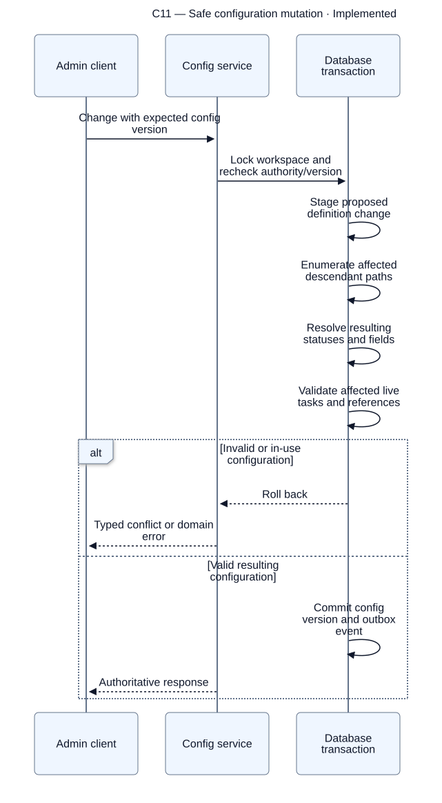

# Domain rules and writes

[Atlas index](../DIAGRAMS.md). Source snapshot: `cc0e3d6`; render/update details are in the [diagram guide](README.md).

## C09 — Scoped status resolution

**Status: Implemented.** Child rows patch display/visibility attributes, not the canonical status identity or category. A nearer explicit visible override can restore a hidden status. Sibling lists can therefore resolve different sets safely.

[Editable Mermaid source](sources/c09-scoped-status-resolution.mmd). References: [Status resolver](../../packages/contracts/src/status-resolution.ts), [Status repository](../../packages/database/src/status-repository.ts).

## C10 — Field resolution and value validation

**Status: Implemented.** Field overrides replace complete definitions, including options and requiredness. Unknown keys and invalid options fail. Clearing a required value still fails final validation.

[Editable Mermaid source](sources/c10-field-resolution-and-value-validation.mmd). References: [Field resolver](../../packages/contracts/src/field-resolution.ts), [Field validation](../../packages/contracts/src/field-values.ts).

## C11 — Safe configuration mutation

**Status: Implemented.** A deletion can reveal inherited configuration, so validation checks the result across descendants. In-use statuses/fields cannot leave tasks with an invalid board or schema.

[Editable Mermaid source](sources/c11-safe-configuration-mutation.mmd). References: [Status changes](../../packages/database/src/status-repository.ts), [Field changes](../../packages/database/src/field-repository.ts).

## C12 — Atomic cross-list move

**Status: Implemented.** A move either commits completely or leaves the task unchanged. Source-only custom values are not silently discarded; the payload must clear them and supply required destination values.

[Editable Mermaid source](sources/c12-atomic-cross-list-move.mmd). References: [Move contract](../../packages/contracts/src/task-moves.ts), [Task repository](../../packages/database/src/task-repository.ts).

## C13 — Ordering and no-op handling

**Status: Implemented.** Reordering may change sibling positions as well as the dragged task. Only changed rows receive version updates, and a canonical no-op does not create history.

[Editable Mermaid source](sources/c13-ordering-and-no-op-handling.mmd). References: [Ordering helpers](../../packages/contracts/src/ordering.ts), [Task ordering writes](../../packages/database/src/task-repository.ts).
