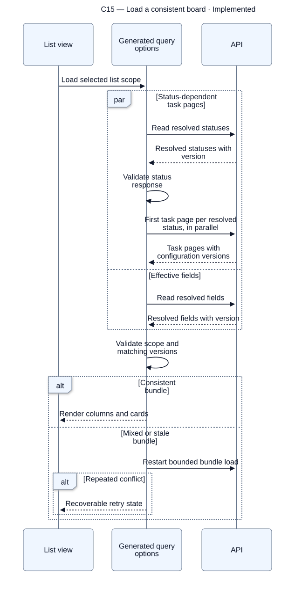

# Frontend flows

[Atlas index](../DIAGRAMS.md). Source snapshot: `cc0e3d6`; render/update details are in the [diagram guide](README.md).

## C14 — UI composition ownership

**Status: Implemented.** Reusable presentation stays in the UI package; form bindings stay in forms. Web coordinates generated operations, permissions, URL state and feature interactions.

[Editable Mermaid source](sources/c14-ui-composition-ownership.mmd). References: [UI component system](../UI_COMPONENT_SYSTEM.md), [Form system](../FORM_SYSTEM.md), [Frontend guide](../FRONTEND_GUIDELINES.md).

## C15 — Load a consistent board

**Status: Implemented.** Statuses and fields begin concurrently; validated statuses determine the first task request for each column. The complete bundle must have compatible versions before rendering, including empty resolved columns.

[Editable Mermaid source](sources/c15-load-a-consistent-board.mmd). References: [Board queries](../../apps/web/src/features/board/useBoard.ts), [Architecture board flow](../../ARCHITECTURE.md#load-a-board-then-drag-a-card).

## C16 — Optimistic drag lifecycle

**Status: Implemented.** Optimistic state is a temporary task/list projection. Settlement removes that projection and refetches authoritative lists; failure repairs its own preview while preserving newer changes. Keyboard and explicit move controls share the server operation.

[Editable Mermaid source](sources/c16-optimistic-drag-lifecycle.mmd). References: [Mutation coordination](../../apps/web/src/features/board/useTaskPlacementMutation.ts), [Board drag adapter](../../apps/web/src/features/board/BoardDnd.tsx).

## C17 — Form submit and recovery

**Status: Implemented.** Local invalid input does not trigger a success request/toast. Server failures preserve the draft, and conflicts never silently replace an edit with another client’s data.

[Editable Mermaid source](sources/c17-form-submit-and-recovery.mmd). References: [Task form](../../apps/web/src/features/tasks/TaskForm.tsx), [Task writes](../../apps/web/src/features/tasks/useTaskWriteMutation.ts), [Form system](../FORM_SYSTEM.md).
