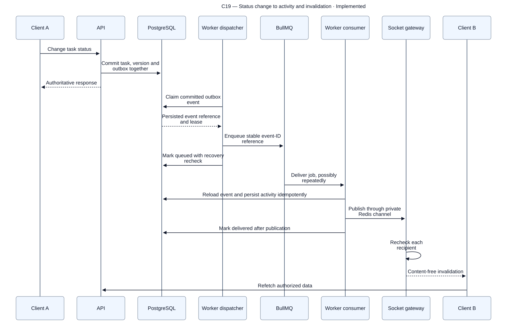

# Redis and background work

[Atlas index](../DIAGRAMS.md). Source snapshot: `cc0e3d6`; render/update details are in the [diagram guide](README.md).

## C18 — Redis roles

**Status: Implemented.** Redis is not a task or resolved-configuration cache. Its counter, queue, publication and adapter responsibilities are separate; environment isolation must cover all of them.

[Editable Mermaid source](sources/c18-redis-roles.mmd). References: [Redis and jobs](../REDIS_AND_JOBS.md), [Job constants](../../packages/contracts/src/jobs.ts).

## C19 — Status change to activity and invalidation

**Status: Implemented.** The request succeeds after database commit, independently of asynchronous activity. The worker reaches browsers through the gateway; it never bypasses recipient authorization.

[Editable Mermaid source](sources/c19-status-change-to-activity-and-invalidation.mmd). References: [Activity processor](../../apps/worker/src/activity.processor.ts), [Realtime service](../../apps/api/src/modules/realtime/realtime.service.ts).

## C20 — Outbox state and lease recovery

**Status: Implemented.** The worker can claim before the dispatcher marks the event queued, so this is not a strict linear chain. Token-checked updates stop stale claimants from overwriting newer state. Failed means quarantine, not an automatic success.

[Editable Mermaid source](sources/c20-outbox-state-and-lease-recovery.mmd). References: [Outbox repository](../../packages/database/src/outbox-repository.ts), [Event consumer repository](../../packages/database/src/event-consumer-repository.ts).

## C21 — Retry and duplicate safety

**Status: Implemented.** Stable event IDs and idempotent activity support at-least-once delivery. Repeated publication is possible, and disconnected clients recover by reading current authorized state.

[Editable Mermaid source](sources/c21-retry-and-duplicate-safety.mmd). References: [Async recovery](../REDIS_AND_JOBS.md#duplicates-outages-and-recovery), [Processor](../../apps/worker/src/activity.processor.ts).

## C22 — Authorized socket delivery

**Status: Implemented.** Room membership is a routing aid, not durable authorization. Periodic and emission-time checks prevent revoked users from continuing to receive protected updates.

[Editable Mermaid source](sources/c22-authorized-socket-delivery.mmd). References: [Realtime authorization](../../apps/api/src/modules/realtime/realtime.service.ts), [Event contract](../api-events.md).
