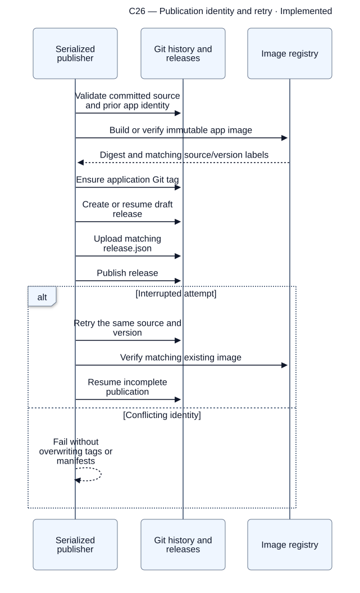

# CI and independent releases

[Atlas index](../DIAGRAMS.md). Source snapshot: `cc0e3d6`; render/update details are in the [diagram guide](README.md).

## C23 — Trunk and review flow

**Status: Operating model.** This is the documented operating model. CI runs today; branch protection and merge policy are repository settings that must be configured and verified separately.

[Editable Mermaid source](sources/c23-trunk-and-review-flow.mmd). References: [Trunk-based guide](../DELIVERY_OPERATIONS.md#trunk-based-development-in-flowboard), [Workflow](../DEVELOPMENT_WORKFLOW.md).

## C24 — Seven CI lanes and release gates

**Status: Implemented.** In public repositories, all seven check instances start independently; each lane still respects its own build dependencies. Current gated CD targets the legacy providers, not Render.

[Editable Mermaid source](sources/c24-seven-ci-lanes-and-release-gates.mmd). References: [GitHub workflow](../../.github/workflows/delivery.yml), [CI details](../CI_CD.md).

## C25 — Independent release decision

**Status: Implemented.** The first published version initializes at 0.1.0. Later release ownership comes from files and dependency fingerprints, not just commit scope text. Complete reverts can produce no release; changing API internals alone need not release the browser.

[Editable Mermaid source](sources/c25-independent-release-decision.mmd). References: [Release planner](../../packages/release-tools/src/index.ts), [Release examples](../DELIVERY_OPERATIONS.md#how-independent-releases-work).

## C26 — Publication identity and retry

**Status: Implemented.** Publication checks its committed source and per-app history. It may publish an earlier queued main commit; the deployment layer separately rejects stale workflow-main identities.

[Editable Mermaid source](sources/c26-publication-identity-and-retry.mmd). References: [Publisher](../../packages/release-tools/src/publisher.ts), [Image publication](../../packages/release-tools/src/images.ts).

## C27 — One image with different runtime configuration

**Status: Runtime seams implemented; promotion planned.** The runtime seams and image publication exist. End-to-end ordered multi-environment promotion is still planned. Each environment needs isolated data and Redis; config changes restart the same image rather than rebuild it.

[Editable Mermaid source](sources/c27-one-image-with-different-runtime-configuration.mmd). References: [Runtime injection](../DELIVERY_OPERATIONS.md#where-environment-settings-enter), [Promotion contract](../PROMOTION.md).
