# Runtime hosting and promotion

[Atlas index](../DIAGRAMS.md). Original baseline: `cc0e3d6`; deployment review: `507a0a8`, 26 October 2026. Render details are in the [diagram guide](README.md).

## C28 — Temporary Vercel demo topology

**Status: Ohio configured in P39-07; live rollout pending P39-08.** The temporary demo routes public pages/REST to web and Socket.IO to API; web forwards domain REST through the private binding. P39-07 aligns dynamic compute and the worker to Ohio beside the existing Neon/Upstash services; live region proof belongs to P39-08. This is not future ECR production.

[Editable Mermaid source](sources/c28-planned-render-topology.mmd). References: [Vercel setup](../VERCEL.md).

## C29 — Demo verification and remaining gates

**Status: Demo verified; CI activation pending.** P38 implementation and manual live checks are complete. Protected main-branch CD activation remains separate; ECR publication and unchanged-image promotion are future work.

[Editable Mermaid source](sources/c29-render-activation-gates.mmd). References: [Live demo evidence](../evidence/P38-03.md), [Current gates](../VERCEL.md#one-project-deployment-and-ci), [Open tasks](../TASKS.md).

## C30 — Selected-candidate promotion

**Status: Planned.** The planned ECR promoter pins selected app digests, updates only changed image/configuration states and retains unselected services in every environment. New main commits never replace an in-flight candidate; compatibility and runtime settings are checked at each target.

[Editable Mermaid source](sources/c30-selected-candidate-promotion.mmd). References: [Build-once contract](../PROMOTION.md), [Runtime operations](../DELIVERY_OPERATIONS.md#data-promotion-and-rollback).
